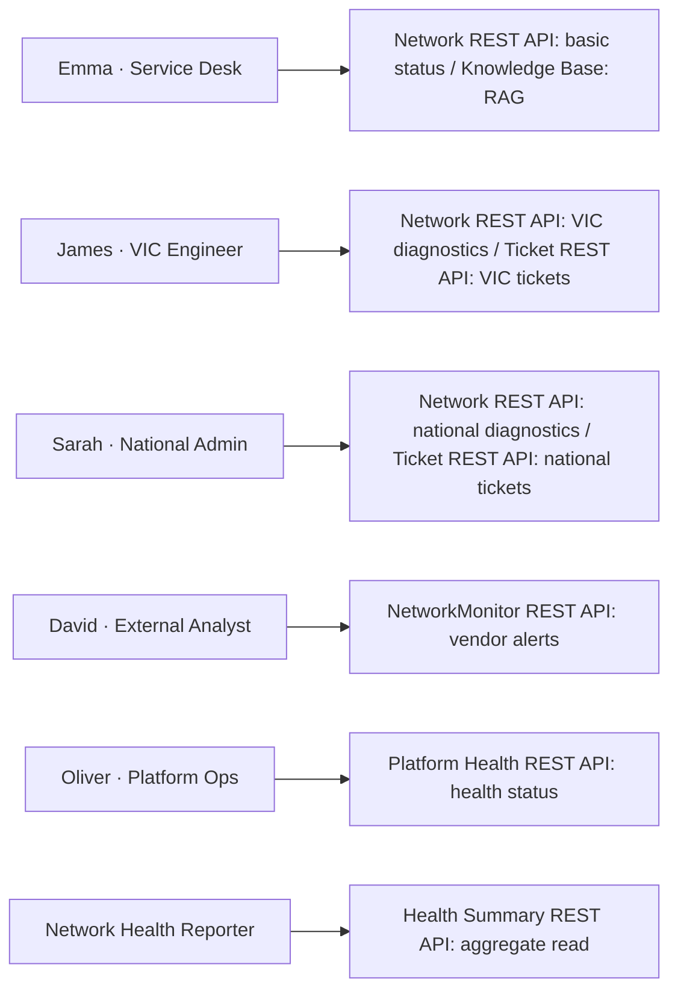

# AWS Agentic AI Patterns

An enterprise GenAI proof of concept built around realistic **business users, the systems they need, and the security rules that control access**. All operational data and external services are synthetic.

## 1. The end systems

Before looking at AWS components, these are the systems the assistant must work with.

| End system | Type / example endpoint | Purpose |
|---|---|---|
| **Network Operations** | Protected **REST API** — `GET /assets/{id}`, `GET /assets/{id}/diagnostics` | Asset status and faults |
| **Ticket Management** | Protected **REST API** — `GET /tickets/{id}`, `POST /tickets` | Read and create tickets |
| **Knowledge Repository** | **RAG** — Bedrock Knowledge Base retrieval | Approved procedures with citations |
| **NetworkMonitor SaaS** | Third-party **REST API** — `GET /alerts` | Separately authorised vendor alerts |
| **Platform Health** | **REST API** — `get_platform_health` operation | Platform status for operations |
| **Network Health Summary** | **REST API** — `GET /network/health-summary` | Read-only aggregate automation report |

Network Operations and Ticket Management use a protected **PostgreSQL database** behind their REST APIs. The database is not exposed directly as an AI tool.

## 2. Who can access what?

We use five named people and one automated service. Each has a specific business purpose and permission boundary.

| Persona | Accessible end systems | Restrictions |
|---|---|---|
| **Emma — Service Desk** | Network basic status; Knowledge Repository | No diagnostics or ticket actions |
| **James — VIC Engineer** | Network diagnostics; Ticket Management; Knowledge Repository | VIC records only; tickets require confirmation |
| **Sarah — National Admin** | Network diagnostics; Ticket Management; Knowledge Repository | National permissions; ticket creation requires confirmation |
| **David — External Analyst** | NetworkMonitor SaaS | Must separately authorise his vendor account; no privileged internal access |
| **Oliver — Platform Operations** | Platform Health | No broader Network/Ticket privileges |
| **Network Health Reporter — automation** | Network Health Summary | Aggregate read-only data; no human identity or writes |

### Simple user-access diagram

Each row shows one user or service and the systems they may access. It is a **business access map**, not the AWS technical architecture.

James and Sarah can also use shared RAG procedures. Every connection is limited by the role, region and consent requirements in the table above. The protected Network and Ticket APIs enforce database access; users never connect directly to PostgreSQL.

## 3. Business use cases

| ID | Journey | Desired result |
|---|---|---|
| **UC01** | Emma checks an asset and asks for an outage procedure | Basic status and cited guidance |
| **UC02** | James investigates a VIC network fault | VIC diagnostics and an authorised escalation |
| **UC03** | Sarah reviews national faults and creates a ticket | National visibility and a confirmed, authorised ticket |
| **UC04** | David connects NetworkMonitor | Alerts from his separately authorised vendor account |
| **UC05** | Oliver checks platform health | Platform health information only |
| **UC06** | Reporter produces the daily health summary | Scheduled, read-only aggregate results |

## 4. Architecture patterns

The seven agreed technical patterns explain **how** we deliver and secure those journeys.

| ID | Pattern | Demonstration |
|---|---|---|
| **P01** | Corporate SSO + JWT | Microsoft Entra sign-in and validated API access |
| **P02** | OAuth On-Behalf-Of (OBO) | James's delegated identity reaches the Network API |
| **P03** | IAM + OAuth 2LO | Machine reporter obtains scoped application access |
| **P04** | Third-party OAuth 3LO | David separately authorises NetworkMonitor via Cognito |
| **P05** | MCP Gateway + Cedar | Fine-grained tool and parameter authorisation |
| **P06** | REST APIs + PostgreSQL RLS | VIC versus national data isolation |
| **P07** | Shared RAG retrieval | Approved Knowledge Base excerpts and citations |

## 5. AWS implementation

The design uses **two AgentCore Runtimes and two AgentCore Gateways**: one lane for human JWT callers and another for IAM-authenticated automation. The Gateways expose **eight MCP tools** across the end systems above, with independently configured downstream credentials.

The full AWS architecture, authentication flows, controls and component diagram belong in the [technical architecture](docs/two-gateway-design.md). The reason for the dual inbound-authentication boundaries is recorded in [ADR-001](docs/architecture-decisions.md#adr-001--separate-human-jwt-and-automation-iam-gateways).

### Technical reference

- [Users and permissions](docs/identities-and-permissions.md)
- [Eight MCP tools and downstream API mappings](docs/tool-and-api-inventory.md)
- [2LO, 3LO and OBO architecture notes](docs/oauth-token-flows.md)
- [Architecture decisions](docs/architecture-decisions.md)

**Status:** Design in progress; no infrastructure has been deployed and identity flows are not yet verified.
