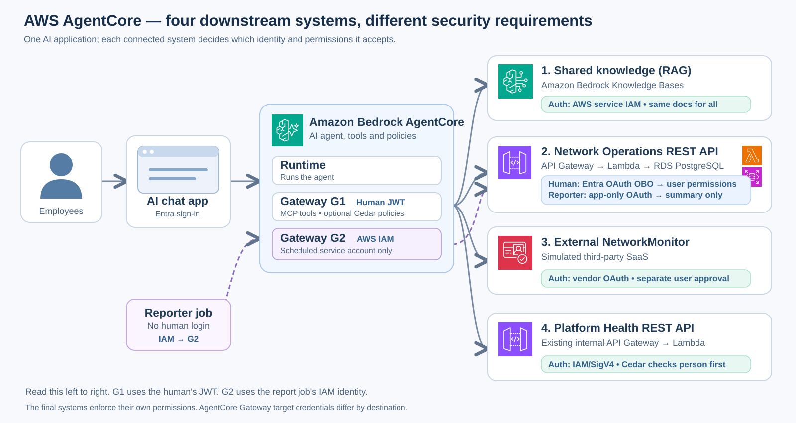

# AWS AgentCore Authentication & Authorization Patterns

Agentic AI introduces a difficult enterprise architecture challenge: **an agent may need to access several systems, but each system can authenticate callers differently and enforce different permissions**. Preserving a person's identity, allowing a service account to act independently, and obtaining third-party consent are not the same problem.

**The objective of this project is to identify, explain and standardise these common authentication and authorization approaches into reusable AgentCore architecture patterns.** We use one fictional enterprise application, four end systems and seven callers to show when each pattern applies—and how to prevent unauthorized access.

**Why isn't one authentication pattern enough?** Because the end systems trust **different identities**: some need the signed-in person, some need an application identity, some require separate authorization from an external provider, and some accept an AWS IAM role. One token or service account cannot safely satisfy all of those requirements.

**How to read this guide:** First meet the four end systems, then the seven callers and exactly what each may access. Next, see the AWS architecture and understand **why each connection requires a different identity or authorization method**. The technical explanations that follow cover OBO, application tokens, IAM/SigV4, Cedar, scopes and database row-level security.

**The key idea:** Successfully signing into our AI chat application does **not** automatically grant access to every connected system. Each final API must still authenticate the caller it receives and enforce the appropriate permissions.

## 1. End systems

| # | End system | Description | High-level access rule |
|---|---|---|---|
| **1** | **Knowledge Base (RAG)** | Uses retrieval-augmented generation (**RAG**) to answer questions from shared troubleshooting documents in Amazon Bedrock Knowledge Bases. | **All human users who successfully sign in to the AI chat app** can search the same approved knowledge. |
| **2** | **Network Operations API** | Read/write enterprise REST API backed by **Amazon RDS PostgreSQL**. Returns asset status, diagnostics and aggregate health, and creates support tickets. | **Only authorized callers.** Human permissions depend on region and operation; the two approved automation identities have aggregate-only access. |
| **3** | **NetworkMonitor** | Simulated monitoring service owned by **another company**, with its own user accounts, permissions and OAuth server (modelled using Amazon Cognito). Returns the vendor user's alerts. | **Only users granted tool access who separately authorize their vendor account.** Each user sees only their permitted alerts. |
| **4** | **Platform Health API** | Existing internal AWS API Gateway REST API, originally used by AWS workloads such as Lambda to read platform-health data. It uses IAM authentication rather than OAuth. | **Only users explicitly granted access to this tool.** Cedar checks the person; the API authenticates the Gateway's IAM role. |

### Network Operations API — four endpoints

These are the complete planned REST endpoints for our PoC. They all belong to **one Network Operations API** backed by RDS PostgreSQL:

| Endpoint | What it returns or does | Access rule |
|---|---|---|
| `GET /assets/{id}/status` | Basic network asset status | Signed-in users **granted Network API access**; basic fields only for limited roles |
| `GET /assets/{id}/diagnostics` | Detailed fault and diagnostic information | Authorized engineers/admins; **permitted regions only** |
| `POST /tickets` | Creates a support ticket | Authorized engineers/admins; **permitted regions only**, with user confirmation |
| `GET /network/health-summary` | Aggregate network-health summary | **Two approved automated identities only**; no individual asset details |

The Network API enforces each caller's permissions. The agent never queries RDS directly. We introduce the named people and their exact permissions next.

### Supporting database — Amazon RDS PostgreSQL

- Stores network assets, diagnostics, tickets and access entitlements.
- Is accessed **only through the Network Operations API**, never directly by the AI agent.
- Uses database permissions and **row-level security (RLS)** to restrict which rows a caller can see or change.

**How does RLS know the user's permissions?** PostgreSQL does **not** read OAuth tokens. The Network API verifies the caller and passes trusted access restrictions to the database. We explain the full James example in [How OAuth connects to PostgreSQL RLS](#how-oauth-connects-to-postgresql-rls).

## 2. Users and their access

The PoC has **five human users and two separate non-human callers**. They authenticate into AgentCore differently, but both can request only the aggregate Network API report.

| User | Role | Systems they can access | Exact permissions |
|---|---|---|---|
| **Sarah** | National Admin | **RAG, Network API** | Shared knowledge; network status, diagnostics and ticket creation in **all regions**. |
| **James** | VIC Engineer | **RAG, Network API** | Shared knowledge; network status, diagnostics and ticket creation for **VIC only**. |
| **Emma** | Service Desk | **RAG, Network API** | Shared knowledge; **basic asset status in all regions**. No detailed diagnostics or sensitive fields. |
| **David** | External Analyst | **RAG, NetworkMonitor** | Shared knowledge; **his own third-party alerts**, after separate vendor authorization. |
| **Oliver** | Platform Analyst | **RAG, Platform Health API** | Shared knowledge; **read-only platform-health information**. |
| **AWS Network Health Reporter** | **Scheduled Lambda with IAM role** | **Network API** | Aggregate health only; **IAM/SigV4 into G2**, then its own Entra OAuth application token to the API. |
| **Entra Automation Client** | **Separate Entra service principal** | **Network API** | Aggregate health only; **Entra Client Credentials JWT into G1**, then its own Network API OAuth application token. |

### Network API — exact endpoints for each caller

**The Network Operations API has four endpoints, but no caller automatically gets all four.** Here is exactly what each human or automated application may invoke.

| Caller | Exact Network API endpoints they are allowed to call |
|---|---|
| **Sarah — National Admin** | `GET /assets/{id}/status` — all regions, full permitted status `GET /assets/{id}/diagnostics` — all regions `POST /tickets` — all regions, user confirmation required |
| **James — VIC Engineer** | `GET /assets/{id}/status` — **VIC only** `GET /assets/{id}/diagnostics` — **VIC only** `POST /tickets` — **VIC only**, user confirmation required |
| **Emma — Service Desk** | `GET /assets/{id}/status` — **all regions, basic fields only** |
| **David — External Analyst** | **None.** David uses the separate NetworkMonitor vendor service. |
| **Oliver — Platform Analyst** | **None.** Oliver uses the separate Platform Health API. |
| **AWS Network Health Reporter — IAM workload** | `GET /network/health-summary` — aggregate summary only |
| **Entra Automation Client — OAuth service principal** | `GET /network/health-summary` — aggregate summary only |

**Any endpoint not listed for that caller is denied.** In particular:

- **Sarah and James cannot call** `GET /network/health-summary`; it is reserved for the two approved automation identities.
- **Emma cannot call** the diagnostics, ticket-create or summary endpoints—even though she is successfully signed into the AI application.
- **Neither automation identity can call** asset status, diagnostics or ticket endpoints. Each uses a **different app-only Network API token** with summary-only rights.
- **David and Oliver cannot call any Network Operations API endpoint.**

**Same endpoint, different result:** James can call `GET /assets/{id}/diagnostics` for an asset in **VIC**, but the **identical endpoint** must deny an asset in **NSW**. Emma can call `GET /assets/{id}/status` nationally but sees **basic fields only**, not sensitive diagnostic details.

**Where are these permissions enforced?** Cedar checks whether a verified **human or application identity** may invoke a particular **agent tool**. The **Network API** then checks its OAuth token, endpoint permission and verified region/field entitlement; **PostgreSQL RLS** protects the underlying rows. A successful chat sign-in is never sufficient by itself.

### Explicit restrictions

| User | Access that must be denied |
|---|---|
| **Sarah** | NetworkMonitor alerts and Platform Health API. |
| **James** | NSW/other-region records, NetworkMonitor and Platform Health API. |
| **Emma** | Detailed diagnostics, sensitive asset fields, ticket actions, NetworkMonitor and Platform Health API. |
| **David** | Network API and Platform Health API. |
| **Oliver** | Network API and NetworkMonitor. |
| **AWS Network Health Reporter** | RAG, individual asset records, diagnostics, ticket actions, NetworkMonitor, Platform Health and human impersonation. |
| **Entra Automation Client** | RAG, individual asset records, diagnostics, ticket actions, NetworkMonitor, Platform Health and human impersonation. |

**Default rule:** A successful sign-in allows a human to use the AI chat app and shared RAG. Every other system requires its own authorization. If access is not explicitly listed above, it is denied. Ticket creation additionally requires explicit confirmation.

## Architecture overview

The diagram shows the **whole PoC at a glance**. Employees use our AI chat app; the agent uses AgentCore to reach four downstream systems. Each system has a different authentication requirement. The AWS Reporter enters IAM-protected G2, while a separate Entra Automation Client enters JWT-protected G1. Neither involves a human.

**Read the notes on the four right-hand systems:** shared RAG uses AWS IAM; Network Operations uses Entra OAuth (human OBO or application-only); the external vendor requires its **own** OAuth authorization; and Platform Health accepts IAM-signed requests after the user's tool permission is checked.

The detailed architecture diagram remains near the end for readers who want to see more of the individual AWS components.

## 3. How these requirements lead to authentication patterns

The access rules above lead to different technical patterns. **A use case is what someone wants to do; an authentication pattern is how the system grants and checks access.** One system can use more than one pattern: the **Network Operations API** uses OBO for Sarah, James and Emma, but **OAuth Client Credentials** for each independent automated application identity.

The examples below show why **the identity reaching the end system matters**.

### Authentication terms in plain English

- **OAuth OBO (On-Behalf-Of):** The backend obtains a new API-specific token **representing the signed-in user**.
- **OAuth Client Credentials:** An **application** gets a token for itself, without a human.
- **OAuth Authorization Code:** A **person authorizes an application** to access an account, such as an external vendor account.
- **AWS IAM:** An **AWS role** authenticates a request to an AWS-protected service.

### AgentCore components in everyday language

Before following the examples, here are the AWS parts:

| Term | Meaning in this PoC |
|---|---|
| **AI chat application** | The web page where a person signs in and types a question. |
| **Chat API and Lambda** | The application backend receiving that question and passing the authenticated request to the agent. |
| **AgentCore Runtime** | Where our AI agent runs and decides which tool to request. |
| **Amazon Bedrock AgentCore Gateway** | The controlled entry point for invoking agent tools. **G1** accepts Entra JWTs from signed-in humans **and the separately authorized Entra Automation Client**; **G2** accepts IAM/SigV4 from the AWS Reporter. **G1** also accepts the separate Entra Automation Client's **application JWT**, in addition to human JWTs. |
| **MCP tool** | A named action the agent can invoke, such as `get_diagnostics` or `create_ticket`. |
| **Gateway target** | Configuration connecting an MCP tool to an existing backend API. It is **not** another API or running service. |
| **Cedar** | The policy language we use at Gateway to decide whether a caller may invoke a tool. It does not retrieve data or issue OAuth tokens. |

The journey is straightforward: **a caller asks → the agent selects a tool → Gateway checks and invokes it → the final system checks access and returns the result**. Different patterns change which identity the final system receives.

**Two different AWS services have “Gateway” in their names:** **Amazon API Gateway** is the REST API front door (for example, `POST /ai/chat` or our Platform Health REST API). **AgentCore Gateway** is the MCP tool-access layer used by the AI agent. They serve different purposes even when both appear in the same flow.

### One API, different permissions

The **Network API** is the clearest example of why identity matters:

| Caller | Request | Result |
|---|---|---|
| **Sarah** | NSW diagnostics | ✅ Allowed |
| **James** | NSW diagnostics | ❌ Denied — VIC only |
| **Emma** | NSW basic asset status | ✅ Allowed — basic fields only |
| **Emma** | NSW diagnostics | ❌ Denied |
| **AWS Reporter — IAM into G2** | National aggregate health summary | ✅ Allowed — aggregate only |
| **Entra Automation Client — JWT into G1** | National aggregate health summary | ✅ Allowed — aggregate only |

**Same API, different results:** the system uses each caller's identity and permissions to decide what can be returned.

An application identity cannot replace an individual user. Some systems need to know **which person** made the request, some only **which application**, and the external vendor needs **a separate user-authorized OAuth grant**.

| Why this pattern is needed | Authentication approach | What the downstream system knows |
|---|---|---|
| **Shared RAG:** Everyone signed into the AI app sees the same approved knowledge, so there is no need for per-user document access. | **Application sign-in + AWS IAM** for knowledge retrieval. | The AWS service identity, not individual document permissions. |
| **Network API:** Sarah, James and Emma have different region and action permissions. The API **must know which person** called. | **OAuth On-Behalf-Of (OBO)** with Microsoft Entra ID. | The human caller. The API enforces permissions and sensitive fields; PostgreSQL RLS restricts database rows. |
| **AWS Reporter IAM workload:** Lambda/Runtime enters G2 via IAM/SigV4, without a human. | **IAM inbound → Entra Client Credentials outbound** to Network API. | The Reporter's Entra app identity, summary-only. |
| **Entra Automation Client:** Another application enters G1 with a JWT, without a human. | **Entra Client Credentials JWT inbound → new Entra Client Credentials token outbound** to Network API. | The separate Automation Client Entra app identity, summary-only. |
| **Third-party service:** David's vendor account belongs to **another company**. Our Entra login cannot authorize access to that account. | **OAuth Authorization Code** with the vendor's OAuth provider (simulated using Cognito). David completes a separate vendor OAuth sign-in/authorization, and the resulting vendor credential is bound to his authenticated session. | Which vendor user authorized our application and what alerts they can access. |
| **Platform Health:** The downstream API accepts **AWS IAM-signed requests**, not a human's OAuth token. Oliver must be checked **before** Gateway calls it. | **IAM/SigV4 (AWS-signed service request):** AgentCore Gateway signs the final API call using its **service IAM role**, not Oliver's user credentials. | The Gateway IAM role, **not Oliver**. Tool authorization enforces Oliver's access before invocation. |

### Five downstream access patterns and two machine entry methods

**Why five downstream patterns and two machine entry methods?** An **endpoint** is an action exposed by an API; a **pattern** is how a caller proves its identity and gets permission to perform that action. The same OBO pattern covers the three human Network API endpoints, while the fourth endpoint uses a service-account token. Our other patterns demonstrate shared RAG, an external vendor account and an existing IAM-protected API. **We are not creating a separate pattern for every endpoint.**

The comparison table above is the quick reference. Here is the **reasoning behind each choice**, starting with what someone is trying to do.

#### Pattern 1 — Shared knowledge (RAG)

**Why does an enterprise need this?** Imagine an operations organisation with hundreds of approved troubleshooting guides, network procedures and internal FAQs. Engineers and service-desk staff repeatedly ask the same questions. Instead of relying only on the language model's general training, our AI chat application searches this **shared RAG knowledge base** and uses relevant passages to ground its answers.

- **What does the user want?** Any of our five human users signs in to our AI chat application and asks a question such as “What is the approved process for investigating a network outage?” The agent searches the same approved documents for everyone.
- **Why isn't signing in enough on its own?** Entra sign-in authenticates the person to **our chat application**. It does not give the person's browser credentials to query Amazon Bedrock Knowledge Bases directly. The backend agent still needs an authenticated AWS identity to retrieve passages.
- **Why not use the Network API's OBO pattern?** The documents in this particular knowledge base are **deliberately shared with every signed-in human**. There are no different document permissions for Sarah versus Emma, and the AWS retrieval operation uses the application's service role. Exchanging each person's Entra token for a downstream user token would add no access distinction for this resource.
- **What solves it?** Our application checks that the person is signed in. The backend agent then retrieves relevant approved passages using its **authorised AWS service role**. The knowledge base is not public, and no end-user AWS credentials are exposed to the browser.

**Why keep this as a separate pattern?** It is the baseline **shared knowledge-access pattern**: users must be authenticated to the application, but the downstream knowledge service authenticates the **agent's AWS identity** and returns shared material. This is **not a separate OAuth protocol**. It contrasts with later patterns where the end system must know the specific person, application or vendor account. RAG can reduce hallucinations by grounding an answer in approved material, but does not guarantee correctness.

#### Pattern 2 — Human identity preserved with Entra OBO

**Why does an enterprise need this?** A single network database contains records for multiple regions and sensitivity levels. Employees can use the same AI interface, but an engineer responsible for VIC must not obtain NSW diagnostic records, and a service-desk employee must not see sensitive diagnostics at all.

- **What does the user want?** James asks the agent for VIC diagnostics. Sarah can request diagnostics nationally; Emma may see basic status but not detailed diagnostics.
- **Why isn't the initial token enough?** Their original Entra access token was issued for our **Chat API**, not the separate **Network Operations API**. The Network API must not accept a token intended for another audience. A shared service-account token would also hide which person is asking.
- **What solves it?** The Chat API validates the user token and our trusted flow preserves it through Lambda, AgentCore Runtime and human Gateway **G1**. AgentCore Gateway/Identity uses **OBO** to obtain a **new Network API token** representing that same person. The Network API validates the new token and applies scopes, verified entitlements and PostgreSQL row-level security. James gets VIC records, not NSW records.

**Why a distinct pattern?** The final API must make decisions based on the **actual human's identity**. OBO supplies the appropriately scoped, downstream-audience token without asking James to sign in again. OBO does **not** grant new regional permissions or replace API authorization.

**Why does this API have three human endpoints, rather than one?** They illustrate **different permission decisions within the same OBO pattern**:

- `GET /assets/{id}/status` — **read basic information**. Sarah, James and Emma can call it, but James is limited to VIC and Emma receives only basic fields.
- `GET /assets/{id}/diagnostics` — **read restricted information**. Sarah and James can call it, with their regional limits; Emma cannot.
- `POST /tickets` — **make a change**. Only Sarah and James can create a ticket, for an allowed region, after the person confirms the action. Emma cannot create tickets.

All three use **human OBO**, not three new OAuth methods. The point of separate endpoints is to show that **one authenticated person does not automatically have permission for every operation**, and that a write can require tighter approval than a read.

#### Pattern 3 — Non-human OAuth access through two different AgentCore ingress methods

**Why does an enterprise need this?** Not every consumer of the Network Operations API is an employee asking a question. A scheduled Network Health Reporter generates an aggregate report automatically—for example, for an overnight operations briefing. The job runs in AWS and has an **IAM role**, but the existing Network API is protected by **Microsoft Entra OAuth**. That API is not configured to accept an AWS IAM signature.

- **What does the caller want?** The Reporter runs on a schedule and invokes **the same Network Operations API** used by people, but requests only `GET /network/health-summary`. It must never retrieve individual assets or tickets.
- **Why can't it use the human OBO pattern?** Nobody has signed in to the job. There is **no person's access token** to exchange, and inventing or borrowing a human identity would be wrong.
- **Why isn't its AWS IAM role sufficient end to end?** IAM can authenticate the scheduled AWS workload when it invokes **machine Runtime M and Gateway G2**. But the **final Network API expects an Entra-issued OAuth access token**. IAM and Entra tokens are different credentials for different trust boundaries. The Network API must not start accepting an unrelated AWS role just to support this reporter.
- **What solves it?** Register a dedicated **Network Health Reporter application identity** in Entra and grant it the application permission `HealthSummary.Read`. The Gateway's configured Entra OAuth credential provider uses **Client Credentials** to obtain an **app-only access token** for the Network API. The API validates the token's audience and application permission, recognises the Reporter application rather than any human, and permits **only** the aggregate endpoint. Its backend must still enforce that limitation.

**Why a distinct pattern?** This is **machine-to-machine OAuth for an API that requires OAuth**, even though the caller runs on AWS. It differs from **OBO**, which carries a particular human's delegated identity; from **Shared RAG**, where the downstream AWS service accepts an IAM role; and from **Platform Health**, where the final REST API itself accepts IAM/SigV4. The two hops are intentional: **AWS IAM into G2; Entra OAuth Client Credentials out to Network Operations.**

**Two non-human callers, not one identity described twice:** The **AWS Reporter** is an AWS Lambda/Runtime M workload that uses **IAM/SigV4 into G2**. The **Entra Automation Client** is a separate registered Entra service principal that obtains an **AI-backend-audience application JWT** using Client Credentials, invokes JWT-protected Runtime U and **G1**, and uses its own **Network-API-audience application token** for the summary. G1 must explicitly allow the machine's client ID and restrict its Cedar/tool authorization to **summary only**. Both caller identities are distinct, both lack a human, and neither uses OBO. **One token cannot be reused across the AI-backend and Network API audiences.**

#### Pattern 4 — Independent authorization at an external vendor

**Why does an enterprise need this?** An organisation may subscribe to a monitoring SaaS provider, while individual employees have separate accounts and alert permissions **at that vendor**. The AI assistant should be able to retrieve an employee's permitted alerts, just as other assistants connect to a separately authorised SaaS account. Corporate sign-in alone cannot make that vendor trust the request.

- **What does the user want?** David asks our AI chat application to retrieve his alerts from **NetworkMonitor**, a simulated service owned by another company.
- **Why isn't his corporate sign-in enough?** Entra authenticates David to **our** application, but it cannot independently grant access to his account and alerts in **NetworkMonitor's** identity system. An Entra OBO token for our Network API is not a NetworkMonitor token.
- **What solves it?** After David is authorized to use the vendor tool, he separately completes **NetworkMonitor's OAuth Authorization Code flow**. AgentCore's vendor OAuth credential provider obtains and associates a vendor-issued token with the authenticated David, then uses it to call `GET /alerts`. NetworkMonitor validates that token and returns only data permitted to that vendor account.

**Why a distinct pattern?** The vendor controls **its own accounts and authorization**. This is the same broad arrangement used when an enterprise AI assistant connects to an independently protected SaaS account. Our Cognito simulation supports the Authorization Code flow and custom API scopes, demonstrating the separate OAuth boundary. Cognito's managed login does not itself provide every vendor-style consent-screen experience.

#### Pattern 5 — Reusing an existing IAM-protected enterprise API

**Why does this API use IAM in the first place?** Imagine the Platform Health API was built years ago for internal AWS workloads. A Lambda function checks platform health by calling an AWS API Gateway REST endpoint using its IAM execution role. That is a normal AWS service-to-service design: the API trusts approved **AWS roles**, not interactive employees. It has no reason to integrate with Entra just to serve those existing workloads. API Gateway can support other authentication methods; **IAM is a deliberate choice for this example**, not a limitation of REST.

- **What does the user want?** Oliver now asks our **new AI application**: “Is the AI platform healthy?” We want to reuse that existing Platform Health API **without rebuilding its authentication**.
- **Why can't we just send Oliver's token?** His Entra token is an **OAuth** token, while this existing API expects **IAM/SigV4**. The API doesn't know who Oliver is; it recognizes the **AWS role** signing the request. If everyone could invoke the agent's Platform Health tool, the same role could retrieve results for users who should not have access.
- **What solves it?** Oliver signs in to our AI application. Before any API call, **G1 uses Cedar to check that Oliver is allowed to invoke the tool**. Only then does AgentCore Gateway use its **IAM service role** to sign the request to the native API Gateway REST-stage target. The Platform Health API validates the IAM signature and role permissions. Sarah, James, Emma and David are denied **at the tool boundary**, before Gateway can use that role for their request.

**Why can't we simply reuse one of the earlier patterns?**

- **OBO won't work for this final API.** OBO creates a delegated **OAuth** token identifying James or Oliver. Platform Health is deliberately **IAM-only**, so it expects a **SigV4-signed AWS request**, not that token.
- **The Reporter's Client Credentials pattern won't work for this final API either.** That pattern obtains an **OAuth application token** for the Network API. Platform Health does not accept OAuth tokens, and Oliver's request is initiated by a **human**, not a scheduled reporting service.
- **Shared RAG is the closest match, but it doesn't demonstrate the restriction we need.** Both RAG and Platform Health can use AWS service identity. In RAG, **every signed-in human** may retrieve shared documents. Here **only Oliver** may invoke the IAM-backed Platform Health tool. Because the downstream API sees Gateway's service role rather than Oliver, **Cedar must enforce Oliver's permission before the call**.

**So why keep this example?** It demonstrates a real enterprise requirement the others do not show together: **a restricted human-triggered tool that calls an IAM-protected REST API using the AgentCore native API Gateway stage target**. This is an **authorization and integration pattern**, not a new authentication protocol.

**The rule to remember:** **Cedar authorizes the human; IAM authenticates the service.**

### When and why should we use Cedar?

**What is Cedar?** It is a way to write rules such as: **“Only Engineers may invoke the diagnostics tool”** or **“Only Oliver may invoke the Platform Health tool.”** AgentCore Gateway evaluates those rules **before calling the tool**.

**Is Cedar always required? No.** A properly secured downstream API can make its own authorization decisions using a verified OAuth token. We use Cedar when we want an **additional, centrally managed check on agent tool access**. That is different from losing user identity: **Cedar does not preserve identity or issue OAuth tokens.**

**When is it useful—and when can we leave it out?**

| Situation | Cedar decision in our PoC | Why? |
|---|---|---|
| **Shared RAG: everyone signed into our chat app has the same access** | **No special per-user Cedar policy needed.** | No user-specific document restrictions to enforce at this tool. The AWS knowledge service still authenticates the agent's service role. |
| **Network API: OBO carries the real user to an API that enforces their permissions** | **Optional extra protection; we choose to use it.** | Cedar can deny Emma's diagnostics **tool call early**. Even without Cedar, the Network API must independently reject the unauthorized request. |
| **Platform Health: the final API sees only Gateway's IAM role** | **An upstream user-permission check is essential; we choose Cedar.** | The final API cannot tell Oliver from Emma by looking at the IAM role. Cedar permits Oliver's tool call and denies everyone else **before the same service role is used**. An equivalent correctly enforced application-side check could also provide this protection. |

**The decision rule:** If the final API **knows the user and enforces their permissions**, Cedar can add defence in depth. If the final API **only knows a shared service identity**, make sure **some trusted component authorizes the human first**; Cedar is our selected control in that case.

An **OAuth access token** contains signed information about a caller and permissions. **The token cannot enforce a rule by itself**: a component must validate the token and make an allow/deny decision. Cedar performs that job for **agent tool calls**; our Network API performs it for **downstream API requests and data**.

#### Three simple examples

**1. Emma — OAuth already protects the API**

1. Emma signs in and asks for diagnostics.
2. In our PoC, Cedar sees her Service Desk role and denies the diagnostics **tool**.
3. If we removed Cedar, the Network API could still reject Emma using her OBO identity and API rules.

**Lesson:** Cedar is **defence in depth**, not a substitute for preserving Emma's identity or checking permissions at the API.

**2. James — Cedar allows a tool, but cannot grant extra data**

1. James asks for NSW diagnostics.
2. Cedar allows the diagnostics **tool** because James is an Engineer.
3. OBO supplies a Network API token representing James.
4. The API checks his **VIC-only** entitlement, and PostgreSQL RLS restricts the rows. The NSW request is **denied**.

**Lesson:** Cedar permission to invoke a tool does **not** override downstream OAuth authorization or RLS.

**3. Oliver — the downstream API does not recognize a human token**

1. Oliver asks for Platform Health.
2. Cedar verifies that only Oliver is allowed to use that tool.
3. Gateway signs the final API request with its **AWS IAM service role**.
4. The API trusts that role. It does **not** receive Oliver's OAuth identity as its authenticated caller.

**Lesson:** Here we need an **upstream user-specific permission check**, because the final API cannot make that decision from the service-role credentials. Cedar is a good fit; another properly enforced application authorization mechanism could also perform the check.

**Remember:** **Cedar authorizes the tool call. OAuth/OBO authenticates the delegated user to the Network API. The Network API and database enforce data permissions.** Using Cedar never removes the need for downstream authorization.

### How Entra roles, groups and OAuth scopes work together

Let's start with the problem, **without assuming any Microsoft identity knowledge**.

**James signs in to our AI chat application and asks: “Show me the diagnostics for this NSW network asset.”**

Being signed in does **not** mean he can see everything. We need to answer three separate questions:

| Question | Simple answer for James | What makes the decision? |
|---|---|---|
| **1. Is he allowed to use the diagnostics tool?** | **Yes.** James is an engineer. | His **app role**, checked by **Cedar** |
| **2. Is this API call permitted?** | **Yes.** Our AI application has permission to request diagnostics on James's behalf. | The **OAuth scope**, checked by the **Network API** |
| **3. Can he see this particular NSW record?** | **No.** James belongs to the VIC engineering team. | His verified **Entra group/region entitlement**, checked by the **Network API** and backed by database rules |

**Final result: Access denied.** The first two checks passed, but the third did not. That is the whole reason we need all three concepts.

Now change the person:

- **Sarah**, a national administrator: tool allowed, API operation allowed, NSW region allowed → **gets NSW diagnostics**.
- **Emma**, service desk: she can request **basic status**, but her role does **not** allow the diagnostics tool → **denied before the diagnostic API is called**.
- **AWS Reporter and Entra Automation Client**, two distinct automated programs: nobody signs in. Each has its **own application permission** for the aggregate report only → **gets the summary, not individual diagnostics**.

#### What are Entra, a token, a role, a group and a scope?

- **Microsoft Entra ID** is our corporate identity system. It knows who employees are and which roles or groups have been assigned.
- **An access token** is a digitally signed message from Entra that the application sends to an API. Think of it as **proof of identity and specific permissions**, intended for **one particular API**. The receiving API verifies it; it must not blindly trust it.
- **An app role** is a label **we define**, such as `Network.Engineer`. We assign it to James in Entra. In **our design**, Cedar uses that verified label to decide whether James can use a diagnostics tool.
- **An Entra group** is a list of members, such as `Network-VIC-Engineers`. Our Network API knows that membership in this group means **VIC records only**. Entra stores the membership; **our code defines and enforces what VIC-only means**.
- **An OAuth scope** is permission for a **client application to call a particular protected API operation on behalf of a user**. Our Network API defines `diagnostics.read`; Entra can issue that permission in the token the client requests for the Network API. **The scope does not make James a national administrator.**

**Where do we set these up?** In **Entra**, we register the APIs, define app roles and OAuth scopes, assign roles and maintain groups. In **AWS**, we configure Cedar tool rules and write Network API checks for scopes, users, groups and data. **Neither Entra nor AWS magically knows our business rules. We configure them.**

**Do app roles, groups and scopes automatically become each other? No.** A user can be in a group without having an app role; an app role does not automatically grant an OAuth scope; and a scope does not grant access to every record. We deliberately join those checks at the appropriate boundaries.

The sections below show the **actual PoC names, the two access tokens, the four endpoints and exactly where each check occurs**. You can understand the example above without knowing what a JWT claim is; the claim details are included for readers implementing the design.

#### The two protected APIs and their tokens

**What is the Chat API?** It is the AWS API Gateway endpoint the browser calls when someone sends a message: `POST /ai/chat`. It forwards the request through Lambda to AgentCore Runtime. It is **not a second AI engine**.

We register the **browser client**, **Chat API** and **Network Operations API** as separate Entra applications/resources for this design. A person signs in once; access tokens still have a **specific intended API (audience)**.

**The important OBO configuration (without jargon):** We use **one Entra application registration called `enterprise-ai-backend`** for two jobs: it represents the **Chat API** that Token A is issued for, and it is the **confidential client** AgentCore's Entra OAuth credential provider uses to request Token B. These must refer to **the same registered backend application**. The browser uses a **different** registration, `enterprise-ai-web`. The Network API has its **own** registration. This is required because Microsoft will not let one application exchange a token intended for another application.

| | Token A — Chat API | Token B — Network Operations API |
|---|---|---|
| **How obtained** | Browser requests an access token for `POST /ai/chat` | Trusted middle tier obtains a new token through **OBO** |
| **Issued by** | Microsoft Entra ID | Microsoft Entra ID |
| **Audience (`aud`)** | **Chat API** | **Network Operations API** |
| **Example claims** | `scp: chat.invoke`; `roles: [Network.Engineer]` for James | `scp: diagnostics.read`; James's user identity |
| **What it authorizes** | Chat API invocation and, after **Cedar** evaluation, eligible agent tools | The delegated caller's access to the **Network API**, subject to API business rules |
| **Who checks it** | Chat API validates the token; AgentCore Gateway **G1/Cedar** evaluates its verified user claims | Network API validates this **different** token, then checks scope, identity, data entitlements and RLS |

The examples show **claims we will configure**, not claims Entra automatically adds to every token. In particular, **OBO does not copy Token A's app roles or group claims into Token B**. The Network API must use claims issued **for it** or a trusted identity/entitlement lookup.

**Why not use Token A all the way through?** Its `aud` is the Chat API. The Network API must reject a token issued for another API. OBO gives the downstream API a correctly addressed token **still representing the same person**, without another interactive sign-in. [Microsoft's OBO specification](https://learn.microsoft.com/en-us/entra/identity-platform/v2-oauth2-on-behalf-of-flow) requires the exchanged assertion to be intended for the confidential middle-tier application performing the exchange; our Entra registrations and AgentCore credential provider must be configured consistently with that requirement.

#### Who gets which role and group?

These names are **our PoC's proposed Entra configuration**. We assign human app roles **directly to the users** in the Chat API's Enterprise Application. We maintain group memberships independently. Only the Network API needs the network-region memberships.

| Caller | Chat API app role (`roles` in Token A) | Entra membership relevant to Network API | Effective access |
|---|---|---|---|
| **Sarah** | `Network.Admin` | `Network-All-Regions` | All-region status, diagnostics, ticket creation |
| **James** | `Network.Engineer` | `Network-VIC-Engineers` | VIC status, diagnostics, ticket creation |
| **Emma** | `Network.ServiceDesk` | `Network-Service-Desk` | Basic status in all regions; no diagnostics/ticket actions |
| **David** | `Vendor.Analyst` | **No Network API entitlement** | Vendor tool only, after separate vendor OAuth |
| **Oliver** | `Platform.Analyst` | **No Network API entitlement** | Platform Health tool only, after Cedar approval |
| **AWS Network Health Reporter** | No human role; IAM into G2 | No user group | Its own `HealthSummary.Read` app permission on Network API |
| **Entra Automation Client** | No human role; app-only JWT into G1 | No user group | Its own `HealthSummary.Read` app permission on Network API |

All five humans may use shared RAG after signing into our application. These roles do **not** imply that David or Oliver can call Network API endpoints.

**Why put the tool roles on the Chat API registration?** Token A is the verified user token that reaches human AgentCore Gateway **G1**. We want Cedar to evaluate a role claim present on **that token** before invoking a restricted MCP tool. Our actual Cedar rules grant the corresponding tools; simply defining an Entra role is not enough.

**Why keep groups separate?** Regional membership is a different question from tool eligibility. For example, James may invoke a diagnostics tool, but his VIC membership still prevents NSW records from being returned.

#### Which scopes protect the four Network API endpoints?

We define these **delegated OAuth scopes on the Network Operations API**. They are requested for human calls through OBO:

| Network API endpoint | Delegated scope required | Additional business check |
|---|---|---|
| `GET /assets/{id}/status` | `status.read` | Region entitlement; return basic fields only for Emma |
| `GET /assets/{id}/diagnostics` | `diagnostics.read` | Engineer/admin role and requested asset's region |
| `POST /tickets` | `tickets.write` | Engineer/admin role, region and explicit user confirmation |
| `GET /network/health-summary` | **Not a user-delegated operation in this PoC** | either approved automation application's **`HealthSummary.Read` application permission** only |

**Critical distinction:** Each automation application's `HealthSummary.Read` is an **application permission (app role)** issued in an **app-only** token's `roles` claim, **not** an `scp` delegated scope and **not** an Entra user group. A Client Credentials token represents the registered application, not a human. The API must explicitly distinguish application tokens from delegated user tokens and deny attempts to use the wrong permission type.

Also, **scopes describe what the calling client may request**, not exactly what each individual employee may see. Sarah, James and Emma may participate in the same delegated client/API setup; their own roles and network entitlements still limit the result. Tool access is checked by Cedar and must also be enforced at the Network API boundary.

#### Exactly where authorization is enforced

| Stage | What it checks | Example |
|---|---|---|
| **1. Entra ID** | Authenticates person or app; issues the correct audience-specific token with granted scopes/assigned roles | James gets a Chat API token with `Network.Engineer` |
| **2. Chat API / Lambda** | Validates the incoming access token's signature, issuer, audience, lifetime and required Chat API permission; preserves user context | Rejects a token not meant for `POST /ai/chat` |
| **3. AgentCore Gateway G1 + Cedar** | Uses validated user claims/role to permit or deny **each MCP tool** | James may invoke diagnostics; Emma may not |
| **4. Entra OBO** | Issues an appropriately scoped **Network API** token for the same signed-in person | Exchanges the correctly addressed Token A for Token B |
| **5. Network Operations API** | Validates Token B and enforces operation scope, user/application identity, verified region entitlement, permitted fields and actions | Rejects James requesting an NSW diagnostic; limits Emma to basic status |
| **6. RDS PostgreSQL** | Uses properly configured database privileges and **row-level security** as defence in depth | A query acting under James's verified VIC context cannot return NSW rows |

**The database does not understand OAuth automatically.** The Network API validates the caller and sets trustworthy, request-scoped database context used by RLS policies. It must prevent callers from injecting another user's identity or region, and the database connection must not bypass RLS. For Emma, **field-level filtering is enforced by the API**; row-level security alone does not hide sensitive columns.

**How group membership is verified:** The Network API may use configured Entra `groups` claims containing **group object IDs**, or perform an authorised Microsoft Graph membership lookup, including when a token signals group overage. It must not trust group names or region values supplied in a chat prompt. If membership cannot be verified, **deny**. [Microsoft guidance on groups and roles](https://learn.microsoft.com/en-us/security/zero-trust/develop/configure-tokens-group-claims-app-roles) explains the claims and overage behavior.

**For our Entra free-tier PoC:** We plan to assign the human Chat API app roles directly to test users. We are **not** depending on group-based app-role assignment. Group membership is used separately for the region decisions inside our Network API. Exact token claims depend on configuring the relevant API registrations and optional claims, and must not be assumed to appear automatically.

**Remember the three questions:** **Can this human use this tool?** (Cedar/app role) → **May this client call this API operation?** (delegated scope or app permission) → **May this caller see this particular record?** (verified entitlement + API rules + RLS).

Further reading: [Microsoft app roles](https://learn.microsoft.com/en-us/entra/identity-platform/howto-add-app-roles-in-apps), [delegated versus application permissions](https://learn.microsoft.com/en-us/troubleshoot/entra/entra-id/app-integration/application-delegated-permission-access-tokens-identity-platform), and [validate API token claims](https://learn.microsoft.com/en-us/entra/identity-platform/claims-validation).

### How OAuth connects to PostgreSQL RLS

**RLS does not read an OAuth token. The Network API connects the user's OAuth identity to the database rules.**

Imagine James asks our AI application: **“Show me diagnostics for asset 123.”** That asset is in NSW, but James is a VIC engineer.

1. **James signs in** using Microsoft Entra ID.
2. **OBO obtains a new OAuth access token for the Network API**, still representing James. It is not a generic token for the AI agent.
3. **The Network API validates the token** and identifies James using trusted token claims. It then verifies his `Network-VIC-Engineers` membership with Entra claims or an authorised identity lookup.
4. **The Network API establishes trusted database context for this request:** James may access **VIC** data, not NSW. It does not accept a region merely because the user or AI agent supplied it in a prompt.
5. **PostgreSQL applies its RLS policy** to the database query using that verified context. It excludes any row outside James's permitted region.
6. **The API returns only authorized data** to the agent, which uses it to answer James.

| Caller | Verified access from Entra and API rules | What RLS allows |
|---|---|---|
| **Sarah** | National Admin, all-region entitlement | Rows in all permitted regions |
| **James** | Engineer, VIC-only entitlement | **VIC rows only** |
| **Emma** | Service Desk, nationwide basic status | Status rows nationally; **the API** removes sensitive fields |
| **Both approved automation callers** | App-only OAuth permission for health summary | **Not a human regional-RLS example**; the API exposes only an aggregate response |

**The crucial distinction:** OAuth/OBO tells the Network API **who is calling**. Verified Entra groups and our API rules determine **which data that caller may access**. The API conveys that trusted restriction to PostgreSQL, and **RLS enforces it against actual database rows**.

This is a deliberate additional security boundary. An AI agent asking for NSW data cannot override James's VIC entitlement. **RLS filters rows, not individual columns**: Emma's basic-only response is also restricted by the Network API. The database context must be isolated for each request, and the API's database role must not bypass RLS.

### Why can't James use his first token for the Network API?

James signs in **once** to the web chat. The browser obtains **Token A for the Chat API (`POST /ai/chat`)**. James then asks: “Show me VIC diagnostics.”

The Network API is a **different API**. His first token is meant for the **Chat API**, **not** the Network API. The Network API should reject it. Otherwise, a token issued for one system could be reused to enter another.

**OBO (on-behalf-of) solves this without another sign-in:**

1. The Chat API validates **Token A** and forwards that same validated bearer token through Lambda to JWT-protected AgentCore Runtime and human Gateway G1. Runtime must explicitly propagate the bearer token to G1; **Lambda's IAM role is not a substitute for James's identity**.
2. The Network API's OpenAPI target uses **AgentCore Gateway/Identity's configured Entra OAuth credential provider** to exchange Token A for **Token B** using OBO. The credential provider's confidential Entra client must be authorized to redeem Token A (its `aud` must match that client/API registration), and delegated access to the Network API must be consented.
3. Entra issues Token B, which still identifies James but has the **Network API audience**. The Network API validates it and checks his permissions: **VIC allowed, NSW denied**.

The **Token A / Token B** comparison above shows the different audiences and permissions.

**Why this matters:** Each API should accept a token intended **for that API**, with the appropriate permissions. Microsoft recommends OBO when a middle-tier API calls another API on behalf of a signed-in user. See [Microsoft's guidance on APIs calling other APIs](https://learn.microsoft.com/en-us/security/zero-trust/develop/api-calls-api).

**Remember:** OBO preserves *who James is*. It does **not** give him permission to see everything.

### Authentication is not the same as authorization

- **Authentication** establishes the identity of the user, application or AWS role.
- **Authorization** decides which tool, operation, region, record or field that identity may access.
- **OBO preserves user identity; it does not automatically grant all data.** The Network API still enforces each user's permissions.
- **Cedar** (rules controlling which tools an agent may call) is used for restricted AgentCore tool access. **PostgreSQL RLS** enforces appropriate row restrictions behind the enterprise APIs. Shared RAG does not require a special per-user Cedar restriction.

### Two Gateway authentication boundaries

We also agreed on two separate AgentCore entry paths:

- **G1 — Entra JWT Gateway:** accepts five human users **and** the separate Entra Automation Client. Cedar distinguishes the Entra application's token from human tokens and grants only its report tool.
- **G2 — AWS IAM Gateway:** accepts IAM/SigV4 requests from the separate AWS Reporter Runtime M.

**Why is GW2 necessary in *our chosen design*?** The Network Health Reporter is a scheduled AWS workload. Its Lambda and AgentCore Runtime use **AWS IAM roles**, and we deliberately want the Reporter to authenticate **into AgentCore Gateway using IAM/SigV4**—without pretending to be a human or obtaining an Entra JWT just to enter Gateway. G1 accepts **Entra OAuth JWTs**, from authorized humans and the separately registered Entra Automation Client. AgentCore Gateway has **one inbound authorizer type per Gateway**; therefore **these two chosen inbound methods cannot share a single Gateway**. GW2 is required *because we chose IAM inbound for this AWS workload*, not because all service accounts require their own Gateway.

**The useful cross-boundary lesson:** Reporter Lambda / Runtime M → **GW2 (IAM/SigV4 inbound)** → a restricted health-summary OpenAPI target → **Network API (Entra OAuth Client Credentials outbound)** → RDS. The final Network API does not accept the Reporter's AWS role as an OAuth token. GW2 uses the Reporter's Entra application identity to obtain a separate Network API token; the API authorizes **health-summary only**.

**Could we remove GW2? Yes, but it would change what we demonstrate.** We could configure the Reporter to obtain an **Entra Client Credentials JWT for G1** and use one JWT-inbound Gateway. We explicitly retain GW2 to teach **AWS IAM inbound → enterprise OAuth outbound**. It is **not** needed just because downstream APIs use different authentication: **one AgentCore Gateway can contain multiple targets, each with its own outbound authentication**.

### Two ways to connect REST APIs to AgentCore tools

**First, what is an AgentCore Gateway target?** A **target** is the Gateway's configuration for connecting an AI agent to a backend system. It tells Gateway **where the system is, which operations to expose as tools, and how Gateway authenticates when calling it**. A target is **not a new API or another running service**.

**Model Context Protocol (MCP)** is the standard interface the agent uses to discover and call those tools.

Think of the terms this way:

- **End system:** Our Network Operations REST API.
- **Endpoint:** One operation on that API, such as `GET /assets/{id}/diagnostics`.
- **AgentCore Gateway target:** The configured connection to that API, including its operation definitions and outbound authentication.
- **MCP tool:** The action the agent sees and invokes, such as `get_diagnostics`. Gateway translates the tool call into the REST endpoint request.

**One Gateway can contain several targets, and one target can expose several tools.** Our **one Network API** has four endpoints, but it is connected through **three Gateway target configurations**, because the human and two automated identities have distinct outbound OAuth credentials:

- **G1 human OpenAPI target:** Exposes **status, diagnostics and create-ticket** tools. Gateway uses **OBO** to call the Network API as the signed-in person.
- **G1 Entra Automation OpenAPI target:** Exposes **health-summary only** for the verified Automation Client JWT. Gateway uses that application's **Client Credentials** for the Network API.
- **G2 AWS Reporter OpenAPI target:** Exposes **health-summary only** for the authorized IAM Runtime M role. Gateway uses the Reporter's **separate Client Credentials** for the Network API.

**Three target configurations do not mean three copies of the API.** All three targets call the **same Network Operations REST API** and RDS database. We keep the human and two machine targets separate; **Cedar/tool authorization denies** both machine identities from invoking human operations. Target registration alone does not guarantee per-caller tool discovery filtering.

**Both are ordinary REST APIs.** A REST API **can** authenticate users with OAuth. The difference is how we **register the API as a target in AgentCore Gateway** and which outbound credentials that particular target type supports.

| | Native AWS API Gateway stage target | OpenAPI schema target |
|---|---|---|
| **Our example** | Platform Health API | Network Operations API |
| **What we give AgentCore** | An existing AWS API Gateway REST API stage | An **OpenAPI document** listing the REST URLs, operations and parameters |
| **Outbound authentication AgentCore supports** | **AWS IAM/SigV4** or API key; **no OAuth option** for this target type | **OAuth**, including OBO for a person and Client Credentials for a service |
| **Identity the final API receives in our PoC** | Gateway's **AWS IAM service role** | A **user-delegated Entra token** or the service account's Entra token |

**Why does Network Operations need the OpenAPI option?** Its REST endpoints must identify the human caller to enforce regional permissions. When James requests VIC diagnostics:

1. AgentCore discovers the diagnostics tool from the **OpenAPI definition**.
2. AgentCore's configured **OAuth credential provider** uses OBO to obtain an Entra token **for the Network API**, still representing James.
3. Gateway calls the REST endpoint with that token. **The Network API validates it** and enforces James's VIC-only permissions.

The native API Gateway stage target **cannot perform step 2 using OAuth outbound authentication**. This is a **limitation of that AgentCore target type**, **not of REST APIs or AWS API Gateway itself**. The actual REST endpoint may still be hosted on AWS API Gateway.

**Why use the native target for Platform Health?** That API is deliberately protected by **AWS IAM**, so Gateway can import the REST stage and sign requests with **its own service role (SigV4)**. Oliver must first be authorized to use the tool; the final API authenticates the service role, **not Oliver's Entra token**.

**Important:** The OpenAPI document **does not authenticate anyone or create another service**. It describes the existing REST API. AgentCore's credential provider obtains the OAuth token, and the downstream API validates and authorizes it. See AWS's [Gateway outbound-authentication matrix](https://docs.aws.amazon.com/bedrock-agentcore/latest/devguide/gateway-outbound-auth.html) and [native API Gateway target limitation](https://docs.aws.amazon.com/bedrock-agentcore/latest/devguide/gateway-vpc-egress.html).

These are our **core integration/authentication patterns**. Detailed session handling, Cedar policies, database controls, logging and implementation decisions belong in the supporting architecture documents—not in the introductory access tables.

## Architecture at a glance

This diagram shows how the chat app, AWS services and two AgentCore Gateways connect to the end systems. **G1 handles Entra JWT callers (humans and the Entra Automation Client); G2 handles the IAM-authenticated AWS Reporter.** The earlier tables explain who may use each connection.

**Terminology note:** You may see *two-legged OAuth (2LO)* used informally for application-only access, and *three-legged OAuth (3LO)* for user-authorized access. This guide uses the actual OAuth flow names—**Client Credentials** and **Authorization Code**—because they're clearer. OBO is a separate token-exchange flow used when a backend calls another API for a signed-in user.

## More detail (optional)

- [Architecture baseline](docs/architecture-baseline.md) — complete technical design.
- [Patterns guide](docs/architecture-patterns.md) — detailed authentication flows and examples.
- [Architecture decisions](docs/architecture-decisions.md) — all decisions in one ADR document.
- [Test plan](docs/test-and-evidence-plan.md) — expected success and denial scenarios.
