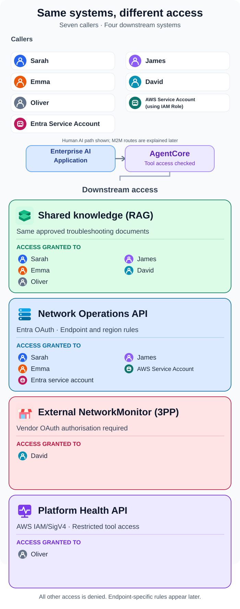
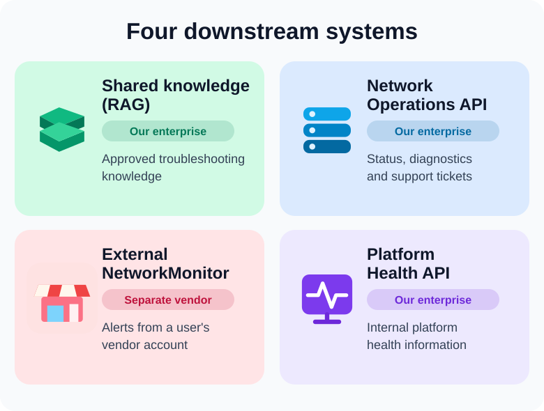
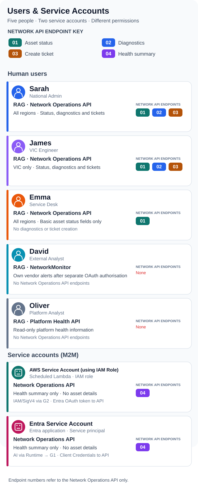
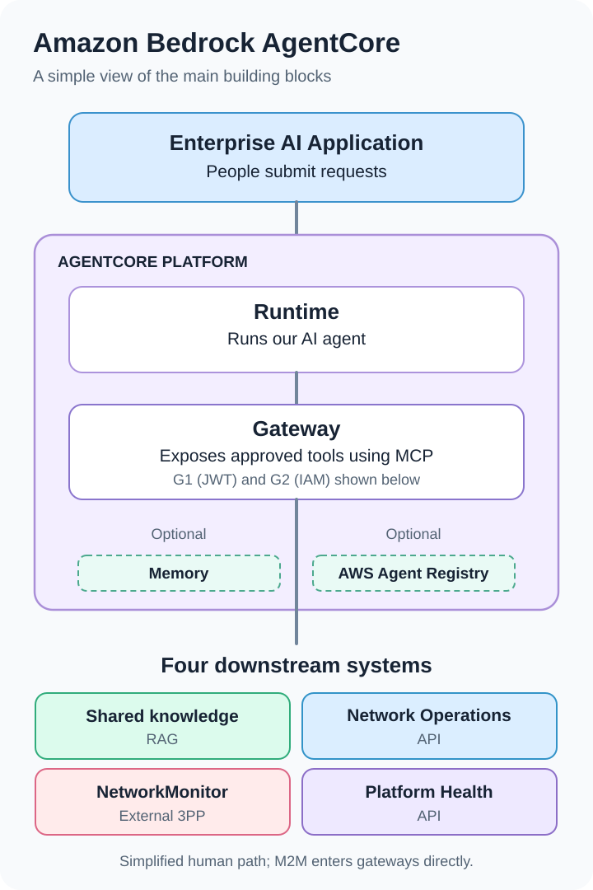
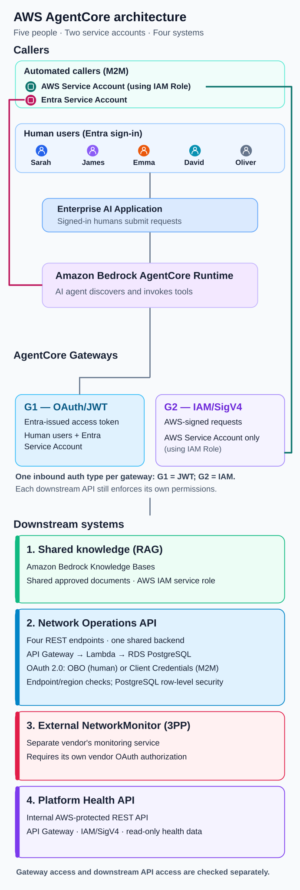

# AWS AgentCore Authentication & Authorization Patterns

Agentic AI introduces a difficult enterprise architecture challenge: **an agent may need to access several systems, but each system can authenticate callers differently and enforce different permissions**. Preserving a person's identity, allowing a service account to act independently, and obtaining third-party consent are not the same problem.

**The objective of this project is to identify, explain and standardise these common authentication and authorization approaches into reusable AgentCore architecture patterns.** We use one fictional enterprise application, four end systems and seven callers to show when each pattern applies—and how to prevent unauthorized access.

*At a glance: five people use the AI agent and two service accounts (M2M) use different automated paths to the same enterprise tools, with different access to four systems. A caller listed under a system has some access—not permission for every operation. The detailed AWS service diagram appears later.*

**Why isn't one authentication pattern enough?** Because the end systems trust **different identities**: some need the signed-in person, some need an application identity, some require separate authorization from an external provider, and some accept an AWS IAM role. One token or service account cannot safely satisfy all of those requirements.

**How to read this guide:** First meet the four end systems, then the seven callers and exactly what each may access. Next, see the AWS architecture and understand **why each connection requires a different identity or authorization method**. For implementation-level teaching, follow the links to the **[Deep dives](#deep-dives--identity-and-authorization)** at the bottom. They cover Entra groups, app roles, scopes, OBO, IAM, Cedar and RLS.

**The key idea:** Successfully signing into our Enterprise AI Application does **not** automatically grant access to every connected system. Each final API must still authenticate the caller it receives and enforce the appropriate permissions.

## 1. End systems

-  **1. Shared Knowledge (RAG)**
  - **Description:** Uses retrieval-augmented generation (**RAG**) to answer questions from shared troubleshooting documents in Amazon Bedrock Knowledge Bases.
  - **High-level access rule:** **All human users who successfully sign in to the Enterprise AI Application** can search the same approved knowledge.

-  **2. Network Operations API**
  - **Description:** Read/write enterprise REST API backed by **Amazon RDS PostgreSQL**. Returns asset status, diagnostics and a health summary, and creates support tickets.
  - **High-level access rule:** **Only authorized callers.** Human permissions depend on region and operation; the two approved service accounts (M2M) can access the health-summary endpoint only.

-  **3. NetworkMonitor**
  - **Description:** Simulated monitoring service owned by **another company**, with its own user accounts, permissions and OAuth server (modelled using Amazon Cognito). Returns the vendor user's alerts.
  - **High-level access rule:** **Only users granted tool access who separately authorize their vendor account.** Each user sees only their permitted alerts.

-  **4. Platform Health API**
  - **Description:** Existing internal monitoring REST API that returns operational health information about an enterprise platform or service. AWS workloads already call it through Amazon API Gateway using **AWS IAM**, not OAuth. It is protected, not anonymously accessible; the technical endpoint-type requirement is explained under Pattern 5.
  - **High-level access rule:** **Only users explicitly granted access to this tool.** Cedar checks the person; the API authenticates the Gateway's IAM role.

### Network Operations API — four endpoints

**Why four endpoints?** This PoC uses one Network Operations API with different operations to demonstrate how **human users and service accounts authenticate differently** and how access can be **allowed or denied per endpoint**. We also demonstrate restrictions on regions, returned fields and actions such as creating a ticket.

The four planned REST endpoints are exposed through **Amazon API Gateway**, with **AWS Lambda** handling the API requests and reading or writing data in **Amazon RDS PostgreSQL**. We introduce the endpoints here; the architecture section later explains what Lambda does and how the components communicate.

**These are different permissions on the same API, not four separate APIs.** The API validates the caller's token and enforces endpoint and data restrictions. AgentCore can also block an unauthorized tool call before it reaches the API. PostgreSQL row-level security (RLS) adds protection for database rows. The architecture section introduces Gateway and its Cedar authorization rules.

### Supporting database — Amazon RDS PostgreSQL

- Stores network assets, diagnostics, tickets and access entitlements.
- Is accessed **only through the Network Operations API**, never directly by the AI agent.
- Uses database permissions and **row-level security (RLS)** to restrict which rows a caller can see or change.

**How does RLS know the user's permissions?** PostgreSQL does **not** read OAuth tokens. The Network Operations API verifies the caller and passes trusted access restrictions to the database. We explain the full James example in [How OAuth connects to PostgreSQL RLS](#how-oauth-connects-to-postgresql-rls).

## 2. Users and their access

We have **five human users and two service accounts (M2M)**. The cards below show each caller's role, accessible systems and exact permissions. Each caller has a **fixed color and icon** reused in the access diagrams.

**Why the VIC restriction?** It is deliberate: a national admin can access records across regions, while a VIC engineer can access VIC records only. Later, we demonstrate how **PostgreSQL row-level security (RLS)** enforces this data restriction even when both users are allowed to call the same API endpoint.

**Endpoint labels 01–04 refer to the four operations in the [Network Operations API diagram](#network-operations-api--four-endpoints) above:** 01 = asset status, 02 = diagnostics, 03 = create ticket, 04 = health summary. They are identifiers for the same endpoints, not extra APIs.

A **service account** is an automated application or workload that operates **without a human signing in**. The AWS Service Account (using IAM Role) runs a scheduled health-summary operation; the Entra Service Account invokes an AI agent for automated health analysis. Both are limited to endpoint **04**. Their different technical routes are introduced in the architecture section.

### Network Operations API — exact endpoints for each caller

**Endpoint key (Network Operations API):**

-  Asset status — `GET /assets/{id}/status`
-  Diagnostics — `GET /assets/{id}/diagnostics`
-  Create ticket — `POST /tickets`
-  Health summary — `GET /network/health-summary`

*How to read this diagram: green = allowed, amber = allowed with restrictions, and red = denied. Every Network Operations API request is checked against the caller's endpoint permissions and, where relevant, region and field restrictions. These are planned PoC rules, not yet-implemented controls.*

**Same endpoint, different result:** James can call `GET /assets/{id}/diagnostics` for an asset in **VIC**, but the **identical endpoint** must deny an asset in **NSW**. Emma can call `GET /assets/{id}/status` nationally but sees **basic fields only**, not sensitive diagnostic details.

**Where are these permissions enforced?** Tool access is checked at AgentCore Gateway; the **Network Operations API** independently validates the OAuth token and checks endpoint, region and field entitlements; **PostgreSQL RLS** protects underlying rows. We explain Gateway's Cedar rules after the authentication patterns. Signing in alone is never sufficient.

### Explicit restrictions

| User | Access that must be denied |
|---|---|
|  **Sarah** | NetworkMonitor alerts and Platform Health API. |
|  **James** | NSW/other-region records, NetworkMonitor and Platform Health API. |
|  **Emma** | Detailed diagnostics, sensitive asset fields, ticket actions, NetworkMonitor and Platform Health API. |
|  **David** | Network Operations API and Platform Health API. |
|  **Oliver** | Network Operations API and NetworkMonitor. |
|  **AWS Service Account (using IAM Role)** | RAG, individual asset records, diagnostics, ticket actions, NetworkMonitor, Platform Health and human impersonation. |
|  **Entra Service Account** | RAG, individual asset records, diagnostics, ticket actions, NetworkMonitor, Platform Health and human impersonation. |

**Default rule:** A successful sign-in allows a human to use the Enterprise AI Application and shared RAG. Every other system requires its own authorization. If access is not explicitly listed above, it is denied.

## 3. Architecture overview

Our **Enterprise AI Application** is the user-facing product. Its **Chat API** is a backend REST endpoint (`POST /ai/chat`), not a separate AI application. The agent runs in **Amazon Bedrock AgentCore Runtime**, and **AgentCore Gateway** exposes approved tools.

The diagrams introduce the **PoC and its main building blocks**. Employees use our **Enterprise AI Application** to interact with an agent hosted by **Amazon Bedrock AgentCore**. AgentCore is more than a gateway: **Runtime** runs the agent, **Memory** can retain context across interactions, **AWS Agent Registry** provides a searchable catalogue of agents and tools, and **Gateway** connects the agent to approved tools. **MCP (Model Context Protocol)** is the standard interface used to discover and invoke those tools—not an authentication method.

This PoC focuses on **Runtime, Gateway and access control**; Memory and Registry are optional platform capabilities, not additional authorization steps. [AgentCore components explained](#appendix-agentcore-components-in-context).

### AgentCore components in everyday language

Before following the examples, here are the AWS parts:

| Term | Meaning in this PoC |
|---|---|
| **Enterprise AI Application** | Our user-facing enterprise AI system. Employees sign in and submit requests; its Chat API is the backend entry point. |
| **Chat API and Lambda** | The application backend receiving that question and passing the authenticated request to the agent. |
| **AgentCore Runtime** | Where our AI agent runs and decides which tool to request. |
| **Amazon Bedrock AgentCore Gateway** | The controlled entry point for invoking tools. **G1** receives approved Runtime tool calls carrying human-delegated or Entra automation credentials; **G2** accepts IAM/SigV4 from the AWS Service Account (using IAM Role). |
| **MCP tool** | A named action an agent or approved automated client can invoke, such as `get_diagnostics` or `create_ticket`. |
| **Gateway target** | Configuration connecting an MCP tool to an existing backend API. It is **not** another API or running service. |
| **Cedar** | The policy language we use at Gateway to decide whether a caller may invoke a tool. It does not retrieve data or issue OAuth tokens. |

The AI journey is: **human or approved Entra automation → Runtime agent → G1 tool → downstream authorization**. The direct-tool journey is: **AWS Lambda → G2 tool → downstream authorization**, without an AI agent. The final API checks an appropriately authenticated downstream identity in either case.

**Two different AWS services have “Gateway” in their names:** **Amazon API Gateway** is the REST API front door (for example, `POST /ai/chat` or our Platform Health REST API). **AgentCore Gateway** is the MCP tool-access layer used by the AI agent. They serve different purposes even when both appear in the same flow.

*Simplified platform view: the detailed diagrams below distinguish human AI requests, Entra automated AI requests, and direct AWS machine-to-machine tool calls.*

**Three invocation patterns (different from authentication protocols):**

1. **Human → AI agent:** Five people use the **Enterprise AI Application** to invoke **AgentCore Runtime**; the agent selects approved tools through **G1 (OAuth/JWT)**.
2. **M2M → AI agent:** The **Entra Service Account** invokes JWT-protected **Runtime** with an automated analysis request. The agent uses a **separately obtained, correctly audience-scoped Entra application token** to invoke its approved health-summary tool through **G1**. Runtime does not automatically forward an inbound token to G1.
3. **M2M → tool directly:** The scheduled **AWS Service Account (using IAM Role)** Lambda knows which operation it needs and invokes the health-summary MCP tool on **G2 (IAM/SigV4)**, without Runtime or an AI prompt.

**Why keep direct M2M tool access?** For a predictable operation, AI reasoning adds no benefit. Gateway offers a reusable, governed MCP interface and can translate tool calls to REST, but a conventional application could also invoke the underlying API directly. We intentionally show both automated AI invocation and direct tool invocation. **Human requests must never borrow the Entra automation's application-only credentials.**

**What is an AgentCore Gateway?** It provides a controlled entry point for **agent and automated-client tool calls**. It authenticates the caller, applies configured tool-access controls and routes permitted requests to the appropriate integration. The downstream API still verifies its own authentication and permissions.

**Why two gateways?** An AgentCore Gateway has **one configured inbound authorization type**. It cannot accept both **Entra OAuth/JWT** and **AWS IAM/SigV4** as inbound authorization methods on the same gateway. Because this PoC demonstrates both, we use **two separate gateways**:

- **G1 — JWT Gateway:** Accepts an Entra-issued access token. Used by the Runtime agent for the approved human flow and the **Entra Service Account** automation flow, with separately authorized credentials.
- **G2 — IAM Gateway:** Accepts AWS IAM-signed requests. Used by the **AWS Service Account (using IAM Role)**, such as the scheduled Lambda.

Each gateway can expose approved tools for the downstream systems shown below. **Gateway access does not grant automatic access to a downstream API or operation.**

### Detailed architecture — AWS components

**The same three invocation paths, with AWS components:** human users → Runtime → G1; Entra Service Account → Runtime → G1; AWS Service Account (using IAM Role) → G2 directly. The endpoint-access matrix in Section 2 remains authoritative for each caller's permissions.

**Terminology note:** You may see *two-legged OAuth (2LO)* used informally for application-only access, and *three-legged OAuth (3LO)* for user-authorized access. This guide uses the actual OAuth flow names—**Client Credentials** and **Authorization Code**—because they're clearer. OBO is a separate token-exchange flow used when a backend calls another API for a signed-in user.

### Authentication terms in plain English

- **OAuth 2.0 On-Behalf-Of (OBO) flow:** The backend obtains a new API-specific token **representing the signed-in user**.
- **OAuth 2.0 Client Credentials grant:** An **application** gets a token for itself, without a human.
- **OAuth 2.0 Authorization Code grant (with PKCE):** A person signs in with an authorization provider. The application receives a short-lived authorization code, then exchanges it for an access token. PKCE protects this exchange.
- **AWS IAM/SigV4 authentication:** An AWS role supplies temporary credentials used to sign a request to an IAM-protected service.

## 4. How these requirements lead to authentication patterns

The access rules discussed earlier lead to different technical patterns. **A use case is what someone wants to do; an authentication pattern is how the system grants and checks access.** Some paths use OAuth; others use AWS IAM. The five patterns below explain the reason for each choice.

### Five downstream access patterns

**Why five downstream patterns?** An **endpoint** is an action exposed by an API; a **pattern** is how a caller proves its identity and gets permission to perform that action. The same OBO pattern covers the three human Network Operations API endpoints, while the fourth endpoint uses a service-account token. Our other patterns demonstrate shared RAG, an external vendor account and an existing IAM-protected API. **We are not creating a separate pattern for every endpoint.**

The **endpoint-access diagram** in Section 2 is the quick reference. Here is the **reasoning behind each pattern**, starting with what someone is trying to do.

#### Pattern 1 — Shared Knowledge (RAG)

**Why does an enterprise need this?** Imagine an operations organisation with hundreds of approved troubleshooting guides, network procedures and internal FAQs. Engineers and service-desk staff repeatedly ask the same questions. Instead of relying only on the language model's general training, our Enterprise AI Application searches this **shared RAG knowledge base** and uses relevant passages to ground its answers.

- **What does the user want?** Any of our five human users signs in to our Enterprise AI Application and asks a question such as “What is the approved process for investigating a network outage?” The agent searches the same approved documents for everyone.
- **Why isn't signing in enough on its own?** Entra sign-in authenticates the person to **our Enterprise AI Application**. It does not give the person's browser credentials to query Amazon Bedrock Knowledge Bases directly. The backend agent still needs an authenticated AWS identity to retrieve passages.
- **Why not use the Network Operations API's OBO pattern?** The documents in this particular knowledge base are **deliberately shared with every signed-in human**. There are no different document permissions for Sarah versus Emma, and the AWS retrieval operation uses the application's service role. Exchanging each person's Entra token for a downstream user token would add no access distinction for this resource.
- **What solves it?** Our application checks that the person is signed in. The backend agent then retrieves relevant approved passages using its **authorized AWS service role**. The knowledge base is not public, and no end-user AWS credentials are exposed to the browser.

**Why keep this as a separate pattern?** It is the baseline **shared knowledge-access pattern**: users must be authenticated to the application, but the downstream knowledge service authenticates the **agent's AWS identity** and returns shared material. This is **not a separate OAuth protocol**. It contrasts with later patterns where the end system must know the specific person, application or vendor account. RAG can reduce hallucinations by grounding an answer in approved material, but does not guarantee correctness.

#### Pattern 2 — Human identity preserved with Entra OBO

**Why does an enterprise need this?** A single network database contains records for multiple regions and sensitivity levels. Employees can use the same AI interface, but an engineer responsible for VIC must not obtain NSW diagnostic records, and a service-desk employee must not see sensitive diagnostics at all.

- **What does the user want?** James asks the agent for VIC diagnostics. Sarah can request diagnostics nationally; Emma may see basic status but not detailed diagnostics.
- **Why isn't the initial token enough?** Their original Entra access token was issued for our **Chat API**, not the separate **Network Operations API**. The Network Operations API must not accept a token intended for another audience. A shared service-account token would also hide which person is asking.
- **What solves it?** The Chat API validates the user token and our trusted flow preserves it through Lambda, AgentCore Runtime and human Gateway **G1**. AgentCore Gateway/Identity uses **OBO** to obtain a **new Network Operations API token** representing that same person. The Network Operations API validates the new token and applies scopes, verified entitlements and PostgreSQL row-level security. James gets VIC records, not NSW records.

**Why a distinct pattern?** The final API must make decisions based on the **actual human's identity**. OBO supplies the appropriately scoped, downstream-audience token without asking James to sign in again. OBO does **not** grant new regional permissions or replace API authorization.

**Why does this API have three human endpoints, rather than one?** They illustrate **different permission decisions within the same OBO pattern**:

- `GET /assets/{id}/status` — **read basic information**. Sarah, James and Emma can call it, but James is limited to VIC and Emma receives only basic fields.
- `GET /assets/{id}/diagnostics` — **read restricted information**. Sarah and James can call it, with their regional limits; Emma cannot.
- `POST /tickets` — **make a change**. Only Sarah and James can create a ticket, for an allowed region. Emma cannot create tickets.

All three use **human OBO**, not three new OAuth methods. The point of separate endpoints is to show that **one authenticated person does not automatically have permission for every operation**, and that a write can require tighter approval than a read.

#### Pattern 3 — Application-only (M2M) API access: AI and direct-tool invocation

**Why does an enterprise need this?** Not every consumer of the Network Operations API is an employee asking a question. Our AWS Lambda invokes a known health-summary tool directly, while the Entra Service Account invokes the AI agent to analyse the same type of health data. The job runs in AWS and has an **IAM role**, but the existing Network Operations API is protected by **Microsoft Entra OAuth**. That API is not configured to accept an AWS IAM signature.

- **What does the caller want?** The AWS Service Account (using IAM Role) runs on a schedule and invokes **the same Network Operations API** used by people, but requests only `GET /network/health-summary`. It must never retrieve individual assets or tickets.
- **Why can't it use the human OBO pattern?** Nobody has signed in to the job. There is **no person's access token** to exchange, and inventing or borrowing a human identity would be wrong.
- **Why isn't its AWS IAM role sufficient end to end?** IAM can authenticate the scheduled AWS Lambda **directly to Gateway G2**. But the **final Network Operations API expects an Entra-issued OAuth access token**. IAM and Entra tokens are different credentials for different trust boundaries. The Network Operations API must not start accepting an unrelated AWS role just to support this reporter.
- **What solves it?** Register a dedicated **Entra app registration for the AWS Service Account (using IAM Role)'s outbound OAuth access** and grant it the application permission `HealthSummary.Read`. The Gateway's configured Entra OAuth credential provider uses **Client Credentials** to obtain an **app-only access token** for the Network Operations API. The API validates the token's audience and application permission, recognises the AWS Service Account (using IAM Role) application rather than any human, and permits **only** the health-summary endpoint. Its backend must still enforce that limitation.

**Why a distinct pattern?** This is **machine-to-machine OAuth for an API that requires OAuth**, even though the caller runs on AWS. It differs from **OBO**, which carries a particular human's delegated identity; from **Shared RAG**, where the downstream AWS service accepts an IAM role; and from **Platform Health**, where the final REST API itself accepts IAM/SigV4. The two hops are intentional: **AWS IAM into G2; Entra OAuth Client Credentials out to Network Operations.**

**Two distinct M2M examples share this downstream access pattern:**

- **AWS Service Account (using IAM Role) — direct tool use:** Scheduled Lambda already knows which summary operation to request. It signs a G2 MCP request using IAM/SigV4. **No prompt, AI agent or Runtime is involved.** G2 obtains an Entra application-only OAuth token to call endpoint **04**.
- **Entra Service Account — automated AI analysis:** An automated application sends an analysis prompt and an **application-only Entra JWT** to JWT-protected Runtime. The agent invokes the approved summary tool through G1 using a **separately obtained G1-audience application JWT**. G1 obtains a third, **Network Operations API-audience** OAuth token to call endpoint **04**.

**Identity boundary:** These are separate application identities, both without a human; neither can use OBO or borrow a human's access. G1 must verify the Entra automation's client identity and restrict its tool access to health summary. For that automation, **Runtime, G1 and Network Operations API have separately configured token audiences**; the incoming token is not automatically valid at the next boundary. By contrast, the human Token A is deliberately configured for the AI backend/Runtime/G1 trust boundary before the OBO exchange.

##### Design decision — why AWS uses IAM inbound and OAuth outbound

**This extra step is intentional, not a Lambda limitation.** Lambda can obtain and use an Entra OAuth token directly. We have chosen a different route to demonstrate a realistic integration between two enterprise identity systems:

1. **AWS workload → G2 (IAM):** The scheduled Lambda already has temporary AWS IAM credentials. It uses SigV4 to authenticate to the IAM-protected AgentCore Gateway G2.
2. **Integration → Network Operations API (OAuth):** The Network Operations API accepts **Entra OAuth tokens only**. An IAM signature cannot authenticate to it, so the integration obtains a separate **application-only Entra access token** using the OAuth 2.0 Client Credentials grant.
3. **Why retain both:** We want to demonstrate IAM-based gateway access **without modifying the API's established Entra security model** for one AWS caller. The gateway and API enforce separate permissions.

**The simpler alternative:** Configure Lambda to obtain an Entra token and use **G1 directly**. That is valid and may be preferable for a workload that only needs Entra-protected resources. We deliberately retain **G2** in this PoC to teach IAM-based gateway authentication and cross-identity integration—not because IAM-to-OAuth is always better.

**In one line:** IAM authorises the AWS workload at **G2**; OAuth authorises the application at the **Network Operations API**. In production, use managed OAuth credentials or workload federation where possible.

#### Pattern 4 — Independent authorization at an external vendor

**Why does an enterprise need this?** An organisation may subscribe to a monitoring SaaS provider, while individual employees have separate accounts and alert permissions **at that vendor**. The AI assistant should be able to retrieve an employee's permitted alerts, just as other assistants connect to a separately authorized SaaS account. Corporate sign-in alone cannot make that vendor trust the request.

- **What does the user want?** David asks our Enterprise AI Application to retrieve his alerts from **NetworkMonitor**, a simulated service owned by another company.
- **Why isn't his corporate sign-in enough?** Entra authenticates David to **our** application, but it cannot independently grant access to his account and alerts in **NetworkMonitor's** identity system. An Entra OBO token for our Network Operations API is not a NetworkMonitor token.
- **What solves it?** After David is authorized to use the vendor tool, he separately completes **NetworkMonitor's OAuth 2.0 Authorization Code grant (with PKCE)**. AgentCore's vendor OAuth credential provider obtains and associates a vendor-issued token with the authenticated David, then uses it to call `GET /alerts`. NetworkMonitor validates that token and returns only data permitted to that vendor account.

**Why a distinct pattern?** The vendor controls **its own accounts and authorization**. This is the same broad arrangement used when an enterprise AI assistant connects to an independently protected SaaS account. Our Cognito simulation supports the Authorization Code flow and custom API scopes, demonstrating the separate OAuth boundary. Cognito's managed login does not itself provide every vendor-style consent-screen experience.

#### Pattern 5 — Reusing an existing IAM-protected enterprise API

**Why does this API use IAM in the first place?** Imagine the Platform Health API was built years ago for internal AWS workloads. A Lambda function checks platform health by calling an AWS API Gateway REST endpoint using its IAM execution role. That is a normal AWS service-to-service design: the API trusts approved **AWS roles**, not interactive employees. It has no reason to integrate with Entra just to serve those existing workloads. API Gateway can support other authentication methods; **IAM is a deliberate choice for this example**, not a limitation of REST.

- **What does the user want?** Oliver now asks our **Enterprise AI Application**: “Is our internal platform healthy?” We want to reuse that existing Platform Health API **without rebuilding its authentication**.
- **Why can't we just send Oliver's token?** His Entra token is an **OAuth** token, while this existing API expects **IAM/SigV4**. The API doesn't know who Oliver is; it recognizes the **AWS role** signing the request. If everyone could invoke the agent's Platform Health tool, the same role could retrieve results for users who should not have access.
- **What solves it?** Oliver signs in to our Enterprise AI Application. Before any API call, **G1 uses Cedar to check that Oliver is allowed to invoke the tool**. Only then does AgentCore Gateway use its **IAM service role** to sign the request to the native API Gateway REST-stage target. The Platform Health API validates the IAM signature and role permissions. Sarah, James, Emma and David are denied **at the tool boundary**, before Gateway can use that role for their request.

**A public endpoint type does not mean anonymous access:** AWS's native AgentCore API Gateway REST-stage target currently requires a **public endpoint type** (not API Gateway's private endpoint type). Our Platform Health API still requires **AWS IAM authorization** for every exposed method. The API can have private integrations behind its front door. This constraint applies to the **native stage target**, not to every API Gateway API or OpenAPI target.

**Why can't we simply reuse one of the earlier patterns?**

- **OBO won't work for this final API.** OBO creates a delegated **OAuth** token identifying James or Oliver. Platform Health is deliberately **IAM-only**, so it expects a **SigV4-signed AWS request**, not that token.
- **The AWS Service Account (using IAM Role)'s Client Credentials pattern won't work for this final API either.** That pattern obtains an **OAuth application token** for the Network Operations API. Platform Health does not accept OAuth tokens, and Oliver's request is initiated by a **human**, not a scheduled reporting service.
- **Shared RAG is the closest match, but it doesn't demonstrate the restriction we need.** Both RAG and Platform Health can use AWS service identity. In RAG, **every signed-in human** may retrieve shared documents. Here **only Oliver** may invoke the IAM-backed Platform Health tool. Because the downstream API sees Gateway's service role rather than Oliver, **Cedar must enforce Oliver's permission before the call**.

**So why keep this example?** It demonstrates a real enterprise requirement the others do not show together: **a restricted human-triggered tool that calls an IAM-protected REST API using the AgentCore native API Gateway stage target**. This is an **authorization and integration pattern**, not a new authentication protocol.

**The rule to remember:** **Cedar authorizes the human; IAM authenticates the service.**

### When and why should we use Cedar?

**What is Cedar?** It is a way to write rules such as: **“Only Engineers may invoke the diagnostics tool”** or **“Only Oliver may invoke the Platform Health tool.”** AgentCore Gateway evaluates those rules **before calling the tool**.

**Is Cedar always required? No.** A properly secured downstream API can make its own authorization decisions using a verified OAuth token. We use Cedar when we want an **additional, centrally managed check on agent tool access**. That is different from losing user identity: **Cedar does not preserve identity or issue OAuth tokens.**

**When is it useful—and when can we leave it out?**

- **Shared Knowledge (RAG): every signed-in human has the same approved knowledge access**
  - **Cedar decision in our PoC:** **No special per-user Cedar policy needed.**
  - **Why?:** No user-specific document restrictions to enforce at this tool. The AWS knowledge service still authenticates the agent's service role.

- **Network Operations API: OBO carries the real user to an API that enforces their permissions**
  - **Cedar decision in our PoC:** **Optional extra protection; we choose to use it.**
  - **Why?:** Cedar can deny Emma's diagnostics **tool call early**. Even without Cedar, the Network Operations API must independently reject the unauthorized request.

- **Platform Health: the final API sees only Gateway's IAM role**
  - **Cedar decision in our PoC:** **An upstream user-permission check is essential; we choose Cedar.**
  - **Why?:** The final API cannot tell Oliver from Emma by looking at the IAM role. Cedar permits Oliver's tool call and denies everyone else **before the same service role is used**. An equivalent correctly enforced application-side check could also provide this protection.

**The decision rule:** If the final API **knows the user and enforces their permissions**, Cedar can add defence in depth. If the final API **only knows a shared service identity**, make sure **some trusted component authorizes the human first**; Cedar is our selected control in that case.

An **OAuth access token** contains signed information about a caller and permissions. **The token cannot enforce a rule by itself**: a component must validate the token and make an allow/deny decision. Cedar performs that job for **agent tool calls**; our Network Operations API performs it for **downstream API requests and data**.

#### Three simple examples

**1. Emma — OAuth already protects the API**

1. Emma signs in and asks for diagnostics.
2. In our PoC, Cedar sees her Service Desk role and denies the diagnostics **tool**.
3. If we removed Cedar, the Network Operations API could still reject Emma using her OBO identity and API rules.

**Lesson:** Cedar is **defence in depth**, not a substitute for preserving Emma's identity or checking permissions at the API.

**2. James — Cedar allows a tool, but cannot grant extra data**

1. James asks for NSW diagnostics.
2. Cedar allows the diagnostics **tool** because James is an Engineer.
3. OBO supplies a Network Operations API token representing James.
4. The API checks his **VIC-only** entitlement, and PostgreSQL RLS restricts the rows. The NSW request is **denied**.

**Lesson:** Cedar permission to invoke a tool does **not** override downstream OAuth authorization or RLS.

**3. Oliver — the downstream API does not recognize a human token**

1. Oliver asks for Platform Health.
2. Cedar verifies that only Oliver is allowed to use that tool.
3. Gateway signs the final API request with its **AWS IAM service role**.
4. The API trusts that role. It does **not** receive Oliver's OAuth identity as its authenticated caller.

**Lesson:** Here we need an **upstream user-specific permission check**, because the final API cannot make that decision from the service-role credentials. Cedar is a good fit; another properly enforced application authorization mechanism could also perform the check.

**Remember:** **Cedar authorizes the tool call. OAuth/OBO authenticates the delegated user to the Network Operations API. The Network Operations API and database enforce data permissions.** Using Cedar never removes the need for downstream authorization.

### Identity and authorization — short version

- **Entra ID group:** Which team a person belongs to, such as `Network-Engineers-VIC`. The Network Operations API uses verified group membership to enforce endpoint and regional permissions.
- **Entra app role:** What a person can do **in the Enterprise AI Application**, such as `Network.Engineer`. AgentCore Cedar checks the role before invoking tools.
- **OAuth delegated scope:** What the **client app** may request from a protected API for a signed-in user, such as `diagnostics.read`. API Gateway validates it for each endpoint.
- **OBO:** The **confidential AI backend**, not an Entra ID group, asks Entra for a new **Network Operations API** token representing that signed-in person. OBO does not itself grant regional or endpoint entitlements.

These are independent controls. A valid scope never overrides the Network Operations API's user/group checks. **[Full explanation with Entra configuration, tokens, OBO and a James/Emma example](#deep-dive-entra-id-groups-app-roles-oauth-scopes-and-obo).**

## Deep dives — identity and authorization

The sections below are optional implementation detail. The main walkthrough above is complete without them.

### Deep dive: Entra ID groups, app roles, OAuth scopes and OBO

#### 1. Start with the business problem

James and Emma both sign in to **our Enterprise AI Application**. James is a VIC engineer; Emma works on the Service Desk. Both may have an OAuth token that includes `diagnostics.read`, yet **James may retrieve VIC diagnostics and Emma may not retrieve any diagnostics**.

That is not contradictory. The token's scope is **only one check**:

- **May this person invoke the AI diagnostics tool?**
  - **Mechanism:** **AI Backend app role**, enforced by AgentCore G1 **Cedar**
  - **Our example:** James allowed; Emma denied

- **May the AI client request the Network Operations API diagnostics operation for a signed-in person?**
  - **Mechanism:** **Delegated OAuth scope**, enforced by API Gateway
  - **Our example:** `diagnostics.read` is required

- **May this person access diagnostics for this asset and region?**
  - **Mechanism:** **Entra ID group** membership, mapped by Network Operations API Lambda to business entitlements
  - **Our example:** James VIC allowed; NSW denied; Emma denied

- **Which database rows may the request return or change?**
  - **Mechanism:** PostgreSQL **row-level security (RLS)**
  - **Our example:** James's request cannot retrieve NSW rows

**The key rule:** An authenticated user and a valid OAuth scope are not sufficient to access every API operation or record. The final Network Operations API must still enforce the individual's rights.

#### 2. Four concepts, explained simply

- **Entra ID group**
  - **Plain-English meaning:** A named collection of users, such as the VIC engineering team. **We use ordinary Entra ID groups**, not an API Gateway-specific group.
  - **Where we configure it:** Entra ID → Groups

- **App role**
  - **Plain-English meaning:** A named permission **within a particular application**, such as `Network.Engineer`.
  - **Where we configure it:** App registration → App roles; assign through Enterprise Applications

- **OAuth delegated scope**
  - **Plain-English meaning:** Permission for a **client application to request an operation on behalf of a signed-in person**, such as `diagnostics.read`.
  - **Where we configure it:** Network Operations API app registration → Expose an API; grant delegated API permission/consent to the middle tier

- **OBO (On-Behalf-Of)**
  - **Plain-English meaning:** A token exchange: our confidential AI backend asks Entra for a **new Network Operations API token representing the same signed-in person**.
  - **Where we configure it:** AI Backend confidential client + AgentCore Identity OAuth credential provider

**These do not automatically map to each other.** Adding James to an Entra ID group does not automatically grant an app role, make him an OAuth client, or issue an OBO token. Granting `diagnostics.read` does not turn Emma into an engineer.

**Entra ID group names versus IDs:** We write names such as `Network-Engineers-VIC` because people can read them. Entra also assigns each group a unique **Object ID**. Our Network Operations API authorizes based on the **verified Object ID**, not a name supplied in an agent prompt or HTTP request.

#### 3. Exactly what we create and assign in Microsoft Entra

**A. Human Entra ID groups — three in total**

- **`Network-Admins`**
  - **Member:** Sarah
  - **What our Network Operations API rules grant:** Status, diagnostics and ticket creation for all regions

- **`Network-Engineers-VIC`**
  - **Member:** James
  - **What our Network Operations API rules grant:** Status, diagnostics and ticket creation for VIC only

- **`Network-ServiceDesk`**
  - **Member:** Emma
  - **What our Network Operations API rules grant:** Basic asset status for all regions; **no** diagnostics or tickets

These are proposed names for **normal Entra ID groups**. **There is no special Entra ID group registered to AWS API Gateway, and no group that is enabled for OBO.** David and Oliver need **no Entra ID group for the Network Operations API** because their permitted tools point to different systems. Neither non-human caller uses these human Entra ID groups.

**B. Three Entra app registrations for the human flow**

- **`enterprise-ai-web`**
  - **Represents:** Browser chat client
  - **What we define or configure:** Interactive authorization code + PKCE; permission to call the AI Backend's `chat.invoke` delegated scope

- **`enterprise-ai-backend`**
  - **Represents:** Protected Chat API (`POST /ai/chat`) **and** confidential client for OBO
  - **What we define or configure:** Expose `chat.invoke`; define the human app roles below; configure the **same backend application ID** for the confidential OBO client

- **`enterprise-network-api`**
  - **Represents:** Protected Network Operations API
  - **What we define or configure:** Expose delegated scopes `status.read`, `diagnostics.read`, `tickets.write`; define app-only role `HealthSummary.Read`; configure appropriate group claims for this API if using token membership

**Why must the backend OBO client match Token A's audience?** Microsoft permits the middle tier to redeem an incoming token only when the assertion was issued **for that confidential middle-tier application**. Using some other client ID to exchange a Chat API token is not our design and can fail token exchange.

**C. Human AI-application roles — assigned directly in this PoC**

- **Sarah**
  - **Chat API app role in Token A:** `Network.Admin`
  - **Entra ID group for the Network Operations API:** `Network-Admins`

- **James**
  - **Chat API app role in Token A:** `Network.Engineer`
  - **Entra ID group for the Network Operations API:** `Network-Engineers-VIC`

- **Emma**
  - **Chat API app role in Token A:** `Network.ServiceDesk`
  - **Entra ID group for the Network Operations API:** `Network-ServiceDesk`

- **David**
  - **Chat API app role in Token A:** `Vendor.Analyst`
  - **Entra ID group for the Network Operations API:** None

- **Oliver**
  - **Chat API app role in Token A:** `Platform.Analyst`
  - **Entra ID group for the Network Operations API:** None

We assign these human **app roles directly to users** in the AI Backend's Enterprise Application. **Separately**, we maintain their Entra ID group memberships. This keeps the two concepts easy to demonstrate, including in an Entra Free learning tenant.

**Could we assign an Entra ID group to an app role instead? Yes.** Microsoft supports assigning groups to an application's user-facing roles, allowing assigned members to receive role claims. That is an alternative enterprise pattern; we are **not** using it in this PoC. We do not implicitly turn Entra ID group membership into an app role or scope.

**D. Delegated permissions and consent for OBO**

The Network Operations API defines the three **delegated scopes**. The confidential `enterprise-ai-backend` client is configured with the **Network Operations API delegated permissions** it needs, and the required user/admin consent is granted. This is **client/API authorization**, not an Entra ID group assignment. The Network Operations API's HTTP methods each require the appropriate scope.

#### 4. Token A and Token B: why they are different

A person signs in **once**, but each protected API expects a token intended for **that API**.

**Token A — AI Backend**

- **Who obtains it?:** The browser client following interactive Entra sign-in
- **Issued by:** Microsoft Entra ID
- **Intended audience (`aud`):** `enterprise-ai-backend`
- **Example delegated scope (`scp`):** `chat.invoke`
- **User:** James (`tid`, `oid`)
- **Additional claims:** AI Backend-specific user roles may appear in `roles`
- **Who validates it?:** Chat API and configured JWT-based AgentCore boundaries

**Token B — Network Operations API**

- **Who obtains it?:** The **confidential AI backend** using AgentCore Identity **OBO**
- **Issued by:** Microsoft Entra ID
- **Intended audience (`aud`):** `enterprise-network-api`
- **Example delegated scope (`scp`):** `diagnostics.read`
- **User:** **The same James** (`tid`, `oid`)
- **Additional claims:** Group claims can appear **if configured for the Network Operations API**; no automatic copying from Token A
- **Who validates it?:** Network Operations API Gateway authorizer and its backend

**Why not send Token A to every system?** Because the Network Operations API must reject a token addressed to the Chat API. Accepting an unrelated token audience creates a security boundary failure. OBO obtains a properly addressed token without another interactive sign-in.

**What is inside a token?** An Entra access token is a **signed** message. `aud` identifies the intended API; `scp` carries delegated scopes; `roles` carries application roles or user app roles for that token's resource; `tid` and `oid` identify the Entra tenant and user. **Not every token contains every claim.** We must explicitly configure and verify the claims each receiving service requires.

#### 5. OBO: exactly who does it and what enables it

**OBO is not a feature switched on for particular Entra ID groups.** Entra ID is the **token issuer**. Our **confidential AI backend**, through its configured **AgentCore Identity OAuth credential provider**, is the **requesting client**.

1. **James signs in** to our Enterprise AI Application using Entra (authorization code with PKCE), and the browser receives **Token A**, intended for the AI Backend.
2. The chat backend and AgentCore JWT ingress **validate Token A**. AgentCore G1 Cedar examines James's assigned AI app role when he requests the diagnostics tool.
3. **AgentCore Identity's Microsoft Entra OBO provider** uses James's incoming Token A, the confidential backend's client ID and credential, and the configured delegated Network Operations API permission to request a new access token from **Entra's token endpoint**.
4. Entra verifies the middle-tier identity, Token A audience and the relevant **delegated permission/consent**. If these conditions are not met, **no Token B is issued**.
5. Entra issues **Token B** for the Network Operations API, **still identifying James** and containing the granted Network Operations API delegated scope.
6. AgentCore's **OpenAPI target** calls the Network REST endpoint with **Token B**; the Network Operations API validates it and enforces James's business rights.

**Who can participate?** Sarah, James and Emma are human users and can all be represented by OBO tokens **if the application setup and delegated permissions allow the exchange**. Group membership decides what they may **do afterward**. David and Oliver also have human identities, but we give them **no Network Operations API authorization** in this PoC. The two service accounts (M2M) have **no human user token**, so they use **Client Credentials**, not OBO.

**Who does not request OBO?** Not the Entra ID group; not API Gateway simply because it hosts the endpoint; not RDS. AgentCore Identity performs the configured exchange for the confidential middle tier.

#### 6. How the Network Operations API enforces endpoint and regional access

The **Network Operations API** is one REST API backed by one RDS PostgreSQL database. Its four endpoints are:

- **`GET /assets/{id}/status`**
  - **OAuth/API permission required:** Delegated `status.read`
  - **Additional Network Operations API rules:** Sarah all regions; James VIC; Emma nationwide **basic fields only**

- **`GET /assets/{id}/diagnostics`**
  - **OAuth/API permission required:** Delegated `diagnostics.read`
  - **Additional Network Operations API rules:** Sarah all regions; James VIC; Emma **denied**

- **`POST /tickets`**
  - **OAuth/API permission required:** Delegated `tickets.write`
  - **Additional Network Operations API rules:** Sarah all regions; James VIC; Emma **denied**

- **`GET /network/health-summary`**
  - **OAuth/API permission required:** **App-only** `roles: [HealthSummary.Read]`, not a delegated `scp`
  - **Additional Network Operations API rules:** **Only** the two approved non-human Entra application identities; health summary only

**Where does each check happen?**

1. **API Gateway REST JWT authorizer** validates the Entra signature, tenant issuer, **Network Operations API audience**, expiry and required delegated **method scope** for human endpoints. The app-only summary method deliberately has **no `scp` requirement**, because Client Credentials tokens use `roles`.
2. **The Network Operations API Lambda** obtains the **verified** user `tid/oid` and Entra ID group Object IDs from correctly issued Network Operations API claims, or an authorized membership lookup. It determines permissions from the RDS **`group_entitlements`** table. **Entra is the source of truth for group membership; RDS is the source for our business mappings.**
3. Lambda checks the actual asset's **trusted region**, permitted operation and, for Emma, **permitted response fields**. It rejects a prompt-supplied user ID, region or group claim as an authorization source.
4. Lambda establishes trustworthy **per-request database context**. PostgreSQL **RLS** filters permitted rows. RLS does **not** read an OAuth token by itself, and RLS does **not** redact columns; the API shapes Emma's basic response.
5. For `POST /tickets`, Lambda checks the caller's ticket-creation permission and verified regional entitlement before writing to the database.

**Same OAuth scope, different person:**

- **James**
  - **Example delegated scope:** `diagnostics.read`
  - **Attempt:** VIC diagnostics
  - **Result:** **Allow**

- **James**
  - **Example delegated scope:** `diagnostics.read`
  - **Attempt:** NSW diagnostics
  - **Result:** **Deny** — outside VIC

- **Emma**
  - **Example delegated scope:** `diagnostics.read` (even if her authorized client obtained it)
  - **Attempt:** Any diagnostics
  - **Result:** **Deny** — Service Desk has no diagnostics entitlement

- **Emma**
  - **Example delegated scope:** `status.read`
  - **Attempt:** Basic NSW status
  - **Result:** **Allow** — basic fields only

**Why isn't OAuth enough?** OAuth scopes describe what the client may request on a user's behalf, not every individual business rule. An endpoint that accepts James's `diagnostics.read` token must still deny James's NSW asset and Emma's diagnostics request.

**Group membership details:** The Network Operations API's Entra token can be configured to carry **Entra ID group Object IDs**. Where group claims are omitted or indicate overage, a trusted Microsoft Graph membership lookup or another authorized entitlement lookup is required. If membership cannot be verified, **deny**. Do not rely on mutable group display names or data supplied in the model's arguments.

**Our selected enforcement option:** Use the existing Network Operations API Lambda for group/operation/region/field rules and RDS RLS for rows. We are **not** creating an extra API-level Cedar engine or separate Lambda authorizer for this PoC. The Lambda uses **generic permission checks** driven by protected entitlement data; no hardcoded if-statements naming James or Emma.

| Other valid option | Why we did not choose it here |
|---|---|
| Separate API Gateway **Lambda authorizer** | Can centralize endpoint checks before the business handler, but adds another function and does not replace record/field checks |
| **Amazon Verified Permissions (Cedar)** for the API | Useful when many APIs share policy; adds a policy store and another authorization boundary beyond the AgentCore Cedar demonstration |
| API Gateway **OAuth scopes alone** | Cannot enforce VIC versus NSW or Service Desk's restricted fields |

#### 7. Where AgentCore Cedar fits — separate from API authorization

G1's **Cedar** policies authorize **MCP tool invocation** from **Token A** identity/app-role claims. For example:

- James's `Network.Engineer` role can permit the diagnostics tool. **It cannot authorize NSW data**—the Network Operations API and RLS still deny that.
- Emma's `Network.ServiceDesk` role permits the basic-status tool but **denies the diagnostics and ticket tools** before calling the API.
- David's `Vendor.Analyst` role permits the vendor tool, but does **not** replace David's independent vendor OAuth authorization.
- Oliver's `Platform.Analyst` role permits the Platform Health tool **before** Gateway uses its **shared AWS IAM role** to invoke the IAM-protected final API.
- The Entra Service Account's **application** role permits its **summary tool only**, never human tools.
- G2 uses an **IAM-principal policy** for the AWS Service Account (using IAM Role) role and exposes **health summary only**.

**Why Cedar is important for Oliver:** Platform Health validates an **AWS SigV4-signed service request** from Gateway. It does not receive Oliver's human OAuth token as its authenticated principal. Without an earlier trusted **human-specific authorization decision**, any person able to trigger that shared service role could potentially use the tool. We choose Cedar for that check.

**Is Cedar mandatory for Network Operations API OBO? No.** Because the Network Operations API identifies James and independently enforces his rights, Cedar is additional **tool-level protection**. But it does not replace the downstream API.

**Exact claims matter:** For Entra v2 access tokens, the calling application ID is commonly `azp` (v1 `appid`). AgentCore JWT `allowedClients` checks a claim named **`client_id`**, which is **not automatically the same claim**. Our G1 Cedar policy checks the verified **`azp`** and required business/app role. Do **not** assume an AWS JWT allow-list of client IDs automatically maps to Entra's claim names. Entra JWT `roles` arrays are exposed to AgentCore Cedar through **string-valued tags**; policies must check complete role values and deny missing/wrong-type claims. We do **not** require human `chat.invoke` globally at G1, because the valid Entra app-only automation token does not have human delegated `scp`.

#### 8. Service accounts (M2M): Client Credentials, not OBO

Our PoC has **two service accounts (M2M) with different inbound authentication**, but both eventually use **Entra application permissions** for the same Network Operations API summary endpoint.

- **AWS Service Account (using IAM Role)**
  - **AgentCore inbound identity:** Scheduled Lambda → G2 **AWS_IAM/SigV4** directly (no Runtime)
  - **Network Operations API outbound credential:** AgentCore Identity OAuth **Client Credentials** for dedicated Entra app `network-health-reporter`
  - **What the final API sees:** AWS Service Account (using IAM Role)'s Entra **application ID**, `HealthSummary.Read`, no human

- **Entra Service Account**
  - **AgentCore inbound identity:** Separate Entra service principal → application JWT → JWT-protected Runtime → separately scoped application JWT → G1 **CUSTOM_JWT**
  - **Network Operations API outbound credential:** Separate target's **Client Credentials** for `entra-automation-client`
  - **What the final API sees:** Entra Service Account's own Entra **application ID**, `HealthSummary.Read`, no human

**No Entra ID group or OBO is involved.** `HealthSummary.Read` is an Entra **application app role** defined on `enterprise-network-api` and granted separately to the two service principals. The Network Operations API checks each application's verified client identity and its role—not just the signature of some Entra-issued JWT.

**G2 IAM inbound does not magically become OAuth outbound.** G2's Network Operations API **OpenAPI target** has an independent **AgentCore Identity OAuth credential provider** configured as an Entra **Client Credentials client** (tenant/token endpoint, client ID, credential, Network Operations API `/.default` resource scope). AgentCore Identity requests the **Network Operations API-audience** app token. The confidential client secret is secured through **AWS Secrets Manager**; AgentCore Identity manages OAuth tokens through its encrypted **token vault**. The Gateway's IAM role is **not** the application secret, and neither is a human identity.

**Why two gateways?** An AgentCore Gateway is configured with **one inbound authorizer type**. G1 accepts Entra JWTs; G2 accepts IAM/SigV4. We deliberately keep both to teach two **service-account ingress** methods. A single G1 JWT Gateway could serve the AWS Service Account (using IAM Role) if the AWS Service Account (using IAM Role) instead obtained an Entra app-only JWT; G2 is a **chosen learning pattern**, not a universal requirement for service accounts. Each Gateway can have multiple targets with independent **outbound** authentication.

#### 9. FAQs — common IAM misunderstandings

| Question | Short answer |
|---|---|
| **Is an Entra ID group tied to API Gateway?** | **No.** It is an ordinary Entra ID group. The Network Operations API Lambda maps its verified Object ID to business rights. |
| **Which Entra ID groups support OBO?** | **None are OBO-enabled.** Entra issues tokens to a correctly configured confidential client's delegated exchange, representing an authenticated human. |
| **Can Emma obtain an OBO token?** | **Yes, if the client permissions and consent allow it.** It does not grant her diagnostics business rights. |
| **Do Entra ID group memberships become app roles automatically?** | **No.** We assign roles separately. Assigning a group to an app role is an alternative configuration we chose not to use. |
| **Do app roles automatically grant OAuth scopes?** | **No.** App roles and delegated scopes are defined and assigned separately, and may belong to different API registrations. |
| **Does API Gateway need the Entra ID group's name?** | **No.** The Network Operations API's authorization logic uses the verified **Object ID** and RDS mappings. |
| **Why not use Token A for Network Operations API?** | **Wrong audience.** Token B is issued specifically for Network Operations API via OBO. |
| **Does RLS read James's token?** | **No.** Lambda converts verified identity/entitlements into database context; RLS restricts rows. |
| **Can Cedar alone protect the Network Operations API?** | **No.** The final API must enforce its own rights, including when reached by another permitted client. |
| **Can the AWS Service Account (using IAM Role) use OBO?** | **No human is signed in.** It uses Client Credentials. |
| **Can a valid scope still be denied?** | **Yes.** Emma's business rights or James's regional restriction can deny the operation. |

**Sources:** [Microsoft OBO](https://learn.microsoft.com/en-us/entra/identity-platform/v2-oauth2-on-behalf-of-flow) · [Entra app roles and Entra ID groups](https://learn.microsoft.com/en-us/entra/identity-platform/howto-add-app-roles-in-apps) · [Entra access token claims](https://learn.microsoft.com/en-us/entra/identity-platform/access-token-claims-reference) · [AWS AgentCore OBO](https://docs.aws.amazon.com/bedrock-agentcore/latest/devguide/on-behalf-of-token-exchange.html) · [AWS Gateway outbound authentication](https://docs.aws.amazon.com/bedrock-agentcore/latest/devguide/gateway-outbound-auth.html) · [API Gateway REST JWT authorizers](https://docs.aws.amazon.com/apigateway/latest/developerguide/rest-api-jwt-authorizer.html).

### How OAuth connects to PostgreSQL RLS

**RLS does not read an OAuth token. The Network Operations API connects the user's OAuth identity to the database rules.**

Imagine James asks our Enterprise AI Application: **“Show me diagnostics for asset 123.”** That asset is in NSW, but James is a VIC engineer.

1. **James signs in** using Microsoft Entra ID.
2. **OBO obtains a new OAuth access token for the Network Operations API**, still representing James. It is not a generic token for the AI agent.
3. **The Network Operations API validates the token** and identifies James using trusted token claims. It then verifies his `Network-Engineers-VIC` membership with Entra claims or an authorized identity lookup.
4. **The Network Operations API establishes trusted database context for this request:** James may access **VIC** data, not NSW. It does not accept a region merely because the user or AI agent supplied it in a prompt.
5. **PostgreSQL applies its RLS policy** to the database query using that verified context. It excludes any row outside James's permitted region.
6. **The API returns only authorized data** to the agent, which uses it to answer James.

- **Sarah**
  - **Verified access from Entra and API rules:** National Admin, all-region entitlement
  - **What RLS allows:** Rows in all permitted regions

- **James**
  - **Verified access from Entra and API rules:** Engineer, VIC-only entitlement
  - **What RLS allows:** **VIC rows only**

- **Emma**
  - **Verified access from Entra and API rules:** Service Desk, nationwide basic status
  - **What RLS allows:** Status rows nationally; **the API** removes sensitive fields

- **Both approved automation callers**
  - **Verified access from Entra and API rules:** App-only OAuth permission for health summary
  - **What RLS allows:** **Not a human regional-RLS example**; the API exposes only a health-summary response

**The crucial distinction:** OAuth/OBO tells the Network Operations API **who is calling**. Verified Entra groups and our API rules determine **which data that caller may access**. The API conveys that trusted restriction to PostgreSQL, and **RLS enforces it against actual database rows**.

This is a deliberate additional security boundary. An AI agent asking for NSW data cannot override James's VIC entitlement. **RLS filters rows, not individual columns**: Emma's basic-only response is also restricted by the Network Operations API. The database context must be isolated for each request, and the API's database role must not bypass RLS.

### Why can't James use his first token for the Network Operations API?

James signs in **once** to the Enterprise AI Application. The browser obtains **Token A for the Chat API (`POST /ai/chat`)**. James then asks: “Show me VIC diagnostics.”

The Network Operations API is a **different API**. His first token is meant for the **Chat API**, **not** the Network Operations API. The Network Operations API should reject it. Otherwise, a token issued for one system could be reused to enter another.

**OBO (on-behalf-of) solves this without another sign-in:**

1. The Chat API validates **Token A** and forwards that same validated bearer token through Lambda to JWT-protected AgentCore Runtime and human Gateway G1. Runtime must explicitly propagate the bearer token to G1; **Lambda's IAM role is not a substitute for James's identity**.
2. The Network Operations API's OpenAPI target uses **AgentCore Gateway/Identity's configured Entra OAuth credential provider** to exchange Token A for **Token B** using OBO. The credential provider's confidential Entra client must be authorized to redeem Token A (its `aud` must match that client/API registration), and delegated access to the Network Operations API must be consented.
3. Entra issues Token B, which still identifies James but has the **Network Operations API audience**. The Network Operations API validates it and checks his permissions: **VIC allowed, NSW denied**.

The [Token A / Token B comparison](#4-token-a-and-token-b-why-they-are-different) earlier in this appendix sets out their different audiences and permissions.

**Why this matters:** Each API should accept a token intended **for that API**, with the appropriate permissions. Microsoft recommends OBO when a middle-tier API calls another API on behalf of a signed-in user. See [Microsoft's guidance on APIs calling other APIs](https://learn.microsoft.com/en-us/security/zero-trust/develop/api-calls-api).

**Remember:** OBO preserves *who James is*. It does **not** give him permission to see everything.

### Authentication is not the same as authorization

- **Authentication** establishes the identity of the user, application or AWS role.
- **Authorization** decides which tool, operation, region, record or field that identity may access.
- **OBO preserves user identity; it does not automatically grant all data.** The Network Operations API still enforces each user's permissions.
- **Cedar** (rules controlling which tools an agent may call) is used for restricted AgentCore tool access. **PostgreSQL RLS** enforces appropriate row restrictions behind the enterprise APIs. Shared RAG does not require a special per-user Cedar restriction.

### Two Gateway authentication boundaries

The architecture has two Gateway inbound authentication methods, but **three invocation paths**. **G1 is not a public alternative to our Chat API.** The JWT-protected Runtime reaches G1 over a **private AgentCore Gateway VPC endpoint (PrivateLink)**. G1's resource/organization policy restricts requests to the approved VPC endpoint (`aws:SourceVpce`), in addition to JWT validation and Cedar authorization; otherwise a caller could bypass the Enterprise AI Application by calling G1 directly with a token. G2 is restricted to the approved AWS Lambda execution role. JWT-protected Runtime ingress admits only the trusted human backend flow and the explicitly approved Entra automation client.

- **G1 — JWT Gateway:** accepts authorized tool calls from Runtime under **human-delegated or Entra application-only credentials**. Human access requires the applicable verified delegated identity and business role. The automation case uses the approved application's **`Automation.Summary.Invoke`** role/client identity and is restricted to the health-summary tool. Runtime must acquire this application-only G1 credential explicitly and never use it for human requests.
- **G2 — IAM Gateway:** accepts IAM/SigV4 tool requests directly from the authorized AWS Service Account (using IAM Role) scheduled Lambda.

**Why is G2 necessary in *our chosen design*?** The AWS Service Account (using IAM Role) is a scheduled AWS workload. Its Lambda uses **an AWS IAM execution role**, and we deliberately want the AWS Service Account (using IAM Role) to authenticate **into AgentCore Gateway using IAM/SigV4**—without pretending to be a human or obtaining an Entra JWT just to enter Gateway. G1 accepts **Entra OAuth JWTs**, from authorized humans and the separately registered Entra Service Account. AgentCore Gateway has **one inbound authorizer type per Gateway**; therefore **these two chosen inbound methods cannot share a single Gateway**. G2 is required *because we chose IAM inbound for this AWS workload*, not because all service accounts require their own Gateway.

**The useful cross-boundary lesson:** AWS Service Account (using IAM Role)'s Lambda → **G2 (IAM/SigV4 inbound)** → a restricted health-summary OpenAPI target → **Network Operations API (Entra OAuth 2.0 Client Credentials outbound)** → RDS. The final Network Operations API does not accept the AWS Service Account (using IAM Role)'s AWS role as an OAuth token. G2 uses the AWS Service Account (using IAM Role)'s Entra application identity to obtain a separate Network Operations API token; the API authorizes **health summary only**.

#### Exactly what we configure in AWS and Entra

**Yes: G2's Network Operations API target is configured to use an OAuth client.** That client is an **Entra application/service principal** we register, and AgentCore Identity knows **which Entra tenant and OAuth token endpoint to contact**. We are not writing our own OAuth implementation.

**In Microsoft Entra ID:**

1. Register `network-health-reporter` as a **confidential client application**. Entra gives it an **Application (client) ID**; create a **client secret**.
2. In the separately registered `enterprise-network-api`, define an **application permission/app role** called `HealthSummary.Read`. Assign this permission to `network-health-reporter` and grant the required administrator consent. This grants the application permission to request a summary, **not** a human user's permissions.
3. Record our **Entra tenant ID**, the reporter application's **client ID**, and the **Network Operations API's Application ID URI** (for example, `api://<network-api-app-id>`).

**In AWS AgentCore Identity (outbound OAuth configuration):**

1. Create an **OAuth 2.0 credential provider**, choosing **Microsoft** as the provider. Supply the **Entra tenant**, **reporter client ID**, and the reporter **client secret** or a reference to that secret in **AWS Secrets Manager**.
2. AgentCore Identity uses the Microsoft tenant/provider configuration to locate Entra's **OAuth token endpoint**, such as `https://login.microsoftonline.com/<tenant-id>/oauth2/v2.0/token`. This is the **connection to Entra ID**; it is not a network connection configured on the AWS IAM role.
3. On **G2's Network Operations OpenAPI target**, choose **Outbound authentication = OAuth**, select that **credential provider**, and set **Grant type = Client Credentials**. Request the Network Operations API resource's `/.default` scope (example: `api://<network-api-app-id>/.default`), which asks Entra for the **application permissions already granted** to this client.
4. Give G2's service role the documented permissions to use that credential provider and its underlying secret. **G2 is not configured with a human JWT for inbound access**—its inbound authentication stays **AWS IAM/SigV4**.

**At runtime:** A signed IAM request arrives at G2 → G2 chooses its health-summary target → **AgentCore Identity** uses the configured Entra **client ID + secret** to ask Entra for an access token → Entra returns a token addressed to `enterprise-network-api` with the approved app role → G2 calls the Network Operations API with `Authorization: Bearer <access-token>`. The API validates the token and authorizes the **summary endpoint only**.

**Where is what stored?** The **client secret** is secured through **Secrets Manager**; the **OAuth provider configuration** belongs to **AgentCore Identity**; issued **access tokens** are managed in AgentCore Identity's encrypted **token vault**. They are **three different things**.

#### How can G2 use OAuth outbound when it accepts IAM/SigV4 inbound?

**G2 does not convert an IAM signature into an OAuth token.** These are **two independent authentication steps**, each at a different boundary:

1. **IAM into AgentCore:** EventBridge starts the AWS Service Account (using IAM Role) Lambda. **Lambda signs the MCP request directly to G2 with its own execution-role credentials**. G2 checks the SigV4 caller identity. There is **no human Entra login or user OAuth token**.
2. **OAuth credential configured on the target:** G2 has a **health-summary OpenAPI target** configured with an **AgentCore Identity OAuth credential provider**, specifically the **Client Credentials** grant. That provider refers to the separate `network-health-reporter` Entra application registration.
3. **Where the secret lives:** The Entra application has a **client ID** and **client secret**. AgentCore's credential-provider setup uses a secret protected in **AWS Secrets Manager** (it can also reference an existing secret). **Do not put the client secret in Lambda code, the agent prompt, or the MCP tool arguments.**
4. **How a token is obtained:** When G2 invokes this target, **AgentCore Identity requests an access token from Microsoft Entra ID**, authenticating with those application credentials. Entra issues a **Network Operations API-audience application token** containing the granted application permission, such as `HealthSummary.Read`. AgentCore Identity handles the OAuth token through its **encrypted token vault**.
5. **OAuth into the enterprise API:** G2 sends that Entra bearer token to the **Network Operations API**. API Gateway validates the JWT, and the API checks the **application identity, audience and `HealthSummary.Read` role**. Only `GET /network/health-summary` is permitted. The API's Lambda retrieves network health summary data from RDS.

- **AWS Service Account (using IAM Role)'s Lambda IAM execution role**
  - **Where it belongs:** AWS IAM
  - **What it is used for:** Signs the direct MCP tool request to G2; not a human OAuth identity

- **AWS Service Account (using IAM Role) Entra client ID and client secret**
  - **Where it belongs:** Entra app registration; secret managed through **AWS Secrets Manager**
  - **What it is used for:** Obtains an application-only OAuth token

- **OAuth credential provider**
  - **Where it belongs:** **AgentCore Identity**, attached to G2's Network Operations API target
  - **What it is used for:** Performs the Client Credentials flow

- **Issued OAuth access token**
  - **Where it belongs:** AgentCore Identity **token vault**
  - **What it is used for:** Used by G2 to call the downstream Network Operations API

- **`HealthSummary.Read` application permission**
  - **Where it belongs:** Defined/granted in **Entra**, enforced by the Network Operations API
  - **What it is used for:** Limits the AWS Service Account (using IAM Role) to the health-summary endpoint

**The distinction from our Entra Service Account:** That is an entirely **different application identity**. It first obtains an **Entra application JWT for Runtime**, invokes the AI agent, and has Runtime use an **explicitly configured, G1-audience application-only credential**. G1's separate outbound provider obtains the Network Operations API token. It does **not** borrow the AWS Service Account (using IAM Role)'s IAM role, client secret or access token. Both access the same final summary endpoint, but the Network Operations API can identify which application called.

**AWS references:** [AgentCore Gateway outbound authentication](https://docs.aws.amazon.com/bedrock-agentcore/latest/devguide/gateway-outbound-auth.html), [OAuth credential providers and Secrets Manager references](https://docs.aws.amazon.com/bedrock-agentcore/latest/devguide/resource-providers.html), and [AgentCore Identity token-vault encryption](https://docs.aws.amazon.com/bedrock-agentcore/latest/devguide/identity-data-encryption.html).

**Could we remove G2? Yes, but it would change what we demonstrate.** We could configure the AWS Service Account (using IAM Role) to obtain an **Entra OAuth 2.0 Client Credentials access token for G1** and use one JWT-inbound Gateway. We explicitly retain G2 to teach **AWS IAM inbound → enterprise OAuth outbound**. It is **not** needed just because downstream APIs use different authentication: **one AgentCore Gateway can contain multiple targets, each with its own outbound authentication**.

### Two ways to connect REST APIs to AgentCore tools

**First, what is an AgentCore Gateway target?** A **target** is the Gateway's configuration for connecting an AI agent or an authorized automated client to a backend system. It tells Gateway **where the system is, which operations to expose as tools, and how Gateway authenticates when calling it**. A target is **not a new API or another running service**.

**Model Context Protocol (MCP)** is the standard interface an agent or approved automated client uses to discover and call those tools.

Think of the terms this way:

- **End system:** Our Network Operations API.
- **Endpoint:** One operation on that API, such as `GET /assets/{id}/diagnostics`.
- **AgentCore Gateway target:** The configured connection to that API, including its operation definitions and outbound authentication.
- **MCP tool:** The action an agent or approved automated client invokes, such as `get_diagnostics`. Gateway translates the tool call into the REST endpoint request.

**One Gateway can contain several targets, and one target can expose several tools.** Our **one Network Operations API** has four endpoints, but it is connected through **three Gateway target configurations**, because the human users and two service accounts have distinct outbound OAuth credentials:

- **G1 human OpenAPI target:** Exposes **status, diagnostics and create-ticket** tools. Gateway uses **OBO** to call the Network Operations API as the signed-in person.
- **G1 Entra Automation OpenAPI target:** Exposes **health summary only** for the verified Entra Service Account JWT. Gateway uses that application's **Client Credentials** for the Network Operations API.
- **G2 AWS Service Account (using IAM Role) OpenAPI target:** Exposes **health summary only** for the authorized AWS Lambda IAM execution role. Gateway uses the AWS Service Account (using IAM Role)'s **separate Client Credentials** for the Network Operations API.

**Three target configurations do not mean three copies of the API.** All three targets call the **same Network Operations API** and RDS database. We keep the human and two service-account targets separate; **Cedar tool authorization denies** both service accounts from invoking human operations. Target registration alone does not guarantee per-caller tool discovery filtering.

**Both integration approaches connect to REST APIs.** REST APIs can use OAuth or IAM; the distinction here is the type of **AgentCore Gateway target** and its supported outbound credentials.

**Native AWS API Gateway stage target**

- **Our example:** Platform Health API
- **What we give AgentCore:** An existing AWS API Gateway REST API stage
- **Outbound authentication AgentCore supports:** **AWS IAM/SigV4** or API key; **no OAuth option** for this target type
- **Identity the final API receives in our PoC:** Gateway's **AWS IAM service role**

**OpenAPI schema target**

- **Our example:** Network Operations API
- **What we give AgentCore:** An **OpenAPI document** listing the REST URLs, operations and parameters
- **Outbound authentication AgentCore supports:** **OAuth**, including OBO for a person and Client Credentials for a service
- **Identity the final API receives in our PoC:** A **user-delegated Entra token** or the service account's Entra token

**Why does Network Operations need the OpenAPI option?** Its REST endpoints must identify the human caller to enforce regional permissions. When James requests VIC diagnostics:

1. AgentCore discovers the diagnostics tool from the **OpenAPI definition**.
2. AgentCore's configured **OAuth credential provider** uses OBO to obtain an Entra token **for the Network Operations API**, still representing James.
3. Gateway calls the REST endpoint with that token. **The Network Operations API validates it** and enforces James's VIC-only permissions.

The native API Gateway stage target **cannot perform step 2 using OAuth outbound authentication**. This is a **limitation of that AgentCore target type**, **not of REST APIs or AWS API Gateway itself**. The actual REST endpoint may still be hosted on AWS API Gateway.

**Why use the native target for Platform Health?** That API is deliberately protected by **AWS IAM**, so Gateway can import the REST stage and sign requests with **its own service role (SigV4)**. Oliver must first be authorized to use the tool; the final API authenticates the service role, **not Oliver's Entra token**.

**Important:** The OpenAPI document **does not authenticate anyone or create another service**. It describes the existing REST API. AgentCore's credential provider obtains the OAuth token, and the downstream API validates and authorizes it. See AWS's [Gateway outbound-authentication matrix](https://docs.aws.amazon.com/bedrock-agentcore/latest/devguide/gateway-outbound-auth.html) and [native API Gateway target limitation](https://docs.aws.amazon.com/bedrock-agentcore/latest/devguide/gateway-vpc-egress.html).

These are our **core integration/authentication patterns**. Detailed session handling, Cedar policies, database controls, logging and implementation decisions belong in the supporting architecture documents—not in the introductory access tables.

## Appendix: AgentCore components in context

AgentCore provides building blocks for deploying agents and connecting them to enterprise systems. They serve different purposes:

- **AgentCore Runtime:** Hosts and executes the AI agent. The agent decides which tool to request; Runtime does not replace the downstream system's permission checks.
- **AgentCore Memory:** Can store and retrieve short-term conversation context and longer-term information across sessions. It must be configured and used by the agent; hosting an agent in Runtime does not automatically give it persistent memory.
- **AWS Agent Registry:** A searchable catalogue in which teams can publish and discover agents, MCP servers, tools and related resources. A registry entry does not itself grant permission to invoke a tool.
- **AgentCore Gateway:** Presents approved APIs, functions and services as agent-accessible tools, and provides an authenticated entry point. Its configured inbound authentication and tool permissions are separate from the downstream API's controls.
- **MCP (Model Context Protocol):** The protocol through which an agent can discover tools and invoke them via Gateway. MCP standardises the tool interface; it does **not** replace OAuth, AWS IAM or business authorization.

**How they fit together here:** Human requests enter the **Enterprise AI Application**, then **Runtime** and **G1**. The **Entra Service Account** also invokes Runtime and G1 for automated AI analysis. The **AWS Service Account (using IAM Role)** calls a known tool on **G2** directly, without Runtime. Each final system applies its own permissions. **Memory and Registry are not required for these authentication flows.**

**AWS references:** [AgentCore overview](https://docs.aws.amazon.com/bedrock-agentcore/latest/devguide/what-is-bedrock-agentcore.html) · [Gateway and MCP](https://docs.aws.amazon.com/bedrock-agentcore/latest/devguide/gateway-using.html) · [AWS Agent Registry](https://docs.aws.amazon.com/bedrock-agentcore/latest/devguide/registry.html).

## More detail (optional)

- [Architecture baseline](docs/architecture-baseline.md) — complete technical design.
- [Patterns guide](docs/architecture-patterns.md) — detailed authentication flows and examples.
- [Architecture decisions](docs/architecture-decisions.md) — all decisions in one ADR document.
- [Test plan](docs/test-and-evidence-plan.md) — expected success and denial scenarios.
