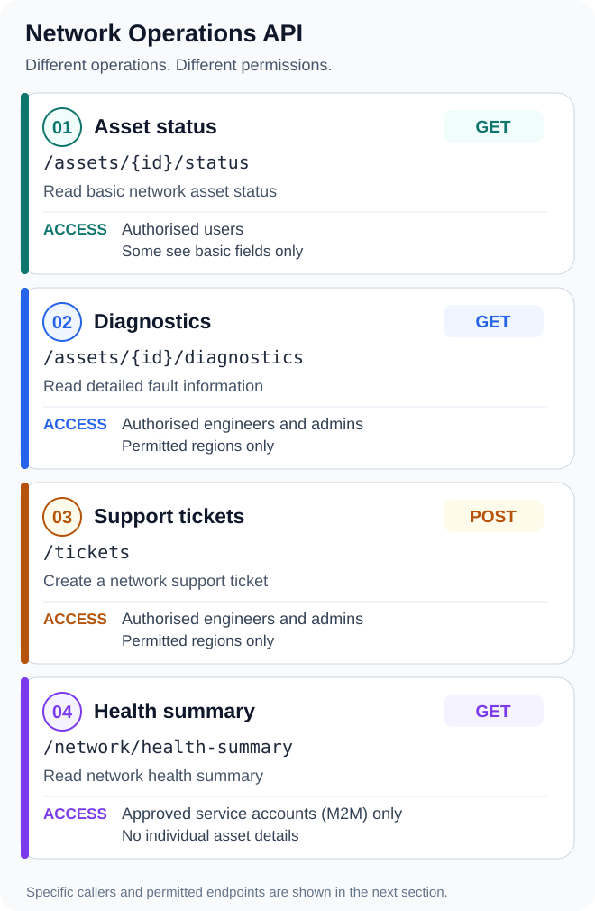
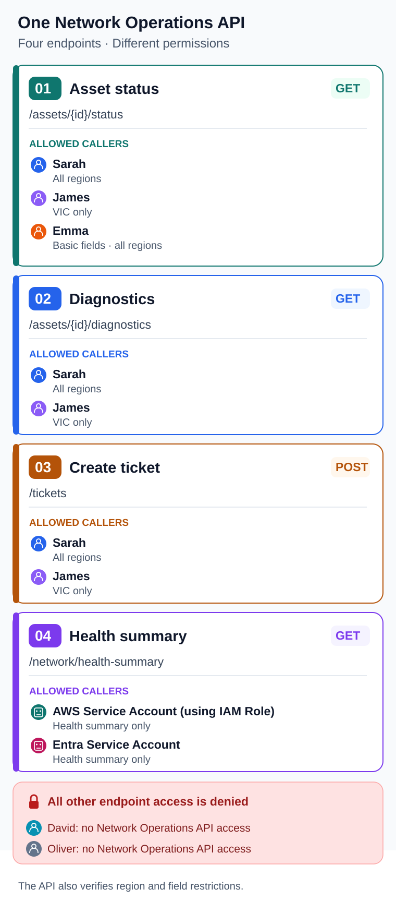
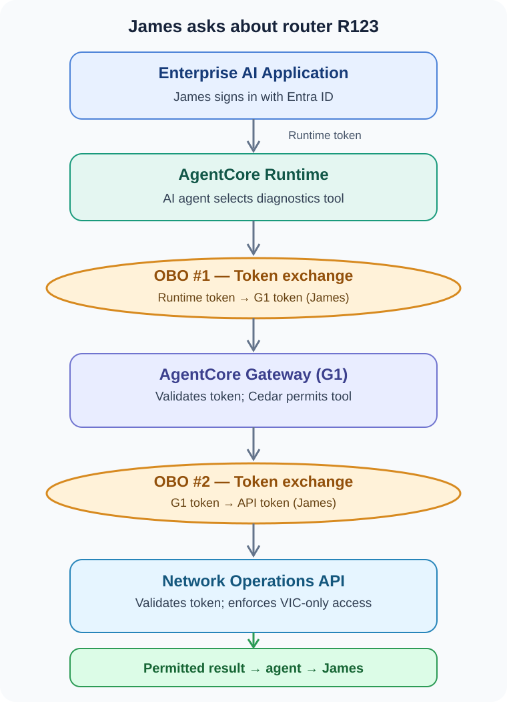
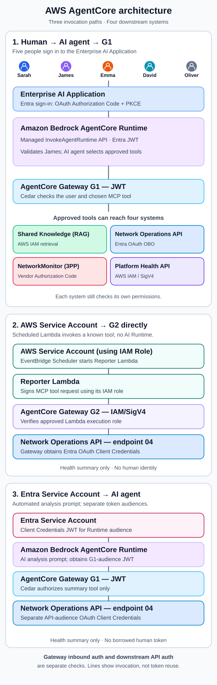

# AWS AgentCore Authentication & Authorization Patterns

Agentic AI introduces a difficult enterprise architecture challenge: **an agent may need to access several systems, but each system can authenticate callers differently and enforce different permissions**. Preserving a person's identity, allowing a service account to act independently, and obtaining third-party consent are not the same problem.

**The objective of this project is to identify, explain and standardise these common authentication and authorization approaches into reusable AgentCore architecture patterns.** We use one fictional enterprise application, four end systems and seven callers to show when each pattern applies—and how to prevent unauthorized access.

*At a glance: five people use the AI agent and two service accounts use different machine-to-machine (M2M) paths to the same enterprise tools, with different access to four systems. A caller listed under a system has some access—not permission for every operation. The detailed AWS service diagram appears later.*

**Why do we need different access patterns?** Because the end systems trust **different identities**: some need the signed-in person, some need an application identity, some require separate authorization from an external provider, and some accept an AWS IAM role. One token or service account cannot safely satisfy all of those requirements.

**How to read this guide:** First meet the four end systems, then the seven callers and exactly what each may access. Next, see the AWS architecture and understand **why each connection requires a different identity or authorization method**. For implementation-level teaching, follow the links to the **[Deep dives](docs/README.md)** at the bottom. They cover Entra groups, app roles, scopes, OBO, IAM, Cedar and RLS.

**What this guide covers:** Three **invocation methods** explain how people and service accounts use AgentCore—with an AI agent or directly through MCP tools. Five **access patterns** explain reusable approaches for securely connecting to the end systems. A single invocation method may use several access patterns.

**The key idea:** Successfully signing into our Enterprise AI Application does **not** automatically grant access to every connected system. Each final API must still authenticate the caller it receives and enforce the appropriate permissions.

## 1. End systems

-  **1. Shared Knowledge (RAG)**
  - **Description:** Uses retrieval-augmented generation (**RAG**) to answer questions from shared troubleshooting documents in Amazon Bedrock Knowledge Bases.
  - **High-level access rule:** **All human users who successfully sign in to the Enterprise AI Application** can search the same approved knowledge.

-  **2. Network Operations API**
  - **Description:** Read/write enterprise REST API backed by **Amazon RDS PostgreSQL**. Returns asset status, diagnostics and a health summary, and creates support tickets.
  - **High-level access rule:** **Only authorized callers.** Human permissions depend on region and operation; the two approved service accounts (M2M) can access the health-summary endpoint only.

-  **3. NetworkMonitor**
  - **Description:** Simulated third-party provider (3PP) monitoring service owned by **another company**, with its own user accounts, permissions and OAuth server (modelled using Amazon Cognito). Returns the vendor user's alerts.
  - **High-level access rule:** **Only users granted tool access who separately authorize their vendor account.** Each user sees only their permitted alerts.

-  **4. Platform Health API**
  - **Description:** Existing internal monitoring REST API that returns operational health information about an enterprise platform or service. AWS workloads already call it through Amazon API Gateway using **AWS IAM**, not OAuth. It is protected, not anonymously accessible; the technical endpoint-type requirement is explained under Pattern 5.
  - **High-level access rule:** **Only users explicitly granted access to this tool.** Cedar checks the person; the API authenticates the Gateway's IAM role.

### Network Operations API — four endpoints

**Why four endpoints?** This PoC uses one Network Operations API with different operations to demonstrate how **human users and service accounts authenticate differently** and how access can be **allowed or denied per endpoint**. We also demonstrate restrictions on regions, returned fields and actions such as creating a ticket.

The four planned REST endpoints are exposed through **Amazon API Gateway**, with **AWS Lambda** handling the API requests and reading or writing data in **Amazon RDS PostgreSQL**. We introduce the endpoints here; the architecture section later explains what Lambda does and how the components communicate.

**These are different permissions on the same API, not four separate APIs.** The API validates the caller's token and enforces endpoint and data restrictions. AgentCore can also block an unauthorized tool call before it reaches the API. PostgreSQL row-level security (RLS) adds protection for database rows. The architecture section introduces Gateway and its Cedar authorization rules.

### Supporting database — Amazon RDS PostgreSQL

- Stores network assets, diagnostics, tickets and access entitlements.
- Is accessed **only through the Network Operations API**, never directly by the AI agent.
- Uses database permissions and **row-level security (RLS)** to restrict which rows a caller can see or change.

**How does RLS know the user's permissions?** PostgreSQL does **not** read OAuth tokens. The Network Operations API verifies the caller and passes trusted access restrictions to the database. We explain the full James example in [How OAuth connects to PostgreSQL RLS](docs/identity-and-authorization-deep-dive.md#how-oauth-connects-to-postgresql-rls).

## 2. Users and their access

We have **five human users and two service accounts (M2M)**. The cards below show each caller's role, accessible systems and exact permissions. Each caller has a **fixed color and icon** reused in the access diagrams.

**Why the VIC restriction?** It is deliberate: a national admin can access records across regions, while a VIC engineer can access VIC records only. Later, we demonstrate how **PostgreSQL row-level security (RLS)** enforces this data restriction even when both users are allowed to call the same API endpoint.

**Endpoint labels 01–04 refer to the four operations in the [Network Operations API diagram](#network-operations-api--four-endpoints) above:** 01 = asset status, 02 = diagnostics, 03 = create ticket, 04 = health summary. They are identifiers for the same endpoints, not extra APIs.

A **service account** is an automated application or workload that operates **without a human signing in**. The AWS Service Account (using IAM Role) runs a scheduled health-summary operation; the Entra Service Account invokes an AI agent for automated health analysis. Both are limited to endpoint **04**. Their different technical routes are introduced in the architecture section.

### Network Operations API — exact endpoints for each caller

**Endpoint key (Network Operations API):**

-  Asset status — `GET /assets/{id}/status`
-  Diagnostics — `GET /assets/{id}/diagnostics`
-  Create ticket — `POST /tickets`
-  Health summary — `GET /network/health-summary`

*How to read this diagram: green = allowed, amber = allowed with restrictions, and red = denied. Every Network Operations API request is checked against the caller's endpoint permissions and, where relevant, region and field restrictions. These are planned PoC rules, not yet-implemented controls.*

**Same endpoint, different result:** James can call `GET /assets/{id}/diagnostics` for an asset in **VIC**, but the **identical endpoint** must deny an asset in **NSW**. Emma can call `GET /assets/{id}/status` nationally but sees **basic fields only**, not sensitive diagnostic details.

**Where are these permissions enforced?** Tool access is checked at AgentCore Gateway; the **Network Operations API** independently validates the OAuth token and checks endpoint, region and field entitlements; **PostgreSQL RLS** protects underlying rows. We explain Gateway's Cedar rules after the access patterns. Signing in alone is never sufficient.

### Explicit restrictions

| User | Access that must be denied |
|---|---|
|  **Sarah** | NetworkMonitor alerts and Platform Health API. |
|  **James** | NSW/other-region records, NetworkMonitor and Platform Health API. |
|  **Emma** | Detailed diagnostics, sensitive asset fields, ticket actions, NetworkMonitor and Platform Health API. |
|  **David** | Network Operations API and Platform Health API. |
|  **Oliver** | Network Operations API and NetworkMonitor. |
|  **AWS Service Account (using IAM Role)** | RAG, individual asset records, diagnostics, ticket actions, NetworkMonitor, Platform Health and human impersonation. |
|  **Entra Service Account** | RAG, individual asset records, diagnostics, ticket actions, NetworkMonitor, Platform Health and human impersonation. |

**Default rule:** A successful sign-in allows a human to use the Enterprise AI Application and shared RAG. Every other system requires its own authorization. If access is not explicitly listed above, it is denied.

## 3. Architecture overview

**A simple example:** James opens our **Enterprise AI Application** and asks, “What's wrong with router R123 in Melbourne?”

1. **Enterprise AI Application:** James signs in through Entra ID and asks his question. The application sends it directly to the managed **AgentCore Runtime API** (`InvokeAgentRuntime`) using a token issued for Runtime.
2. **AgentCore Runtime:** Validates the incoming Entra token and runs our AI agent. The agent decides it needs network diagnostics.
3. **AgentCore Identity:** Obtains a new, G1-audience token representing James through OAuth 2.0 On-Behalf-Of (OBO), so the original Runtime token is not reused at the next service.
4. **AgentCore Gateway (G1):** Validates the G1 token; Cedar checks that James may invoke the diagnostics tool.
5. **Network Operations API:** G1 uses a further OBO exchange to obtain an API-audience token representing James. The API validates it, enforces his VIC-only permission and returns permitted diagnostics.
6. **Response:** The agent explains the result in plain English, and the Enterprise AI Application displays it to James.

*Two OBO exchanges preserve James's identity while issuing a token for each receiving service. G1 authorizes the tool; the Network Operations API independently enforces his VIC-only access.*

**Enterprise AI Application and Runtime:** People sign in to our **Enterprise AI Application**, ask questions and read answers. The application calls the managed **AgentCore Runtime API** using an Entra-issued access token; Runtime authenticates the request and runs our agent. Access to tools and downstream systems is authorized separately. The browser and token configuration is covered in the [authentication appendix](docs/enterprise-ai-application-authentication.md).

**Where does AgentCore fit?** **Runtime** runs the AI agent; **Gateway** exposes approved tools that connect to the four downstream systems. Those tools use **MCP (Model Context Protocol)**, a standard way to discover and invoke tools—not an authentication method. AgentCore also offers **Memory** (to retain context) and **AWS Agent Registry** (to catalogue agents and tools).

This PoC focuses on **Runtime, Gateway and access control**. Memory and Registry are optional platform capabilities, not additional authorization steps. [AgentCore components explained](docs/agentcore-components.md).

### AgentCore components in everyday language

Before following the examples, here are the main components:

| Term | Meaning in this PoC |
|---|---|
| **Enterprise AI Application** | Our user-facing web application. Employees sign in with Entra ID, ask questions and read answers. It invokes the managed AgentCore Runtime API directly using OAuth. |
| **AgentCore Runtime** | Where our AI agent runs and decides which tool to request. |
| **Amazon Bedrock AgentCore Gateway** | An authenticated entry point exposing approved MCP tools. In this PoC, two separate Gateways support JWT and IAM callers; their names and routes are explained immediately below. |
| **MCP tool** | A named action an agent or approved automated client can invoke, such as `get_diagnostics` or `create_ticket`. |
| **Gateway target** | Configuration connecting an MCP tool to an existing backend API. It is **not** another API or running service. |
| **Cedar** | The policy language we use at Gateway to decide whether a caller may invoke a tool. It does not retrieve data or issue OAuth tokens. |

The AI journey is: **human or approved Entra automation → Runtime agent → G1 tool → downstream authorization**. The direct-tool journey is: **AWS Lambda → G2 tool → downstream authorization**, without an AI agent. The final API checks an appropriately authenticated downstream identity in either case.

*Simplified platform view: the detailed diagrams below distinguish human AI requests, Entra automated AI requests, and direct AWS machine-to-machine tool calls.*

**Three invocation methods (ways to use AgentCore):** These describe **how a request reaches and uses AgentCore**, not how the final system grants access. A person or service account can invoke an AI agent, while a service account with a known task can invoke an MCP tool directly without AI. **One invocation method can use more than one access pattern.**

1. **Human → AI agent:** Five people use the **Enterprise AI Application** to invoke **AgentCore Runtime**; the agent selects approved tools through **G1 (OAuth/JWT)**. *Example: James asks why a Melbourne router is failing, and the agent retrieves permitted diagnostics.*
2. **M2M → AI agent:** The **Entra Service Account** invokes JWT-protected **Runtime** with an automated analysis request. The agent uses a **separately obtained, correctly audience-scoped Entra application token** to invoke its approved health-summary tool through **G1**. Runtime does not automatically forward an inbound token to G1. *Example: An overnight automation asks the AI agent to analyse the network health summary, identify potential issues and recommend next steps.*
3. **M2M → tool directly:** The scheduled **AWS Service Account (using IAM Role)** Lambda knows which operation it needs and invokes the health-summary MCP tool on **G2 (IAM/SigV4)**, without Runtime or an AI prompt. *Example: A scheduled Lambda fetches the health summary for a routine report, with no AI analysis.*

**Why keep direct M2M tool access?** For a predictable operation, AI reasoning adds no benefit. Gateway offers a reusable, governed MCP interface and can translate tool calls to REST, but a conventional application could also invoke the underlying API directly. We intentionally show both automated AI invocation and direct tool invocation. **Human requests must never borrow the Entra automation's application-only credentials.**

**Why two gateways?** An AgentCore Gateway has **one configured inbound authorization type**. It cannot accept both **Entra OAuth/JWT** and **AWS IAM/SigV4** as inbound authorization methods on the same gateway. Because this PoC demonstrates both, we use **two separate gateways**:

- **G1 — JWT Gateway:** Accepts Entra-issued tokens specifically intended for G1, from the approved human OAuth 2.0 OBO path or the **Entra Service Account** automation. Cedar restricts each verified principal's tools.
- **G2 — IAM Gateway:** Accepts AWS IAM-signed requests. Used by the **AWS Service Account (using IAM Role)**, such as the scheduled Lambda.

Each gateway can expose approved tools for the downstream systems shown below. **Gateway access does not grant automatic access to a downstream API or operation.**

**Why two OBO exchanges?** Our design preserves a separate, audience-specific token at Runtime, G1 and the Network Operations API, allowing G1 and the API to authorize James independently. [Read the architecture Q&A and AWS/Microsoft evidence](docs/architecture-qa.md).

### Detailed architecture — AWS components

**The same three invocation paths, with AWS components:** human users → Runtime → G1; Entra Service Account → Runtime → G1; AWS Service Account (using IAM Role) → G2 directly. The endpoint-access matrix in Section 2 remains authoritative for each caller's permissions.

[Open the full-width AWS service-icon architecture](docs/diagrams/aws-agentcore-architecture.svg) for individual component detail and a zoomable desktop view.

### Authentication terms in plain English

- **OAuth 2.0 On-Behalf-Of (OBO) flow:** A trusted confidential component obtains a new audience-specific token **representing the signed-in user**; AgentCore Identity brokers these exchanges in our proposed design.
- **OAuth 2.0 Client Credentials grant:** An **application** gets a token for itself, without a human.
- **OAuth 2.0 Authorization Code grant (with PKCE):** A person signs in with an authorization provider. The application receives a short-lived authorization code, then exchanges it for an access token. PKCE protects this exchange.
- **AWS IAM/SigV4 authentication:** An AWS role supplies temporary credentials used to sign a request to an IAM-protected service.

## 4. Five access patterns for connected systems

**Invocation methods and access patterns answer different questions.** Section 3 introduced **three AgentCore invocation methods**—human → AI agent, service account → AI agent, and service account → MCP tool directly without AI. These describe **how the request travels**. The **five access patterns** below describe **how the connected system authenticates callers and enforces permissions**. Several patterns can use the same authentication technology while applying different authorization rules. One invocation method can use several access patterns: James uses the human-to-agent invocation method for both shared RAG (Pattern 1) and network diagnostics with OAuth 2.0 OBO (Pattern 2); Oliver uses that same invocation method for the IAM-protected Platform Health API (Pattern 5).

**Why these five access patterns?** An **endpoint** is an action exposed by an API; an **access pattern** is a reusable arrangement of identity, authentication and authorization controls for accessing a connected system. The same OAuth 2.0 OBO pattern covers the three human Network Operations API endpoints, while its health-summary endpoint permits approved application identities. The other patterns show shared RAG, separate vendor authorization and an IAM-protected API. **We are not creating a new pattern for every endpoint.**

**One-line examples of the five access patterns:**

1. **Shared RAG:** Emma asks for the approved outage procedure; the agent reads shared documents using its AWS role.
2. **OAuth 2.0 OBO:** James requests router diagnostics; the Network Operations API receives a delegated token identifying James and restricts him to VIC.
3. **OAuth 2.0 Client Credentials (M2M):** An approved service account obtains an application-only token to read endpoint **04**, the network health summary.
4. **External vendor OAuth:** David separately authorizes NetworkMonitor so the agent can retrieve alerts permitted by his vendor account.
5. **IAM-protected API:** Oliver requests Platform Health; Cedar permits the tool, then Gateway signs the API request using its AWS IAM role.

The **endpoint-access diagram** in Section 2 is the quick reference. The sections below explain **why** each pattern is needed and where access is enforced.

#### Pattern 1 — Shared Knowledge (RAG)

*Implementation guide: [Pattern 1 — shared knowledge (RAG)](docs/access-patterns/pattern-1-rag.md).*

**Why does an enterprise need this?** Imagine an operations organisation with hundreds of approved troubleshooting guides, network procedures and internal FAQs. Engineers and service-desk staff repeatedly ask the same questions. Instead of relying only on the language model's general training, our Enterprise AI Application searches this **shared RAG knowledge base** and uses relevant passages to ground its answers.

- **What does the user want?** Any of our five human users signs in to our Enterprise AI Application and asks a question such as “What is the approved process for investigating a network outage?” The agent searches the same approved documents for everyone.
- **Why isn't signing in enough on its own?** Entra sign-in authenticates the person to **our Enterprise AI Application**. It does not give the person's browser credentials to query Amazon Bedrock Knowledge Bases directly. The agent running in Runtime still needs an authenticated AWS identity to retrieve passages.
- **Why not use the Network Operations API's OBO pattern?** The documents in this particular knowledge base are **deliberately shared with every signed-in human**. There are no different document permissions for Sarah versus Emma, and the AWS retrieval operation uses the application's service role. Exchanging each person's Entra token for a downstream user token would add no access distinction for this resource.
- **What solves it?** Our application checks that the person is signed in. The agent in Runtime then retrieves relevant approved passages using its **authorized AWS service role**. The knowledge base is not public, and no end-user AWS credentials are exposed to the browser.

**Why keep this as a separate pattern?** It is the baseline **shared knowledge-access pattern**: users must be authenticated to the application, but the downstream knowledge service authenticates the **agent's AWS identity** and returns shared material. This is **not a separate OAuth protocol**. It contrasts with later patterns where the end system must know the specific person, application or vendor account. RAG can reduce hallucinations by grounding an answer in approved material, but does not guarantee correctness.

#### Pattern 2 — Human identity preserved with OAuth 2.0 OBO (Entra ID)

*Implementation deep dive (planned): [Pattern 2 — OAuth 2.0 OBO](docs/access-patterns/pattern-2-obo.md).*

**Why does an enterprise need this?** A single network database contains records for multiple regions and sensitivity levels. Employees can use the same AI interface, but an engineer responsible for VIC must not obtain NSW diagnostic records, and a service-desk employee must not see sensitive diagnostics at all.

- **What does the user want?** James asks the agent for VIC diagnostics. Sarah can request diagnostics nationally; Emma may see basic status but not detailed diagnostics.
- **Why isn't the initial token enough?** James's initial Entra access token is issued for **AgentCore Runtime**, not G1 or the separate **Network Operations API**. Neither service should accept a token intended for another audience. A shared service-account token would also hide which person is asking.
- **What solves it?** The Enterprise AI Application invokes **Runtime** using James's Entra token. The proposed trusted path uses **AgentCore Identity OBO** to obtain a G1-audience token and then a separate **Network Operations API token**, both representing James. G1 checks tool access; the API validates the final token and enforces scopes, verified entitlements and PostgreSQL row-level security. James gets VIC records, not NSW records. The two-step Entra integration must be proven in the PoC.

**Why a distinct pattern?** The final API must make decisions based on the **actual human's identity**. OBO supplies the appropriately scoped, downstream-audience token without asking James to sign in again. OBO does **not** grant new regional permissions or replace API authorization.

**Why does this API have three human endpoints, rather than one?** They illustrate **different permission decisions within the same OBO pattern**:

- `GET /assets/{id}/status` — **read basic information**. Sarah, James and Emma can call it, but James is limited to VIC and Emma receives only basic fields.
- `GET /assets/{id}/diagnostics` — **read restricted information**. Sarah and James can call it, with their regional limits; Emma cannot.
- `POST /tickets` — **make a change**. Only Sarah and James can create a ticket, for an allowed region. Emma cannot create tickets.

All three use **OAuth 2.0 OBO**, not three new OAuth methods. The point of separate endpoints is to show that **one authenticated person does not automatically have permission for every operation**, and that a write can require tighter approval than a read.

#### Pattern 3 — Application-only (M2M) API access: AI and direct-tool invocation

*Implementation deep dive (planned): [Pattern 3 — service accounts (M2M)](docs/access-patterns/pattern-3-service-accounts.md).*

**Why does an enterprise need this?** Automated work has no signed-in person, so **OAuth 2.0 OBO does not apply**. We deliberately demonstrate two valid approaches to the **same** Network Operations API health-summary endpoint **04**:

| Service account | What it does | AgentCore route | Final API permission |
|---|---|---|---|
| **AWS Service Account (using IAM Role)** | Scheduled Lambda requests a known summary—no AI prompt | **Direct G2** tool invocation using IAM/SigV4 | Its own Entra OAuth 2.0 Client Credentials token; `HealthSummary.Read` |
| **Entra Service Account** | Submits an automated health-analysis prompt to the AI agent | **Runtime → G1** using Entra application JWTs | Its **different** Entra OAuth 2.0 Client Credentials token; `HealthSummary.Read` |

Neither service account may read individual assets, run diagnostics, create tickets, access RAG or impersonate a human. **The final Network Operations API accepts Entra OAuth tokens, not AWS IAM signatures**, and independently checks each registered application identity and its `HealthSummary.Read` role.

**How the Entra Service Account gets from Runtime to G1—without borrowing anyone's token:**

1. The approved **`entra-automation-client`** requests a **Runtime-audience** JWT from Entra using Client Credentials. Runtime validates its signature, audience, client identity and `Automation.Runtime.Invoke` application role before accepting the analysis prompt.
2. After verifying that inbound application identity, **trusted Runtime code**, not the AI prompt, uses a **dedicated AgentCore Identity OAuth credential provider** configured for that same `entra-automation-client` application. AgentCore Identity performs another **Client Credentials** request for the separate **`enterprise-agentcore-g1` audience** and its `Automation.Summary.Invoke` app role. The credential is managed outside the prompt and tool arguments; human sessions must never be able to request it.
3. Runtime invokes **G1** with this **new G1-audience JWT**. G1 validates the token and Cedar permits **only the summary tool** for the exact approved automation client identity. Runtime does not simply forward its incoming token.
4. G1's **separate outbound credential provider** obtains a third OAuth Client Credentials token, now for the **Network Operations API audience**, under the Entra automation's own application identity. The API verifies `HealthSummary.Read` and allows **only endpoint 04**.

These are **three audience-specific tokens**, not three copies of the Network Operations API. The approved client registration is associated with the Runtime and G1 permissions; each resource separately grants its own application role. **Implementation checkpoint:** test that the Runtime provider can be used only for the verified automation path, that the G1 JWT identifies `entra-automation-client`, and that an Entra Runtime token is rejected if replayed at G1 or the final API. The design is not yet deployment-tested. [AWS AgentCore Identity token retrieval](https://docs.aws.amazon.com/bedrock-agentcore/latest/APIReference/API_GetResourceOauth2Token.html).

**Why is AWS IAM involved for the other service account?** The scheduled Lambda already has an IAM execution role, and G2 accepts its SigV4-signed MCP call directly. That **does not** authorize the OAuth-protected final API: G2 must obtain a **separate Entra Client Credentials token** for the AWS reporter's registered application identity. A simpler alternative is for Lambda to obtain an Entra JWT and call G1 directly. We retain G2 to demonstrate IAM-inbound/OAuth-outbound integration, **not** because Lambda is incapable of using OAuth.

#### Pattern 4 — Independent authorization at an external vendor

*Implementation deep dive (planned): [Pattern 4 — external vendor OAuth](docs/access-patterns/pattern-4-vendor-oauth.md).*

**Why does an enterprise need this?** An organisation may subscribe to a monitoring SaaS provider, while individual employees have separate accounts and alert permissions **at that vendor**. The AI assistant should be able to retrieve an employee's permitted alerts, just as other assistants connect to a separately authorized SaaS account. Corporate sign-in alone cannot make that vendor trust the request.

- **What does the user want?** David asks our Enterprise AI Application to retrieve his alerts from **NetworkMonitor**, a simulated service owned by another company.
- **Why isn't his corporate sign-in enough?** Entra authenticates David to **our** application, but it cannot independently grant access to his account and alerts in **NetworkMonitor's** identity system. An OAuth 2.0 OBO token issued by Entra for our Network Operations API is not a NetworkMonitor token.
- **What solves it?** After David is authorized to use the vendor tool, he separately completes **NetworkMonitor's OAuth 2.0 Authorization Code grant (with PKCE)**. AgentCore's vendor OAuth credential provider obtains and associates a vendor-issued token with the authenticated David, then uses it to call `GET /alerts`. NetworkMonitor validates that token and returns only data permitted to that vendor account.

**Why a distinct pattern?** The vendor controls **its own accounts and authorization**. This is the same broad arrangement used when an enterprise AI assistant connects to an independently protected SaaS account. Our Cognito simulation supports the Authorization Code flow and custom API scopes, demonstrating the separate OAuth boundary. Cognito's managed login does not itself provide every vendor-style consent-screen experience.

#### Pattern 5 — Reusing an existing IAM-protected enterprise API

*Implementation deep dive (planned): [Pattern 5 — IAM-protected API](docs/access-patterns/pattern-5-iam.md).*

**Why does this API use IAM in the first place?** Imagine the Platform Health API was built years ago for internal AWS workloads. A Lambda function checks platform health by calling an AWS API Gateway REST endpoint using its IAM execution role. That is a normal AWS service-to-service design: the API trusts approved **AWS roles**, not interactive employees. It has no reason to integrate with Entra just to serve those existing workloads. API Gateway can support other authentication methods; **IAM is a deliberate choice for this example**, not a limitation of REST.

- **What does the user want?** Oliver now asks our **Enterprise AI Application**: “Is our internal platform healthy?” We want to reuse that existing Platform Health API **without rebuilding its authentication**.
- **Why can't we just send Oliver's token?** His Entra token is an **OAuth** token, while this existing API expects **IAM/SigV4**. The API doesn't know who Oliver is; it recognizes the **AWS role** signing the request. If everyone could invoke the agent's Platform Health tool, the same role could retrieve results for users who should not have access.
- **What solves it?** Oliver signs in to our Enterprise AI Application. Before any API call, **G1 uses Cedar to check that Oliver is allowed to invoke the tool**. Only then does AgentCore Gateway use its **IAM service role** to sign the request to the native API Gateway REST-stage target. The Platform Health API validates the IAM signature and role permissions. Sarah, James, Emma and David are denied **at the tool boundary**, before Gateway can use that role for their request.

**A public endpoint type does not mean anonymous access:** AWS's native AgentCore API Gateway REST-stage target currently requires a **public endpoint type** (not API Gateway's private endpoint type). Our Platform Health API still requires **AWS IAM authorization** for every exposed method. The API can have private integrations behind its front door. This constraint applies to the **native stage target**, not to every API Gateway API or OpenAPI target.

**Why can't we simply reuse one of the earlier patterns?**

- **OBO won't work for this final API.** OBO creates a delegated **OAuth** token identifying James or Oliver. Platform Health is deliberately **IAM-only**, so it expects a **SigV4-signed AWS request**, not that token.
- **The AWS Service Account (using IAM Role)'s Client Credentials pattern won't work for this final API either.** That pattern obtains an **OAuth application token** for the Network Operations API. Platform Health does not accept OAuth tokens, and Oliver's request is initiated by a **human**, not a scheduled reporting service.
- **Shared RAG is the closest match, but it doesn't demonstrate the restriction we need.** Both RAG and Platform Health can use AWS service identity. In RAG, **every signed-in human** may retrieve shared documents. Here **only Oliver** may invoke the IAM-backed Platform Health tool. Because the downstream API sees Gateway's service role rather than Oliver, **Cedar must enforce Oliver's permission before the call**.

**So why keep this example?** It demonstrates a real enterprise requirement the others do not show together: **a restricted human-triggered tool that calls an IAM-protected REST API using the AgentCore native API Gateway stage target**. This is an **authorization and integration pattern**, not a new authentication protocol.

**The rule to remember:** **Cedar authorizes the human; IAM authenticates the service.**

### When and why should we use Cedar?

**What is Cedar?** It is a way to write rules such as: **“Only Engineers may invoke the diagnostics tool”** or **“Only Oliver may invoke the Platform Health tool.”** AgentCore Gateway evaluates those rules **before calling the tool**.

**Is Cedar always required? No.** A properly secured downstream API can make its own authorization decisions using a verified OAuth token. We use Cedar when we want an **additional, centrally managed check on agent tool access**. That is different from losing user identity: **Cedar does not preserve identity or issue OAuth tokens.**

**When is it useful—and when can we leave it out?**

- **Shared Knowledge (RAG): every signed-in human has the same approved knowledge access**
  - **Cedar decision in our PoC:** **No special per-user Cedar policy needed.**
  - **Why?:** No user-specific document restrictions to enforce at this tool. The AWS knowledge service still authenticates the agent's service role.

- **Network Operations API: OBO carries the real user to an API that enforces their permissions**
  - **Cedar decision in our PoC:** **Optional extra protection; we choose to use it.**
  - **Why?:** Cedar can deny Emma's diagnostics **tool call early**. Even without Cedar, the Network Operations API must independently reject the unauthorized request.

- **Platform Health: the final API sees only Gateway's IAM role**
  - **Cedar decision in our PoC:** **An upstream user-permission check is essential; we choose Cedar.**
  - **Why?:** The final API cannot tell Oliver from Emma by looking at the IAM role. Cedar permits Oliver's tool call and denies everyone else **before the same service role is used**. An equivalent correctly enforced application-side check could also provide this protection.

**The decision rule:** If the final API **knows the user and enforces their permissions**, Cedar can add defence in depth. If the final API **only knows a shared service identity**, make sure **some trusted component authorizes the human first**; Cedar is our selected control in that case.

An **OAuth access token** contains signed information about a caller and permissions. **The token cannot enforce a rule by itself**: a component must validate the token and make an allow/deny decision. Cedar performs that job for **agent tool calls**; our Network Operations API performs it for **downstream API requests and data**.

#### Three simple examples

**1. Emma — OAuth already protects the API**

1. Emma signs in and asks for diagnostics.
2. In our PoC, Cedar sees her Service Desk role and denies the diagnostics **tool**.
3. If we removed Cedar, the Network Operations API could still reject Emma using her OBO identity and API rules.

**Lesson:** Cedar is **defence in depth**, not a substitute for preserving Emma's identity or checking permissions at the API.

**2. James — Cedar allows a tool, but cannot grant extra data**

1. James asks for NSW diagnostics.
2. Cedar allows the diagnostics **tool** because James is an Engineer.
3. OBO supplies a Network Operations API token representing James.
4. The API checks his **VIC-only** entitlement, and PostgreSQL RLS restricts the rows. The NSW request is **denied**.

**Lesson:** Cedar permission to invoke a tool does **not** override downstream OAuth authorization or RLS.

**3. Oliver — the downstream API does not recognize a human token**

1. Oliver asks for Platform Health.
2. Cedar verifies that only Oliver is allowed to use that tool.
3. Gateway signs the final API request with its **AWS IAM service role**.
4. The API trusts that role. It does **not** receive Oliver's OAuth identity as its authenticated caller.

**Lesson:** Here we need an **upstream user-specific permission check**, because the final API cannot make that decision from the service-role credentials. Cedar is a good fit; another properly enforced application authorization mechanism could also perform the check.

**Remember:** **Cedar authorizes the tool call. OAuth/OBO authenticates the delegated user to the Network Operations API. The Network Operations API and database enforce data permissions.** Using Cedar never removes the need for downstream authorization.

### Identity and authorization — short version

- **Entra ID group:** Which team a person belongs to, such as `Network-Engineers-VIC`. The Network Operations API uses verified group membership to enforce endpoint and regional permissions.
- **Entra app role:** What a person can do **in the Enterprise AI Application**, such as `Network.Engineer`. AgentCore Cedar checks the role before invoking tools.
- **OAuth delegated scope:** What the **client app** may request from a protected API for a signed-in user, such as `diagnostics.read`. API Gateway validates it for each endpoint.
- **OBO:** **AgentCore Identity** (using a confidential OAuth credential provider), not an Entra ID group, obtains delegated tokens representing the signed-in person. OBO does not itself grant regional or endpoint entitlements.

These are independent controls. A valid scope never overrides the Network Operations API's user/group checks. **[Full explanation with Entra configuration, tokens, OBO and a James/Emma example](docs/identity-and-authorization-deep-dive.md#deep-dive-entra-id-groups-app-roles-oauth-scopes-and-obo).**

---

## Detailed documentation

- [Architecture Q&A — why two OBO exchanges?](docs/architecture-qa.md)
- [Identity and authorization deep dive](docs/identity-and-authorization-deep-dive.md)
- [Five access-pattern implementation guides](docs/README.md#access-pattern-implementation-guides)
- [AgentCore components and Enterprise AI Application authentication](docs/README.md#architecture)

[Browse all technical documentation](docs/README.md).
