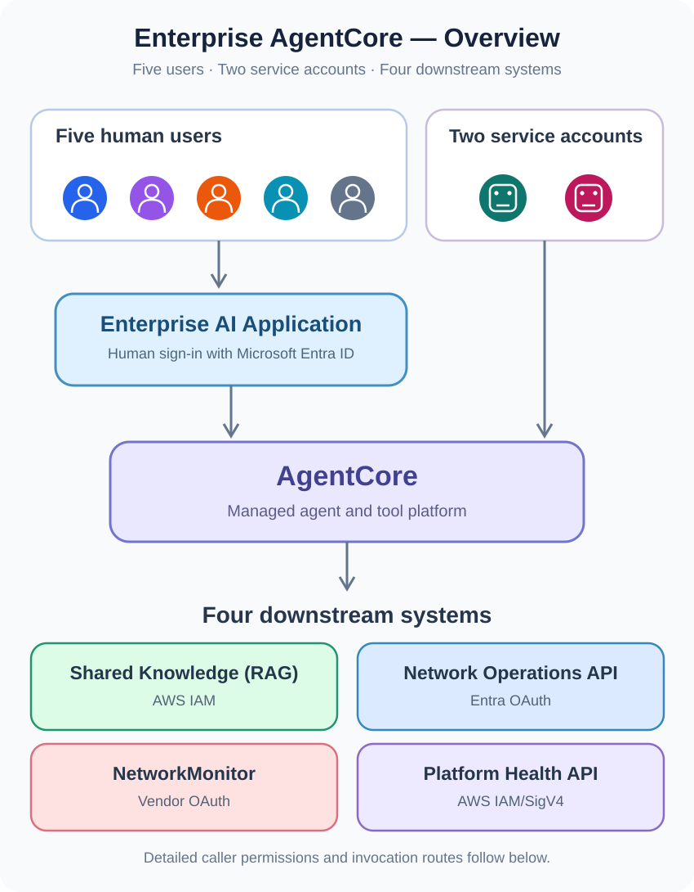
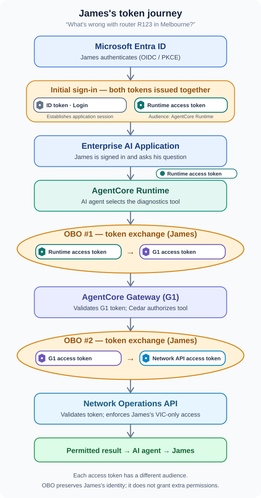

# AWS AgentCore Authentication & Authorization Patterns

Agentic AI introduces a difficult enterprise architecture challenge: **an agent may need to access several systems, but each system can authenticate callers differently and enforce different permissions**. Preserving a person's identity, allowing a service account to act independently, and obtaining third-party consent are not the same problem.

**The objective of this project is to identify, explain and standardise these common authentication and authorization approaches into reusable AgentCore architecture patterns.** We use one fictional enterprise application, four end systems and seven callers to show when each pattern applies—and how to prevent unauthorized access.

*At a glance: five human users and two service accounts reach four downstream systems through different AgentCore paths. Exact caller permissions appear in Section 2; the detailed AWS architecture appears in Section 3.*

**Why do we need different access patterns?** Because the end systems trust **different identities**: some need the signed-in person, some need a service account, some require separate authorization from an external provider, and some accept an AWS IAM role. One token or service account cannot safely satisfy all of those requirements.

**How to read this guide:** Meet the **four end systems**, then see the **seven callers** and their exact permissions. Follow the **AWS architecture** and **five access patterns**, each with a concrete example. Detailed configuration, token flows and test cases are being developed in the [deep dives](docs/README.md); some guides are currently placeholders.

**Key distinction:** Three **invocation methods** describe how people or service accounts reach AgentCore; five **access patterns** describe how downstream systems authorize access. Signing into the Enterprise AI Application **never** grants automatic access to every connected system.

## 1. End systems

These are the **four systems** our AgentCore tools connect to. They have different authentication and authorization requirements, which drive the five access patterns explained later.

The **Network Operations API** is one API with four operations: asset status, diagnostics, ticket creation and health summary. Section 2 shows exactly which of these endpoints each authorized caller can access.

## 2. Users and their access

**Five people and two service accounts (M2M)** have different permissions. For **every caller**, the diagram shows all four downstream systems with a green tick for access or red X for no access. Whenever Network Operations API is allowed, the permitted **endpoint number and name appear directly underneath it**, along with restrictions.

**Network Operations API — endpoint key** (one API, four operations):

**Access is caller-specific:** Being allowed to use the Network Operations API does **not** mean access to all four endpoints. Each user or service account can invoke only the numbered operations shown on their card. The API also enforces data restrictions: for example, James is limited to Victoria (VIC), with PostgreSQL row-level security (RLS) helping restrict database records by state.

**Why these seven callers?** Each demonstrates a different access decision or invocation route:

| Caller | Why included |
|---|---|
| **Sarah — National Admin** | Broad Network Operations API access across all states; baseline for comparing restrictions. |
| **James — VIC Engineer** | Same API endpoints as Sarah, but **VIC-only records** enforced using API authorization and PostgreSQL RLS. |
| **Emma — Service Desk** | **Endpoint 01 only**, with basic fields; demonstrates endpoint-level and field-level restrictions. |
| **David — External Analyst** | Uses **separate vendor OAuth** for NetworkMonitor, not corporate Entra authorization for that service. |
| **Oliver — Platform Analyst** | Uses an **IAM-protected Platform Health API** through an upstream tool-permission check. |
| **Entra Service Account (M2M)** | **Application-only identity** invokes the agent for automated health analysis; no human signs in. |
| **AWS Service Account (using IAM Role, M2M)** | **IAM/SigV4** invokes the health-summary tool directly without an AI agent. |

**Default deny:** Access not explicitly shown is denied. James is restricted to **VIC**, Emma can see only basic asset-status fields, and both service accounts can use **health summary (04)** only. A service account runs without a human signing in. The diagram defines **planned PoC permissions**, not yet-implemented controls.

For exact REST paths, denied-case tests and enforcement across Gateway, the Network Operations API and PostgreSQL RLS, see the [identity and authorization deep dive](docs/identity-and-authorization-deep-dive.md) and the [access-pattern guides](docs/README.md#access-pattern-implementation-guides).

## 3. Architecture overview

**Follow James's request:** James signs in to the **Enterprise AI Application** through Microsoft Entra ID and asks, “What's wrong with router R123 in Melbourne?” The application calls the managed **AgentCore Runtime API** using an Entra-issued **Runtime access token**. **AgentCore Runtime** runs the **agent**, which invokes the diagnostics tool through **AgentCore Gateway (G1)**. The **Network Operations API** independently enforces James's VIC-only permissions.

**What the diagram shows:** During the initial **Authorization Code + PKCE** sign-in, Microsoft Entra ID issues **both tokens together** for this PoC: an **ID token** for James's application login and a separate **Runtime access token** whose audience is AgentCore Runtime. The application sends the **Runtime access token**, never the ID token, to Runtime. **OBO #1** exchanges it for a **G1 access token**; **OBO #2** exchanges the G1 access token for a **Network Operations API access token**. Both OBO results represent James and are valid only for their intended receiving APIs. Each receiving resource validates its own audience-specific token. **Cedar** can authorize the tool at G1; the API independently checks endpoint and data access. This two-OBO Entra integration is a **proposed PoC design**, not yet deployment-tested. [Why two OBO exchanges, and possible simpler alternatives](docs/architecture-qa.md) · [Application sign-in detail](docs/enterprise-ai-application-authentication.md).

### Three invocation methods

These describe **how callers use AgentCore**. They are distinct from the five downstream **access patterns** in Section 4.

| Method | Caller and route | Example |
|---|---|---|
| **Human → agent** | Five signed-in people → Enterprise AI Application → Runtime → **G1 (JWT)** | James asks for VIC router diagnostics. |
| **M2M → agent** | **Entra Service Account** → Runtime → **G1 (JWT)** with separate application tokens | Overnight AI analysis of the health summary. |
| **M2M → tool directly** | **AWS Service Account (using IAM Role)** → **G2 (IAM/SigV4)**; no Runtime | Scheduled Lambda fetches the health summary without AI. |

A **service account (M2M)** acts without a signed-in human. Automated application tokens must **never** be used as if they represented a human. An invocation method may use more than one access pattern.

**Why G1 and G2?** Each AgentCore Gateway has one configured inbound authorization method. **G1** accepts correctly audience-scoped Entra JWTs; **G2** accepts IAM/SigV4 requests. We use two gateways to demonstrate both. Each gateway still needs an authorized outbound identity for the target system. The final API independently checks its own permissions. [AgentCore component reference](docs/agentcore-components.md).

### AWS architecture

[Open the full-width AWS service-icon architecture](docs/diagrams/aws-agentcore-architecture.svg).

**Component names used throughout:** **AgentCore Runtime** runs the agent; **AgentCore Gateway** publishes approved **MCP tools**; a **Gateway target** configures the connection from a tool to its backend (it is not an additional API); **AgentCore Identity** brokers supported OAuth credentials/token exchanges; **Cedar** expresses Gateway tool-authorization rules. MCP is a tool protocol, **not** an authentication mechanism. Optional **Memory** and **Agent Registry** are explained in the [component deep dive](docs/agentcore-components.md).

## 4. Five access patterns for connected systems

An **invocation method** is how a request reaches Runtime or Gateway. An **access pattern** is how the downstream system authenticates the request and enforces permissions. The same person can use multiple patterns during one conversation.

### Pattern 1 — Shared access using an AWS IAM workload role

**Authentication pattern:** The downstream AWS service authenticates the **agent's IAM workload role**, not the signed-in person's Entra token. No user-specific OAuth/OBO exchange is required at this boundary.

**Example — Shared Knowledge (RAG):** Emma asks, “What's the approved outage procedure?” The agent uses its authorized IAM role to retrieve documents from **Amazon Bedrock Knowledge Bases**. All five signed-in human users can access the same approved knowledge.

**Why this is distinct:** The data is deliberately **shared**, so the workload role is sufficient for downstream authentication and authorization. In **Pattern 5**, an IAM role also authenticates to the final API, but **only Oliver** may use that tool; an upstream Cedar permission check is therefore essential. **RAG is the example, not the authentication mechanism.**

[Pattern 1 implementation deep dive (planned)](docs/access-patterns/pattern-1-rag.md).

### Pattern 2 — Human identity preserved with OAuth 2.0 OBO

**Example:** James requests router diagnostics. The Network Operations API receives an appropriately scoped **delegated token identifying James**, and returns only permitted **VIC** records. Sarah can use the same diagnostics endpoint nationally; Emma cannot use it.

**Why this pattern?** The API needs to know **which human** is requesting an operation. Runtime's token cannot simply be replayed at G1 or the API, because each is a different token audience. The two OBO exchanges preserve James's delegated identity across the boundaries; the API enforces endpoint, region and field permissions, backed by PostgreSQL row-level security (RLS). **OBO does not itself grant entitlements.** The precise Entra configuration and two exchanges remain PoC verification items.

[Full Pattern 2 flow and implementation](docs/access-patterns/pattern-2-obo.md) · [Why two OBO exchanges?](docs/architecture-qa.md).

### Pattern 3 — Service Account (M2M) using OAuth 2.0 Client Credentials

**Example:** Both service accounts may retrieve **Network Operations API endpoint 04 — health summary**, but no individual assets or diagnostics.

**Why this pattern?** There is **no human to impersonate**, so OBO is inappropriate. The **Entra Service Account** asks the agent to analyse the summary via **Runtime → G1**. The **AWS Service Account (using IAM Role)** invokes the known summary tool directly through **G2** without AI. Each route ultimately obtains a separate **Entra application-only token** for the Network Operations API, which verifies its application identity and **HealthSummary.Read** permission. IAM access to G2 alone does not authorize the OAuth-protected final API.

[Pattern 3 deep dive (planned): flows, token boundaries and implementation](docs/access-patterns/pattern-3-service-accounts.md).

### Pattern 4 — Separate OAuth authorization at an external vendor

**Example:** David asks for alerts from **NetworkMonitor**, an independently operated third-party monitoring service. He separately authorizes his vendor account; the agent can then retrieve only his permitted vendor alerts.

**Why this pattern?** Signing in through corporate Entra ID **does not grant access to the vendor's account**. NetworkMonitor issues and validates its own OAuth token (Authorization Code with PKCE in the simulation). This is separate authorization, not Entra OBO to our Network Operations API.

[Pattern 4 deep dive (planned): flow and implementation](docs/access-patterns/pattern-4-vendor-oauth.md).

### Pattern 5 — Existing IAM-protected Platform Health API

**Example:** Oliver asks, “Is our platform healthy?” **Cedar at G1** confirms he may invoke the Platform Health tool, then Gateway signs the request to the **Platform Health API** with its AWS IAM role. The API authenticates that role, **not Oliver's Entra identity**.

**Why this pattern?** We reuse an existing IAM-protected REST API without changing it to OAuth. Because it sees a shared service identity, a **trusted upstream authorization check is essential**; Cedar is our chosen control. The native AgentCore API Gateway REST-stage target requires a public **endpoint type**, but API methods remain IAM-protected—it does **not** imply anonymous access.

[Pattern 5 deep dive (planned): flow and implementation](docs/access-patterns/pattern-5-iam.md).

### Where authorization is enforced

| Control | Responsibility |
|---|---|
| **Microsoft Entra ID** | Issues the ID and access tokens for their intended audiences. |
| **AgentCore inbound JWT authorizer** | Runtime and G1 validate the incoming JWT and configured claims. |
| **Cedar at G1** | Allows or denies approved MCP tool invocations for the verified principal. |
| **Network Operations API** | Validates its API-audience OAuth token and enforces operation, user/application, region and field entitlements. |
| **PostgreSQL RLS** | Applies trusted row restrictions supplied by the API; PostgreSQL does **not** interpret OAuth tokens. |
| **Platform Health API** | Authenticates Gateway's SigV4/IAM role; it does not know Oliver from that signature. |

**Is Cedar required everywhere?** No. For the Network Operations API, it is **defence in depth** because the final API also knows and authorizes the user. For Oliver's IAM-only Platform Health API, a trusted **upstream human-permission check is essential**; Cedar is how this PoC implements that check. Cedar never replaces token exchanges or downstream data authorization.

**API authorizer precision:** Our planned Network Operations REST API must configure an appropriate API Gateway authorizer and/or Lambda validation for the Entra token, audience and required permission claims. API logic then enforces the endpoint and data entitlements; PostgreSQL RLS enforces database-row restrictions. Do not assume API Gateway REST automatically checks arbitrary Entra scopes without that configuration.

[Identity, Entra groups, app roles, scopes, Cedar and RLS — deep dive](docs/identity-and-authorization-deep-dive.md).

---

## Detailed documentation

- [Five access-pattern deep dives](docs/README.md#access-pattern-implementation-guides) — implementation material being developed; some guides are currently placeholders.
- [Architecture Q&A](docs/architecture-qa.md) — two-OBO justification, alternatives and trade-offs.
- [Identity and authorization](docs/identity-and-authorization-deep-dive.md) — Entra, Cedar and API authorization.
- [Appendix — Database row-level security (RLS)](docs/identity-and-authorization-deep-dive.md#how-oauth-connects-to-postgresql-rls) — how the Network Operations API enforces database-row restrictions.
- [AgentCore components and application authentication](docs/README.md#architecture).

[Browse all technical documentation](docs/README.md).
