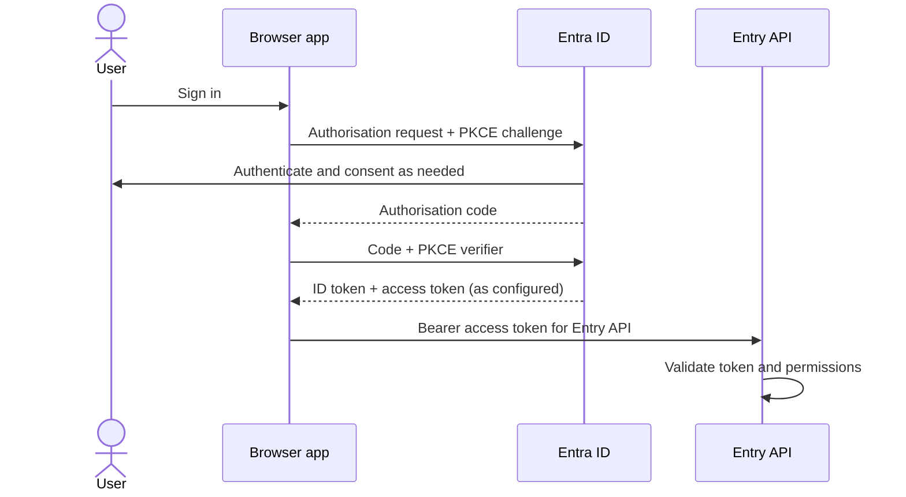
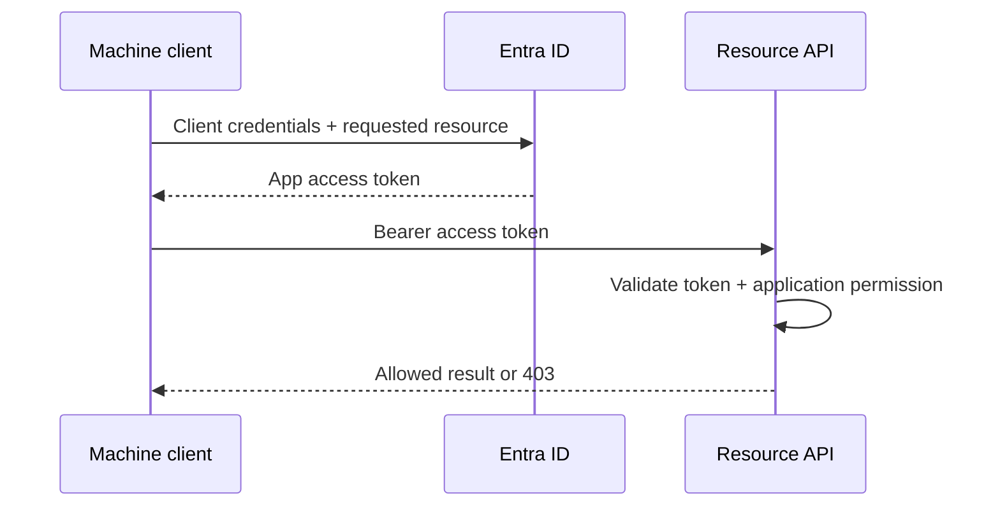
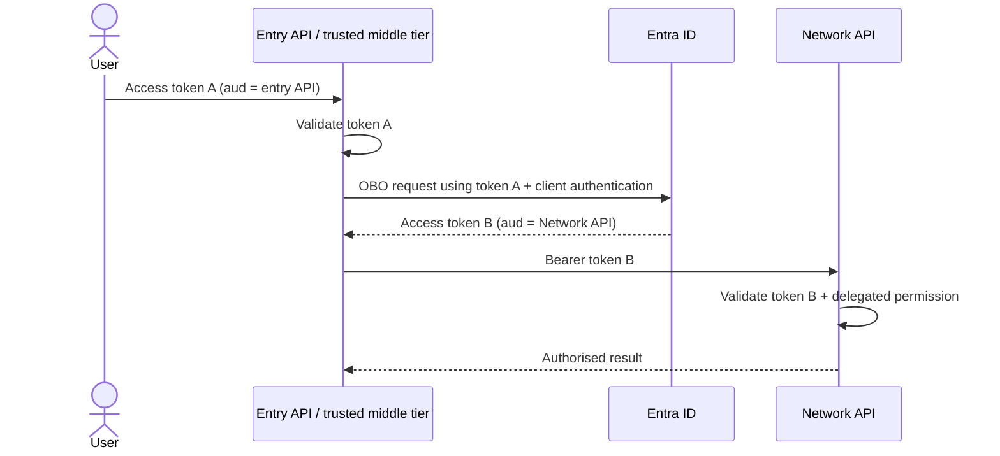
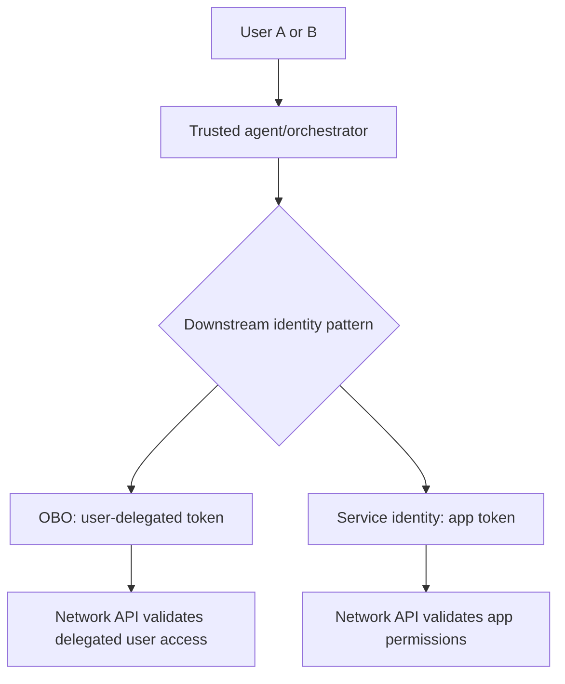

# OAuth Tokens, 2LO, 3LO and OBO — A Practical Tutorial

**Audience:** Engineers learning identity for agentic AI systems.  
**Status:** Tutorial v1 — concepts are grounded in Microsoft Entra ID and AgentCore documentation; the PoC-specific integrations must still be verified.

> **Takeaway:** Authentication asks **who is calling**; authorisation asks **what they may do**. OAuth 2.0 primarily provides delegated or application access to resources. OIDC adds an identity layer for user sign-in. An agent must not confuse an ID token with an API access token.

## 1. The three token types

| Token | Intended receiver | What it proves / enables | Typical mistake |
|---|---|---|---|
| **ID token** | The client application | User sign-in information under OIDC | Sending it as an API bearer token |
| **Access token** | The resource/API named by its audience | Delegated user or application API access | Replaying it to a different API with a different audience |
| **Refresh token** | Client / identity provider token endpoint | Obtain new tokens under applicable rules | Sending it to an API or logging it |

Tokens may be opaque or JWTs. Never assume every OAuth access token is a JWT. Our PoC will use JWT-compatible validation where configured.

### Illustrative JWT payloads

These are **fake, intentionally incomplete examples**, not valid tokens. Token claim shapes vary by identity provider, issuance version and application configuration.

**Interactive user access token for our entry API:**

```json
{
  "iss": "https://login.microsoftonline.com/<tenant-id>/v2.0",
  "aud": "api://agent-entry",
  "sub": "opaque-user-subject",
  "scp": "agent.invoke",
  "exp": 1893456000
}
```

**Machine-to-machine access token:**

```json
{
  "iss": "https://login.microsoftonline.com/<tenant-id>/v2.0",
  "aud": "api://agent-entry",
  "azp": "machine-client-id",
  "roles": ["Network.Status.Read"],
  "exp": 1893456000
}
```

**OBO downstream access token:**

```json
{
  "iss": "https://login.microsoftonline.com/<tenant-id>/v2.0",
  "aud": "api://network-api",
  "sub": "opaque-user-subject-for-this-resource",
  "scp": "network.status.read",
  "azp": "middle-tier-client-id",
  "exp": 1893456000
}
```

Do not compare raw `sub` values across resource applications as a universal identity key. In Entra, `oid` plus `tid` may be useful within the defined tenant/claim semantics, but validation and authorisation must follow the token issuer's contract. Presence of a claim by itself does not grant rights.

## 2. 3LO: interactive user authorisation

**3LO** commonly means an OAuth flow involving the **user, client and authorisation server/resource**. For our browser app, use **authorisation code with PKCE**, plus OIDC for login.



**Important:** Sign-in and resource permission are related but different. The browser should send an **access token**, not its ID token, to the API. `aud` must designate the receiving API.

### What to verify

- The caller is User A or B and the intended tenant/issuer.
- Token signature (using trusted keys), audience, expiry, and required scope/role.
- Token and PKCE flow are not logged or leaked.
- A valid login does **not** automatically mean the user may invoke every tool.

## 3. 2LO: machine-to-machine / client credentials

There is **no interactive user**. A confidential client authenticates to the token endpoint and receives an **application access token** for an API.



Our agreed **Machine Client M-1 is read-only**. It can request status but cannot request a diagnostic. The exact application-role claims and enforcement will be verified during build.

A 2LO token does not establish a human user. Avoid treating an app permission as a delegated user permission. Client credentials normally do not issue refresh tokens: the confidential client obtains another access token using its credential.

## 4. OBO: a downstream access token for the actual user

Suppose User A invokes our agent and the agent needs to read the Network API. The access token received at the **entry API** is for that entry API, not automatically for the **Network API**.

OBO is a **token exchange/delegation** step:



Token A and token B have **different intended audiences**. The downstream API receives a token specifically for it. Depending on token format/provider, subject identifiers may differ, so identity propagation should be proven from validated, documented claims rather than by blindly matching token text.

**OBO is not automatically provided by 3LO.** A user can sign in interactively without the backend being able to obtain a delegated token for a second resource. The application registrations, consent, resource scopes, supported token exchange and confidential client setup must be correct.

### What does OBO buy us?

- The downstream API can make a decision using the real user's delegated context.
- Downstream logs can attribute access to a user, subject to validated claims and privacy policy.
- Least-privilege delegated scopes can prevent operations such as diagnostic requests for User B.

### What OBO does *not* buy us

- Automatic access to every downstream resource.
- Proof that an arbitrary JWT in an HTTP header is legitimate.
- Automatic per-tool authorisation inside an AI model.
- An assurance that every AgentCore target or identity provider supports the exact exchange without configuration.

## 5. Compare OBO with a service account



| Dimension | OBO | Service identity |
|---|---|---|
| Downstream token represents | Delegated user and client context | Application/workload |
| API knows original user from access token | When delegated claims support it | **No** |
| User A/B policy | Can be enforced by downstream delegated permissions | Must be enforced by a trusted upstream authorisation layer |
| Typical benefit | Attribution and end-user least privilege | Simpler system integrations where app identity is appropriate |
| Typical risk | Incorrect token exchange or audience handling | Confused deputy: overprivileged service identity invoked for a restricted user |

**Key security test:** In a shared-service-token pattern, User B must not invoke `request_diagnostic` merely because the service principal has broader access. Restrict the trusted invocation path and isolate the downstream API from direct unauthorised calls.

## 6. How does this fit our two Gateways?

| | Gateway 1 | Gateway 2 |
|---|---|---|
| Target | API Gateway REST stage | OpenAPI specification |
| Outbound auth intention | AWS IAM / SigV4 service identity | OAuth target credentials + OBO experiment |
| Main demonstration | App/service identity | User-delegation feasibility |
| Is real OBO already implemented? | No | **No — must test** |

AWS documents AgentCore Identity **OBO token exchange**, including support for identity-provider token-exchange mechanisms, and Gateway OAuth outbound authorisation. But **support for token exchange in a service is not proof our exact Entra + Gateway + Network API chain works without additional design**. We must verify the precise supported grant type, actor identity, inbound claims, outbound audience and permissions.

The native API Gateway REST stage target has different outbound options from the OpenAPI target; this is an **integration/auth configuration distinction**, not a synonym for service-account-versus-OBO.

## 7. Validation checklist — who validates what?

1. **Browser:** Uses OIDC sign-in and gets an API access token; never treats an ID token as authorisation to an API.
2. **Entry API:** Validates issuer, signature, audience, expiry and permitted scope/role before accepting calls.
3. **Agent Runtime / Gateway:** Uses a trusted caller identity; validates or receives verified identity context according to the integration. Never trusts a prompt-string identity.
4. **Token exchange component:** Uses a validated upstream token and confidential credentials to request a token for the downstream resource.
5. **Network API:** Independently validates the token **issued for it**, enforces read/diagnostic permissions, and rejects wrong audiences.
6. **Logs:** Record token metadata/correlation only, not bearer tokens, refresh tokens or credentials.

Our test matrix will include wrong `aud`, wrong issuer, expired token, missing permission, User B diagnostic denial, and app-only token attempting user-only operations.

## 8. Questions readers should be able to answer

- Why is OAuth described as authorisation if it often appears during login?
- What makes OIDC different from OAuth?
- Is an ID token accepted by API Gateway as API authorisation? *(It should not be our design.)*
- Can a client-credentials token identify a human caller? *(No.)*
- Why does OBO issue token B instead of forwarding token A?
- Why can User B be blocked even if the agent can see the tool?
- Does choosing an OpenAPI target automatically preserve user identity? *(No.)*
- Why might one API produce two MCP tools?
- Which system decides whether a diagnostic operation is allowed?

## 9. Official further reading

- [Microsoft: OAuth 2.0 authorisation-code flow](https://learn.microsoft.com/en-us/entra/identity-platform/v2-oauth2-auth-code-flow)
- [Microsoft: Client-credentials flow](https://learn.microsoft.com/en-us/entra/identity-platform/v2-oauth2-client-creds-grant-flow)
- [Microsoft: On-Behalf-Of flow](https://learn.microsoft.com/en-us/entra/identity-platform/v2-oauth2-on-behalf-of-flow)
- [Microsoft: Tokens and claims](https://learn.microsoft.com/en-us/entra/identity-platform/security-tokens)
- [AWS: AgentCore Identity OBO token exchange](https://docs.aws.amazon.com/bedrock-agentcore/latest/devguide/on-behalf-of-token-exchange.html)
- [AWS: Gateway outbound authorisation](https://docs.aws.amazon.com/bedrock-agentcore/latest/devguide/gateway-outbound-auth.html)

**Next iteration:** Add redacted captures from the *actual* running PoC, concrete HTTP requests and responses, exact Entra app registrations and AgentCore configuration, and link the related ADRs.

See [Two-Gateway Design](two-gateway-design.md), [Identities and Permissions](identities-and-permissions.md), and [Master TODO](../TODO.md).
