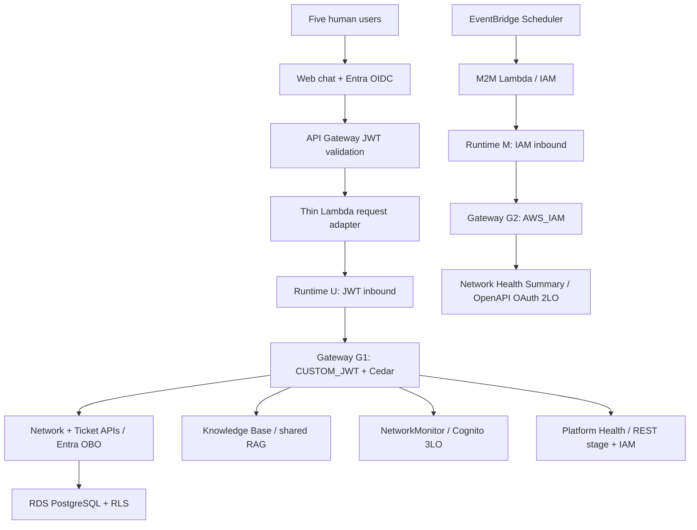

# Two Runtimes and Two Gateways — Technical Architecture

**Status:** Restored design baseline, awaiting technical validation. For **why** the lanes are separate, see [ADR-001](architecture-decisions.md#adr-001--separate-human-jwt-and-automation-iam-gateways).

## End-to-end flow

Diagram shows the **logical** intended path, not already verified token forwarding or an assertion of direct network reachability.

## Component responsibilities

| Component | Technical responsibility |
|---|---|
| Web chat | Interactive user sign-in and prompt submission; access token for the entry API |
| Microsoft Entra ID | Corporate JWT issuance; OBO exchange for internal Network/Ticket API audiences |
| Entry API Gateway | Validate configured JWT issuer, audience, expiry and permissions before forwarding |
| Thin Lambda adapter | Request shaping, correlation ID and secure Runtime invocation; must preserve verified user identity rather than synthesising it |
| **Runtime U** | Strands/Bedrock human agent, JWT inbound, isolated sessions |
| **G1** | CUSTOM_JWT inbound; Cedar tool/parameter policy; human tools with **different outbound auth per target** |
| Knowledge Base | S3/Bedrock KB/S3 Vectors, approved shared procedure retrieval |
| Internal Network/Ticket APIs | Validate delegated downstream tokens, enforce business scope and connect to RDS |
| RDS PostgreSQL | Transaction-local trusted user/region context; RLS on assets, faults and tickets |
| NetworkMonitor | Separate Cognito authorisation-code 3LO, per-user vendor consent |
| Platform Health | Native API Gateway REST stage target with IAM/SigV4 |
| EventBridge Scheduler / M2M Lambda | Trigger read-only reporter using controlled AWS IAM role |
| **Runtime M** | Scheduled machine agent, IAM inbound, no human JWT |
| **G2** | AWS_IAM inbound; narrow reporter permission to health summary only |
| Health summary API | OpenAPI target using OAuth client credentials (2LO), aggregated read-only data |

## Tool placement

- **G1:** `search_knowledge`, `get_asset_status`, `get_diagnostics`, `get_ticket`, `create_ticket`, `search_vendor_alerts`, `get_platform_health`.
- **G2:** `get_network_health_summary` only.

The Native REST API and OpenAPI approaches are **target types**, not separate inbound authentication types. G1 demonstrates both where relevant. [Full tool inventory](tool-and-api-inventory.md).

## Identity and trust boundaries to verify

1. The entry access token has the correct audience; the adapter and Runtime U must not discard/replace its verifiable user context.
2. Runtime U must reject an IAM-only bypass or arbitrary user ID. JWT runtime invocation requirements must be confirmed before choosing an adapter implementation.
3. G1 must validate corporate JWT and deny forbidden tools/parameters via Cedar. A model decision is not an authorisation control.
4. Network/Ticket outbound delegated token must be exchanged **for those APIs' audiences**; APIs validate independently and map claims to RLS context.
5. Vendor OAuth is **separate from Entra**; only David's approved Cognito grant is available to David.
6. Runtime M and G2 accept authorised IAM workload access only; G2's caller identity is Runtime M, **not automatically the Scheduler Lambda**.
7. G2's OAuth 2LO downstream token is an application token with only aggregate read scope.
8. Correlation IDs connect traces; never record raw bearer tokens or secrets.

## Implementation verification gates

- Confirm exact AWS supported target/auth combinations and Region support.
- Define Entra app registrations, claims, group/role mapping, API scopes and audiences.
- Prove an end-to-end JWT path through API Gateway, thin Lambda, Runtime U and G1; ensure no bypass.
- Verify Cedar identity context, tool filters and deny-by-default results.
- Verify independent OAuth OBO and vendor Cognito 3LO behaviour.
- Verify reporter IAM ingress, OAuth 2LO and least-privilege health summary.
- Verify PostgreSQL RLS, ticket confirmation/idempotency and KB citation behaviour.

No resources deployed. This technical design should not duplicate the justification, alternatives or consequences held in [ADR-001](architecture-decisions.md#adr-001--separate-human-jwt-and-automation-iam-gateways).
