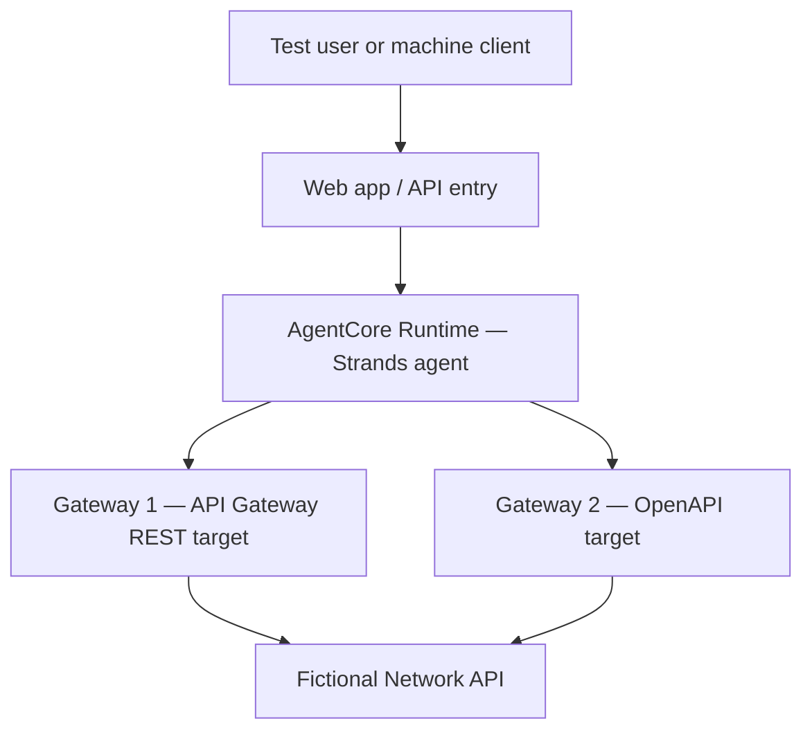

# Two-Gateway Architecture — Design

**Status:** Approved design, not yet deployed. For the reasons for selecting two Gateways, alternatives and trade-offs, see [ADR-001](architecture-decisions.md#adr-001--use-two-agentcore-gateways-for-separate-security-boundaries).

## Side-by-side design

| | Gateway 1 — AWS-native REST | Gateway 2 — OpenAPI + OAuth |
|---|---|---|
| Target type | Amazon API Gateway REST API **stage target** | **OpenAPI specification target** |
| Target configuration | Reference REST API ID/stage, resource selection | OpenAPI contract with `operationId` per operation |
| Downstream authentication | IAM/SigV4 (selected) | OAuth 2.0 (selected for investigation) |
| Identity focus | AWS application/service identity | Delegated user / OBO experiment |
| APIs exposed | Fictional Network API: read status and request diagnostic | Same two logical Network API operations |
| Tools expected | `get_service_status`, `request_diagnostic` | Same operation concepts; verify actual discovery/names |
| Key learning outcome | Native API Gateway export, IAM boundary, tool mapping | Explicit schema, OAuth target credential behaviour, true user delegation if supported |

## Intended call path

Logical diagram only. The exact API deployment, authentication boundary and routing to shared or separate testing endpoints remain an implementation choice. No direct assertion is made that a single deployed endpoint supports both inbound IAM and delegated OAuth without additional configuration.

## Architecture decision

The implementation uses two Gateways with separately configured security boundaries. **[ADR-001](architecture-decisions.md#adr-001--use-two-agentcore-gateways-for-separate-security-boundaries)** is the single source of truth for the justification, alternatives and consequences.

## Critical security distinction

**Target format and identity pattern are orthogonal.**

- The REST API stage target defines *how* AgentCore Gateway discovers and calls API Gateway operations. Its documented outbound options include IAM and API key, not OAuth.
- The OpenAPI target defines *how* REST operations become tools from a supplied contract. OAuth support at the target is **not itself proof** that the original interactive user is represented at the final API.
- **True OBO** requires a supported and explicitly configured token exchange/delegation path, the correct audience for the downstream API, validated user claims, and enforcement at the resource API. Until end-to-end tests verify these, label Gateway 2 **OAuth/OBO experiment**, not “OBO implemented.”
- Gateway 1's service identity cannot establish which interactive user initiated a call. Fine-grained User A/User B restrictions must be enforced by trusted controls before the service-identity invocation; direct API bypass must also be controlled.
- Both integrations must still enforce the agreed permission matrix: User A read+diagnostic, User B read-only, machine client read-only.

## Validation gates

- [ ] Confirm AWS documentation and deployed account/Region support for both target types.
- [ ] Validate the REST stage target IAM/SigV4 call and operation-to-MCP tool mapping.
- [ ] Validate OpenAPI target credentials and actual OAuth token used downstream.
- [ ] Prove or explicitly rule out true user-delegated OBO for the selected downstream path.
- [ ] Ensure end-user restrictions cannot be bypassed through the service identity.
- [ ] Verify both Gateways' discovery and call traces with redacted evidence.

## Source documentation

- [AWS: API Gateway REST API stages as AgentCore Gateway targets](https://docs.aws.amazon.com/bedrock-agentcore/latest/devguide/gateway-target-api-gateway.html)
- [AWS: OpenAPI schema targets](https://docs.aws.amazon.com/bedrock-agentcore/latest/devguide/gateway-schema-openapi.html)
- [AWS: VPC egress and supported outbound authentication](https://docs.aws.amazon.com/bedrock-agentcore/latest/devguide/gateway-vpc-egress.html)

This document describes the selected technical design. See [ADR-001](architecture-decisions.md#adr-001--use-two-agentcore-gateways-for-separate-security-boundaries) for the decision record. Stages 5–6 will verify the behaviour.
